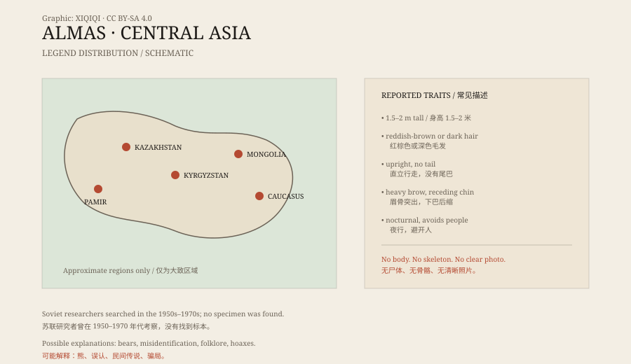

## 1. A legend in the mountains

The Almas story is widely distributed.

Kazakhstan, Kyrgyzstan, western Mongolia, and the Caucasus all have similar accounts: a creature that is like a human but not quite, living in the mountains. It is taller than a person, covered in hair, does not speak, and lives in caves or rock shelters.

Herders say it fears fire and people. Sometimes it approaches a camp and takes food; sometimes it only stands at a distance, watches, and leaves.

## 2. What it looks like

The descriptions vary, but some features recur.

It is said to be one and a half to two metres tall, covered in reddish-brown or dark hair, with a human-like face but a heavy brow and a receding chin. It walks upright, has no tail, and has arms longer than a human's.

Some accounts say it runs fast; others say it moves heavily. Some say it calls at night, a sound like crying; others say it is almost silent.

These details come from oral accounts over many years and many places. They support one another, and they contradict one another.

*Original schematic: the main areas associated with Almas legends and the common descriptions. Not a precise map. Oddity Archive, CC BY-SA 4.0.*

## 3. The Soviet expeditions

In the twentieth century, the Almas attracted the attention of Soviet researchers.

The historian and sociologist Boris Porshnev promoted the study. He argued that the Almas might not be a myth but a surviving population of Neanderthals. The idea was attractive: if an archaic human had survived into the modern era, it would be a major event for biology and anthropology.

From the 1950s to the 1970s, Soviet expeditions went into the Caucasus and Central Asia, interviewing witnesses and collecting footprints, hair, and bone samples. Rewards were offered for a capture.

The results were poor. No capture, no body, no complete skeleton. Most of the hair and footprints could not be consistently identified.

## 4. Neanderthals?

Porshnev's hypothesis linked the Almas to Neanderthals.

Neanderthals did live across Eurasia, and there is fossil evidence for them. But the known Neanderthals disappeared around forty thousand years ago, and there is no evidence that they survived in Central Asia into recent centuries.

More importantly, the Almas descriptions mix too many sources: bears, wolves, fugitives, hermits, and legendary monsters. Grouping them all under a single “relict hominin” is not supported by the evidence.

## 5. Explanations

The most common explanation is misidentification.

In poor mountain light, a bear standing upright can look very much like a “wild man.” A distant herder, a rider, or a hunter in a fur coat can also be seen as a hairy human figure.

Another explanation is folklore. Mountains, forests, and wilderness generate their own monster stories. The Almas may be a figure told for generations rather than a fixed species.

A third is hoaxing. Animal skins, skulls, and footprints have been used to manufacture “evidence,” and the market for curiosities is not small.

## 6. Now

The Almas survives in stories.

There is no clear photograph, no verified specimen, and no skeleton accepted by science. Researchers can record oral accounts, compare descriptions, and analyse supposed samples, but the material is not enough to prove that an unknown large primate lives in Central Asia.

The mountains are still there. So are the stories. What lies below the snow line has no answer yet.

## Names and maps

“Armas” is not a unified species name, but a collection of local names. The Mongolian language, as it is often written in the Russian literature, is called “almasty” and there are other names in the oral statements of Kazakhstan and Kyrgyzstan. The names are different, but they are often similar: straight, hairy, afraid of people, living in mountains.

Tourists who travelled through Mongolia and Central Asia in the nineteenth century took notes of such statements. They brought back names, herdsmen’s stories and unidentifiable hairs, but not bones, teeth, or clear photographs.

This is also the most difficult part of the Almas story: it's spread too widely. Thousands of kilometres of mountains from the Caucasus to the western part of Mongolia have been described, but every one of them is described with its animals, clothing, and terrain.

## Hair and Footprints

Soviet-era study teams collected hair, footprints and so-called bone fragments.

The hair is the most common “material evidence.” It is easy to collect and to be mistaken. Bears, sheep, horses, and human hairs are characterized under microscopes, but after many years of storage, contamination, and transfer of hands, identification is not always reliable. Some samples are identified as coming from known animals, while others are too small to draw conclusions.

Footprints are the same. Footprints on snow, mud and sand change shapes with temperature, humidity and wind. Footprints on a bear, folded on the back and the front, may look like a big foot; one person's footprints are stepped on by another person's footprints and may become wide and long.

Without a full skull, without teeth, without a single bone that can extract enough DNA to take it. Without these, Almas can't be written into animal taxonomy.

## Mountains and memories

The story of Almas, and life in the mountains.

The herdsmen were grazing far from the village, living in tents at night, hearing rocks rolling, wolves barking, wind blowing through the crevices. A man standing up could be a bear or a lost man. The next day, the image would be told to his neighbours; later, it would become "the thing in the mountains."

The story is not evidence, but it is a map. It tells the child not to go far, telling the hunter not to go into the mountain alone at night. The name Almas is a warning, not an animal that has been captured.

The story of Almas is hard to disappear because it does not ask you to believe in a specific animal. It simply asks you to admit that there are places in the mountains that are not yet gone. As long as there is a blank map, the name can remain there.

---

**Sources and licenses**: the factual sources are listed in the source ledger S1–S3 at the bottom of this entry. Text and original diagrams are licensed under CC BY-SA 4.0. This article separates the oral descriptions, the Soviet expeditions, and the various explanations; it does not identify the Almas as a confirmed animal or archaic human.
