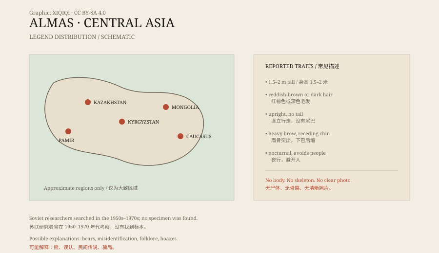

## 一、山里的传说

阿尔马斯的故事，分布得很广。

哈萨克斯坦、吉尔吉斯斯坦、蒙古西部，以及高加索一带，都有类似的说法：山里住着一种像人又不像人的生物。它比人高，浑身长毛，不会说话，住在洞穴或岩缝里。

牧民说，它怕火，也怕人。有时它会靠近营地，拿走食物；有时它只是站在远处看，然后转身走掉。

## 二、它长什么样

目击描述并不一致，但有一些共同点。

它被说成身高一米五到两米，浑身覆盖红棕色或深色的毛，脸像人，但眉骨突出，下巴后缩。它直立行走，没有尾巴，手臂比人长。

有的描述说它跑得很快，有的说它走路笨重。有的说它夜里叫，声音像哭；有的说它几乎不发出声音。

这些细节，来自不同年代、不同地点的口述。它们互相补充，也互相矛盾。

*原创示意图：阿尔马斯传说的主要分布区域与常见描述。不是精确地图。稀奇奇编辑部，CC BY-SA 4.0。*

## 三、苏联的考察

二十世纪，阿尔马斯引起了苏联研究者的注意。

历史学家和社会学家鲍里斯·波尔什涅夫推动了这一研究。他认为，阿尔马斯可能不是神话，而是残存下来的尼安德特人。这个想法在当时很有吸引力：如果一支古人类活到了现代，那将是生物学和人类学的大事件。

从二十世纪五十年代到七十年代，苏联的一些考察队进入高加索和中亚，寻找目击者，收集脚印、毛发和骨骼样本。也有人悬赏捕捉。

结果并不理想。没有捕获，没有尸体，没有完整的骨骼。所谓毛发和脚印，大多无法做出一致的鉴定。

## 四、尼安德特人？

波尔什涅夫的假说，把阿尔马斯和尼安德特人联系了起来。

尼安德特人确实生活在欧亚大陆，也有化石证据。但已知的尼安德特人在大约四万年前消失了，没有证据表明他们存活到近代中亚。

更重要的是，阿尔马斯的描述混合了太多来源：熊、狼、逃犯、隐士、传说中的妖怪。把这些都归为一种“残存古人类”，证据不足。

## 五、解释

最常见的解释是误认。

在光线不好的山里，一只直立起来的熊，轮廓很像“野人”。远处的牧民、骑马的人、穿着皮衣的猎人，也可能被看成毛发蓬松的人形。

另一种解释是民间传说。高山、森林和荒野，总会产生自己的怪物故事。阿尔马斯可能是一个被讲了很多代的形象，而不是一个固定的物种。

还有一种是骗局。用动物皮毛、头骨或脚印制造“证据”，在旅游和猎奇市场里并不少见。

## 六、现在

阿尔马斯仍然活在传说里。

没有清晰照片，没有可验证的标本，也没有被学界承认的骨骼。研究者能做的，是记录口述、比对描述、分析所谓样本；但这些材料不足以证明一种未知的大型灵长类生活在中亚。

山还在那里。故事也还在那里。至于雪线下面到底有什么，目前没有答案。

---

**来源与许可**：本文的事实来源见条目底部来源台账 S1–S3。文字与原创示意图采用 CC BY-SA 4.0。文中把口述描述、苏联时期的考察与各种解释分开叙述；没有把阿尔马斯认定为已证实的动物或古人类。
