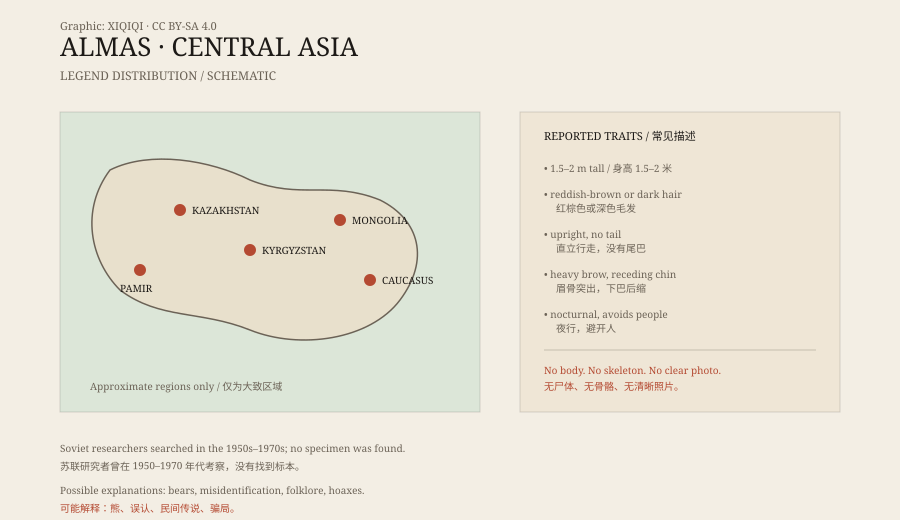

## 一、山里的传说

阿尔马斯的故事，分布得很广。

哈萨克斯坦、吉尔吉斯斯坦、蒙古西部，以及高加索一带，都有类似的说法：山里住着一种像人又不像人的生物。它比人高，浑身长毛，不会说话，住在洞穴或岩缝里。

牧民说，它怕火，也怕人。有时它会靠近营地，拿走食物；有时它只是站在远处看，然后转身走掉。

## 二、它长什么样

目击描述并不一致，但有一些共同点。

它被说成身高一米五到两米，浑身覆盖红棕色或深色的毛，脸像人，但眉骨突出，下巴后缩。它直立行走，没有尾巴，手臂比人长。

有的描述说它跑得很快，有的说它走路笨重。有的说它夜里叫，声音像哭；有的说它几乎不发出声音。

这些细节，来自不同年代、不同地点的口述。它们互相补充，也互相矛盾。

*原创示意图：阿尔马斯传说的主要分布区域与常见描述。不是精确地图。稀奇奇编辑部，CC BY-SA 4.0。*

## 三、苏联的考察

二十世纪，阿尔马斯引起了苏联研究者的注意。

历史学家和社会学家鲍里斯·波尔什涅夫推动了这一研究。他认为，阿尔马斯可能不是神话，而是残存下来的尼安德特人。这个想法在当时很有吸引力：如果一支古人类活到了现代，那将是生物学和人类学的大事件。

从二十世纪五十年代到七十年代，苏联的一些考察队进入高加索和中亚，寻找目击者，收集脚印、毛发和骨骼样本。也有人悬赏捕捉。

结果并不理想。没有捕获，没有尸体，没有完整的骨骼。所谓毛发和脚印，大多无法做出一致的鉴定。

## 四、尼安德特人？

波尔什涅夫的假说，把阿尔马斯和尼安德特人联系了起来。

尼安德特人确实生活在欧亚大陆，也有化石证据。但已知的尼安德特人在大约四万年前消失了，没有证据表明他们存活到近代中亚。

更重要的是，阿尔马斯的描述混合了太多来源：熊、狼、逃犯、隐士、传说中的妖怪。把这些都归为一种“残存古人类”，证据不足。

## 五、解释

最常见的解释是误认。

在光线不好的山里，一只直立起来的熊，轮廓很像“野人”。远处的牧民、骑马的人、穿着皮衣的猎人，也可能被看成毛发蓬松的人形。

另一种解释是民间传说。高山、森林和荒野，总会产生自己的怪物故事。阿尔马斯可能是一个被讲了很多代的形象，而不是一个固定的物种。

还有一种是骗局。用动物皮毛、头骨或脚印制造“证据”，在旅游和猎奇市场里并不少见。

## 六、现在

阿尔马斯仍然活在传说里。

没有清晰照片，没有可验证的标本，也没有被学界承认的骨骼。研究者能做的，是记录口述、比对描述、分析所谓样本；但这些材料不足以证明一种未知的大型灵长类生活在中亚。

山还在那里。故事也还在那里。至于雪线下面到底有什么，目前没有答案。

## 名字与地图

“阿尔马斯”不是一个统一的物种名，而是一组地方称呼的集合。蒙古语里的说法，俄语文献里常写成“almasty”，哈萨克和吉尔吉斯的口述里还有别的叫法。名字不一样，描述却常常相似：直立、长毛、怕人、住在山里。

十九世纪穿越蒙古和中亚的旅行者，在笔记里记下过这类说法。他们带回了地名、牧民的故事和一些无法鉴定的毛发，但没有带回骨架、牙齿或清晰的照片。后来的考察队沿着这些地名进山，找到的仍然是口述。

这也是阿尔马斯故事最难处理的地方：它分布得太广。从高加索到蒙古西部，几千公里的山里都有人说见过，但每一处的描述都带着当地的动物、服装和地形。把这些说法拼成一种动物，听起来完整，实际上是把很多不同的东西压进了一个名字。

## 毛发与脚印

苏联时期的考察队收集过毛发、脚印和所谓的骨骼碎片。

毛发是最常见的“物证”。它容易采集，也容易被误认。熊、羊、马、人的毛发，在显微镜下各有特征，但经过多年存放、污染和转手，鉴定并不总是可靠。一些样本被认定来自已知动物，另一些则因为材料太少，无法得出结论。

脚印也一样。雪地、泥地和沙地上的脚印会随着温度、湿度和风化改变形状。一个熊的脚印，后掌和前掌叠在一起，可能看起来像一只大脚；一个人的脚印被另一个人的脚印踩过，也可能变得又宽又长。

没有完整的头骨，没有牙齿，没有一段可以提取足够 DNA 的骨骼。没有这些，阿尔马斯就无法被写进动物分类学。

## 山与记忆

阿尔马斯的故事，和山里的生活分不开。

牧民在远离村庄的地方放牧，夜里住在帐篷里，听见石头滚动、狼叫、风吹过岩缝。一个站起来的身影，可能是一只熊，也可能是一个走失的人。第二天，这个身影会被讲给邻居听；再往后，它会变成“山里的那个东西”。

故事不是证据，但它是地图。它告诉孩子不要走远，告诉猎人夜里不要一个人进山。阿尔马斯这个名字，装的是这些警告，而不是一个已经被抓到的动物。

阿尔马斯的故事之所以难消失，是因为它不要求你相信一个具体的动物。它只要求你承认，山里还有一些没有被走完的地方。只要地图上还有空白，这个名字就可以继续住在那里。

---

**来源与许可**：本文的事实来源见条目底部来源台账 S1–S3。文字与原创示意图采用 CC BY-SA 4.0。文中把口述描述、苏联时期的考察与各种解释分开叙述；没有把阿尔马斯认定为已证实的动物或古人类。
