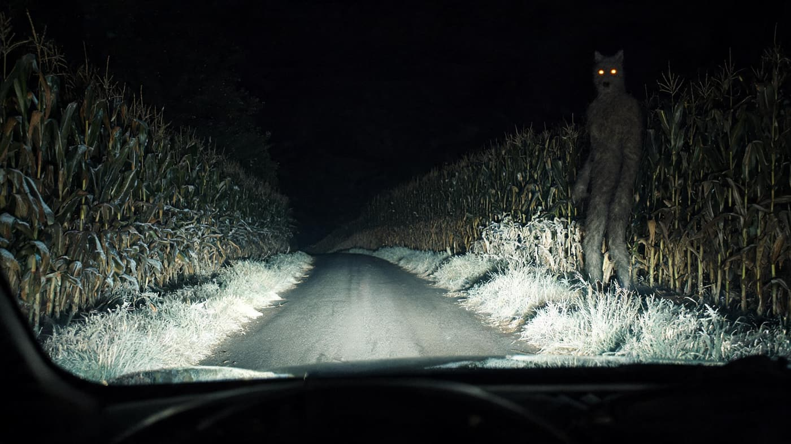
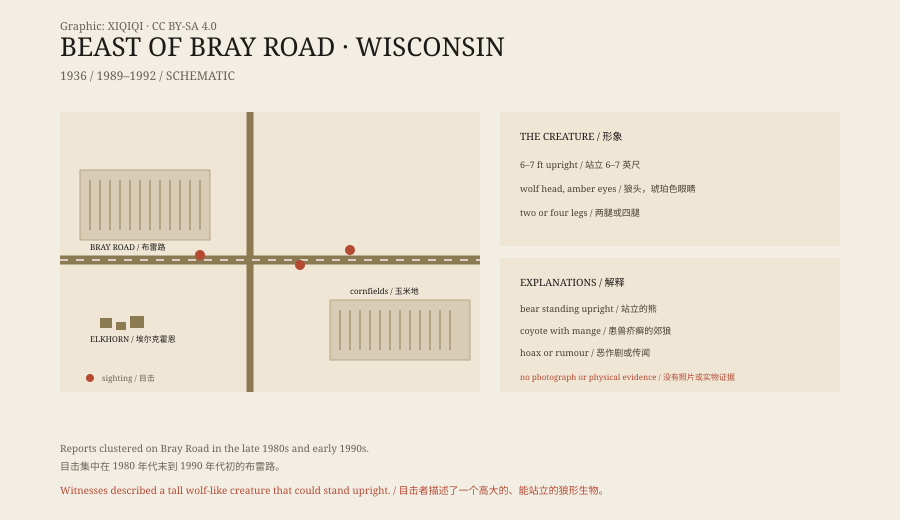

## 1. Bray Road

Bray Road is in Walworth County, Wisconsin, near the town of Elkhorn.

There are farms, cornfields, and woods on both sides. There are no streetlights at night; the headlights pick out a stretch of asphalt and the grass at the edge.

From the late 1980s, a rumour began to circulate around this road: people had seen something that was part wolf and part man.

## 2. 1936

The earliest record goes back to 1936.

Someone said that, in a field nearby that year, they saw a tall, hairy thing. It stood up, walked a few steps like a man, and disappeared into the corn.

The account left no detailed record, but it became the prequel to all the later stories.

## 3. The description

In the early 1990s, reports increased.

Witnesses said the creature was about six to seven feet tall, taller than a man when upright. It had a wolf's head, a long snout, and upright ears. Its fur was gray-brown, and its eyes glowed amber. It could walk on two legs and run on four.

Some said it clawed at car doors, leaving marks. Some said it chased cars. Others said it stood by the road, watched a car go past, and then walked slowly into the woods.

One witness said he was driving through when two orange points appeared in his high beams, low down, like roadside reflectors. As the car came closer, the points rose and became a standing shape. It did not move. It turned slightly and watched the car. When he looked in the mirror, the road was dark and empty.

*Reconstruction: an upright figure at the edge of the corn under headlights, based on witness descriptions. Not a photograph of a sighting. Oddity Archive, CC BY-SA 4.0.*

*Original schematic: the location of Bray Road, the timeline of sightings, and the creature's features. Not a photograph. Oddity Archive, CC BY-SA 4.0.*

## 4. Linda Godfrey

In 1991, a local reporter, Linda Godfrey, began investigating the stories.

She wrote about them for the Walworth County Week, interviewed witnesses, and collected descriptions. Later she turned the material into a book: The Beast of Bray Road: Tailing Wisconsin's Werewolf.

Godfrey did not claim the creature existed. She recorded what people said and how the stories spread through a small town.

## 5. What it might have been

The most common explanation is an animal.

A bear standing upright can look like a tall, hairy human shape from a distance. A coyote with mange loses its fur, and its body looks thin and long, with strange proportions. A wolf-dog hybrid can also be large and unafraid of people.

Another possibility is a hoax. Small-town stories travel easily; a costume and a few willing participants could generate a lot of sightings.

A third explanation is “contagion”: the first person tells a story, and later people who see a deer or a dog at night fit it into the story.

## 6. Now

Today there is no photograph of the Beast of Bray Road, no hair, no footprint, and no body.

Bray Road is still there, and so are the fields. Occasionally people drive along it slowly, hoping to see something. Local bars and shops put the werewolf on T-shirts and signs.

The story has no conclusion. It is a legend that grew out of one place, in a particular decade.

## Newspapers and titles

In 1991, Linda Godfrey wrote the first story about the Beast of the Brewer Road in the Walworth County Weekly. She was a local journalist and interviewed a few people who said they had seen something big on the side of the road. After the article was published, the number of telephone calls was increasing and the story spread as far away as possible.

Godfrey later sorted these interviews into books, using the title of the Brewer. She did not treat witnesses as liars or monsters as facts. What she did was more simple: write down what everyone said, mark the time and place, and let the readers judge themselves.

This has given a fixed text to the story of the road. Before that, it was just a tavern, a gas store and a family meeting; after that, people could take the book and cross the road they had gone to.

## Lycan image

The Brewers are most easily regarded as “wolves” because their description includes both werewolfs and humans.

The wolves are part of head, mouth, ears and hair; the part of man is straight, tall, and shoulder. Together, the two parts are the image of the European werewolf legends. Wisconsin has a large number of descendants of German and Polish immigrants, and the werewolf stories are not unknown. A sighting at the end of the twentieth century fell into a much older narrative.

But "Wolves" are a cultural label, not animalistic conclusions. Witnesses say "wolves like things," not "wolves from people." Later books, televisions and websites mix these two things together.

## Roads and nights

The road of mine is a normal rural road, with cornfields, pastures, and scattered trees on both sides. Without street lights, the traffic lights can only be a small part of the front. At night, the roadside reflectors, the eyes of animals, the plastic bags that are blown by the wind, turn into a little light in the light.

In this environment, distance and size are difficult to judge. An animal on the shoulder may look closer and higher than it actually is; a man standing on the edge of a cornfield may be seen as a "shadow from the ground."

And that's why most of the witnesses are in the night, and there's no clear picture. Not every witness is lying, but the night road is going to stretch the ordinary stuff.

The story of the road was also a reminder that the legend did not need a clear picture. It needed a dark enough road, a few people who wanted to tell it, and a local newspaper who wanted to publish it repeatedly. In the absence of the photograph, the imagination would be filled up.

Today, the road is still a road to drive. There is no fence, no ticket booths, and no sign with the word "beast" in it. Only by night, when the headlights reach the cornfield on the side of the road, will people understand why those stories were chosen here.

---

**Sources and licenses**: the factual sources are listed in the source ledger S1–S3 at the bottom of this entry. Text and original diagrams are licensed under CC BY-SA 4.0. This article separates the early record, the 1990s sightings, the reporter's investigation, and the possible explanations; there is no photograph or physical evidence of the Beast of Bray Road, and animal misidentification, a hoax, and the spread of rumour are all possible.
