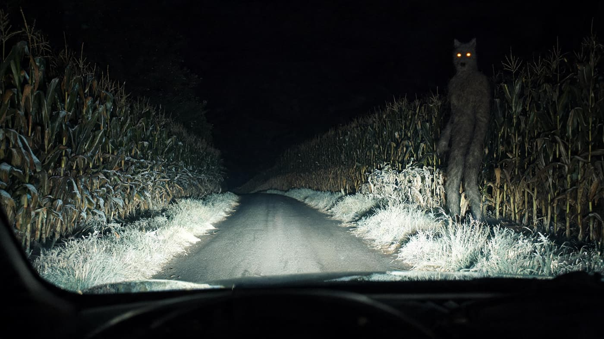
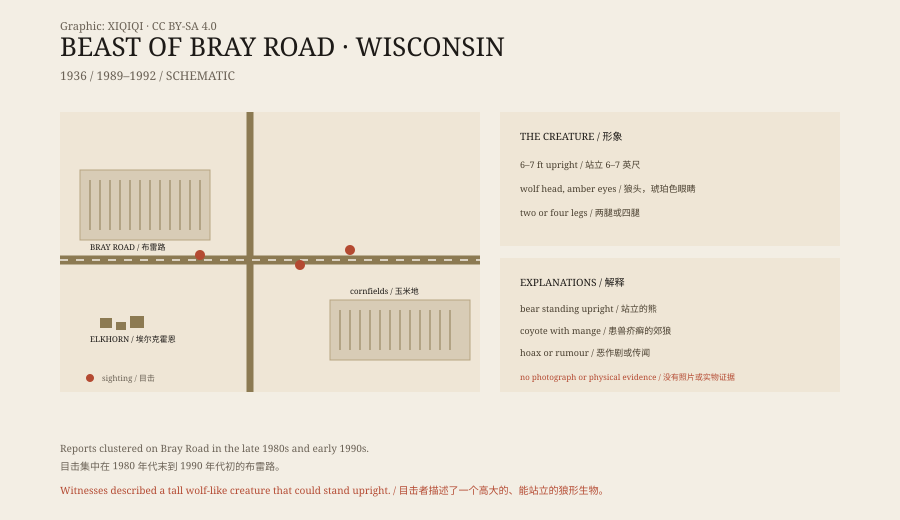

## 一、布雷路

布雷路在威斯康星州沃尔沃斯县，靠近埃尔克霍恩镇。

路两边是农田、玉米地和树林。晚上没有路灯，车灯照出去，只能看到一段路面和路边的草。

从 1980 年代末开始，这条路附近开始出现一种传闻：有人看到一只像狼又像人的东西。

## 二、1936 年

最早的记录，可以追到 1936 年。

有人说，那一年在附近的农田里，看到一个高大的、浑身是毛的东西。它站起来，像人一样走了几步，然后消失在玉米地里。

这个说法没有留下详细记录，但它成了后来所有故事的前传。

## 三、描述

1990 年代初，目击报告多了起来。

目击者说，那东西大约六到七英尺高，站起来比人高。头像狼，嘴很长，耳朵竖着。身上是灰褐色的毛，眼睛发琥珀色的光。它能用两条腿走路，也能四条腿跑。

有人说它抓过车门，留下爪痕。有人说它追过车。还有人说，它在路边站着，看着车过去，然后慢慢走进树林。

有个目击者说，那晚他开车经过，远光灯里先是出现两点橙色的光，很低，像路边的反光片。车再近一点，那两点光升高了，变成一个站着的影子。它没有动，只是侧过身，看着车。等车开过去，他从后视镜里看，路已经黑了，什么都没有。

*场景复原：夜间行车灯下、玉米地边的直立身影，依据目击者描述绘制。不是目击照片。稀奇奇编辑部，CC BY-SA 4.0。*

*原创示意图：布雷路的位置、目击时间线与形象特征。不是目击照片。稀奇奇编辑部，CC BY-SA 4.0。*

## 四、琳达·戈弗雷

1991 年，当地记者琳达·戈弗雷开始调查这些说法。

她为《沃尔沃斯县周报》写文章，采访目击者，收集描述。后来，她把这些材料写成书：《布雷路野兽：追踪威斯康星的狼人》。

戈弗雷没有断言那东西真的存在。她记录的是人们说了什么，以及这些说法如何在小镇里传播。

## 五、可能是什么

最常见的解释是：一只动物。

一只站起来的熊，从远处看，可能像一个高大的、有毛的人形。一只患了兽疥癣的郊狼，毛会掉光，身体显得又瘦又长，比例奇怪。狼和狗的杂交种，也可能体型偏大，不怕人。

另一种可能是恶作剧。小镇故事容易传播，一个道具服、几个愿意配合的人，就能制造出很多目击。

还有一种解释是“群体错觉”：第一个人讲了一个故事，后来的人在夜里看到一只鹿或一条狗，就会把它套进这个故事里。

## 六、现在

今天，没有布雷路野兽的照片，也没有毛发、脚印或尸体。

布雷路还在，路边的农田还在。偶尔有人开车过来，慢慢走一趟，希望能看到什么。当地的酒吧和商店，会把狼人的形象印在 T 恤和招牌上。

故事没有结论。它只是一个地方，在一个特定的年代，长出来的一个传说。

---

**来源与许可**：本文的事实来源见条目底部来源台账 S1–S3。文字与原创示意图采用 CC BY-SA 4.0。文中把早期记录、1990 年代目击、记者调查与可能解释分开叙述；布雷路野兽没有照片或实物证据，动物误认、恶作剧和传闻扩散都是可能解释。
