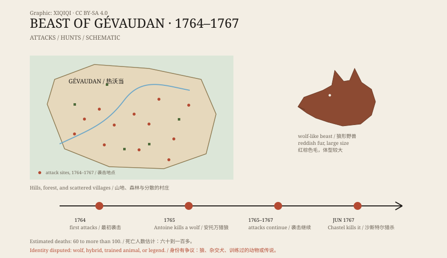

## 1. The mountain villages of 1764

Gévaudan lies in southern France, a region of rolling hills, forests, pastures, and stone houses.

In the summer of 1764, women and children began to disappear in the hills. At first people assumed wolves. Wolves were common there, and sheep were often taken.

But these attacks were different. The animal attacked people, especially women, children, and lone herders. It went for the throat and face, leaving mutilated bodies.

## 2. What it did

The attacks lasted three years.

The recorded death toll is not consistent, but it lies roughly between sixty and more than a hundred, with many more injured. Some attacks happened at the edge of villages; some happened in daylight. It did not avoid people, and it came back after being chased.

That convinced locals it was not an ordinary wolf.

*Original schematic: the attacks and hunts in Gévaudan, 1764–1767. Not a historical painting. Oddity Archive, CC BY-SA 4.0.*

## 3. What it looked like

The descriptions do not agree.

Some said it was like a wolf but larger. Some said it had reddish-brown fur with a dark stripe along its back. Some said it had a long tail, a large head, and a dog-like muzzle. Others said its hide was so tough that ordinary bullets could not penetrate it.

Later prints and pamphlets elaborated these details. By now, the Beast of Gévaudan sits somewhere between a wolf, a dog, and a monster.

## 4. The king's huntsman

News reached Versailles.

In 1765, Louis XV sent his chief wolf hunter, François Antoine, with hounds and soldiers. In September, Antoine shot a very large wolf and brought it to court.

People thought the affair was over. Then the attacks resumed.

In June 1767, a local hunter, Jean Chastel, killed a large animal in the hills. After that, the attacks stopped. Chastel was said to have used bullets he had cast himself, and the story grew from there.

## 5. What was it?

The most common explanation is a wolf, or a group of wolves.

Wolves were numerous in eighteenth-century Gévaudan and came closer to villages when food was scarce in winter. But ordinary wolves usually avoid people, and three years of deliberate attacks on humans is not typical.

Another explanation is a wolf-dog hybrid or a large dog raised by humans. Such an animal would not fear people and might treat them as prey. Some have suggested a trained animal, or even a serial killer using the beast rumours to cover his crimes.

Another possibility is that there was more than one animal. The one Antoine killed and the one Chastel killed may not have been the same, and different animals may have been responsible for different attacks.

## 6. Afterwards

The Beast of Gévaudan became one of France's most famous monster legends.

It appears in prints, novels, films, and folk tales, described as a werewolf, a demon, or a punishment from heaven. The real story is often buried: a poor mountain region where people died for three years, and where the surviving records are incomplete.

Today, a museum in Gévaudan still displays its image. It looks like an oversized wolf, staring out of the frame.

---

**Sources and licenses**: the factual sources are listed in the source ledger S1–S3 at the bottom of this entry. Text and original diagrams are licensed under CC BY-SA 4.0. This article separates the attack record, the official hunts, the eyewitness descriptions, and the various explanations; estimates of the death toll and the animal's identity vary, and the “werewolf” interpretation is not treated as a conclusion.
