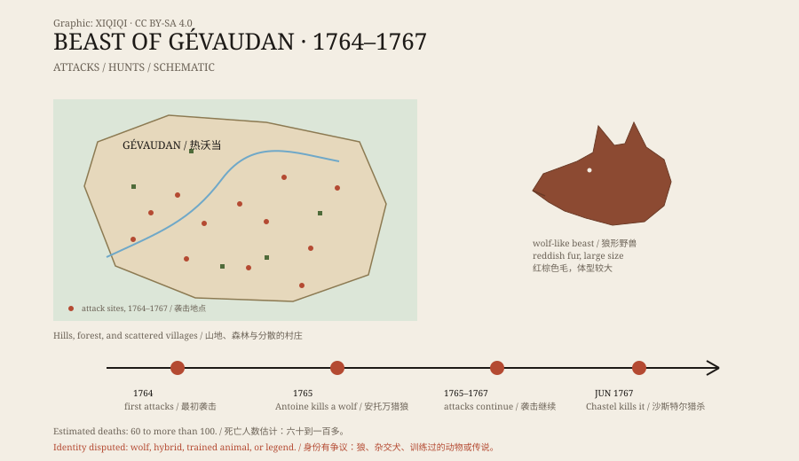

## 一、1764 年的山村

热沃当在法国南部，是片起伏的山地，森林、牧场和石屋散落其间。

1764 年夏天，开始有女人和孩子在山里失踪。最初，人们以为是狼。这一带本来就有狼，羊被叼走是常事。

但接下来的袭击不一样。那只动物攻击人，而且专门挑落单的女人、孩子和放牧的人。它咬住喉咙和脸，留下被撕碎的尸体。

## 二、它做了什么

袭击持续了三年。

记录里的死亡人数不完全一致，大约在六十到一百多之间；受伤的人更多。有的袭击发生在村边，有的发生在白天。它不怕人，甚至在被追赶后还会回来。

这让当地人相信，它不是普通的狼。

*原创示意图：1764–1767 年热沃当袭击与猎捕经过。不是历史画作。稀奇奇编辑部，CC BY-SA 4.0。*

## 三、它长什么样

目击描述并不统一。

有人说它像狼，但比狼大；有人说它有红棕色的毛，背上有黑色条纹；有人说它的尾巴很长，头很大，嘴像狗。还有人说，它的皮很硬，普通子弹打不穿。

这些细节被后来的版画和小册子不断加工。到了今天，热沃当野兽的形象已经介于狼、狗和怪物之间。

## 四、国王的猎手

消息传到凡尔赛。

1765 年，路易十五派出了宫廷猎狼官弗朗索瓦·安托万，带着猎犬和士兵进山。安托万在当年九月打死了一只很大的狼，把它带回宫廷。

人们以为事情结束了。但袭击又开始了。

1767 年 6 月，本地猎人让·沙斯特尔在山上打死了一只大型动物。此后，袭击停止。沙斯特尔用的是自己铸造的子弹，这个故事后来被传得很神。

## 五、它到底是什么

最常见的解释是狼，或者一群狼。

十八世纪的热沃当，狼的数量不少，冬季食物短缺时，狼会靠近村庄。但普通狼通常避开人，连续三年专门攻击人，并不典型。

另一种解释是狼狗杂交，或者被人类饲养过的大型犬。它们不怕人，可能把人类当成猎物。也有人提出，这是一只被训练来攻击人的动物，甚至是一个连环杀手利用野兽传闻掩盖罪行。

还有一种说法是，热沃当野兽根本不止一只。安托万打死的和沙斯特尔打死的，可能不是同一只；袭击也可能由不同的动物完成。

## 六、后来

热沃当野兽成了法国最著名的怪物传说之一。

它出现在版画、小说、电影和民间故事里，被说成狼人、恶魔或天罚。真实的部分反而被淹没了：一个贫困的山村，三年里不断有人死去，而当时的调查和记录并不完整。

今天，热沃当的博物馆里还挂着它的画像。它看起来像一只太大的狼，眼睛盯着画外。

---

**来源与许可**：本文的事实来源见条目底部来源台账 S1–S3。文字与原创示意图采用 CC BY-SA 4.0。文中把袭击记录、官方猎捕、目击描述与各种解释分开叙述；死亡人数和动物身份都存在不同估计，不能把“狼人”说法当作结论。
