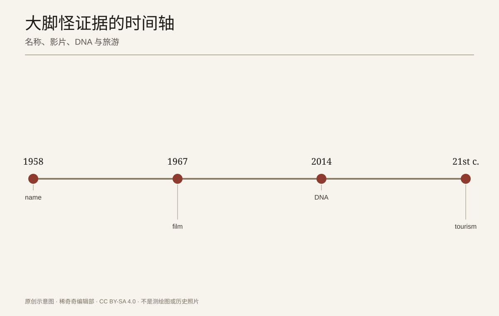

## 1. Name and image

The name 'Bigfoot' entered American newspapers in the late 1950s after reports of large footprints in northern California; 'Sasquatch' comes from a similar word in Pacific Northwest Indigenous languages. The modern image is a bipedal, hair-covered ape-like creature more than two metres tall, living in forests and mountains. This image is not a fixed ancient legend but a twentieth-century composite of Indigenous narratives, frontier stories, carnival tales, and mass media.

## 2. The evidence types

Supporters usually cite four kinds of material: footprints and plaster casts, hair and tissue samples, recordings and calls, and sightings with photos or film. The problem is that most arrive after the fact and lack a traceable chain of collection; footprints can be faked, hair may come from bears or deer, recordings may be known animals or people, and images may be blurry, composite, or misidentified. Persuasive evidence would require a body, skeleton, complete DNA, or repeatable field footage, and none exists.

*Original diagram: Bigfoot from the 1950s name to DNA testing. Not a survey drawing. XIQIQI Editorial, CC BY-SA 4.0.*

## 3. DNA and scientific testing

In the 2010s several teams ran DNA analyses on alleged Bigfoot hair and dung samples; results pointed mainly to bears, wolves, deer, dogs, and humans, with no unknown primate. A 2014 study by Sykes and colleagues analysed dozens of samples and likewise found no anomalous primate. Other researchers have criticised loose provenance and contamination. The key point is not that every sample is fake but that no sample stably points to an unknown large primate.

## 4. Film, casts, and hoaxes

The 1967 Patterson–Gimlin film is the most famous image: a bipedal, hair-covered figure walking across a creek bed at Bluff Creek, California. Supporters see genuine muscle movement and gait; critics note blur, questionable proportions, and people who admitted or were suspected of making hoaxes. The 1958 footprint case in Humboldt County, California, was later linked to Ray Wallace's prank. The existence of hoaxes does not prove every report false, but it shows that the evidence chain must be independent of the narrator.

*Original diagram: sightings, physical evidence, and scientific testing for Bigfoot. Not a survey drawing. XIQIQI Editorial, CC BY-SA 4.0.*

## 5. Folk roots and culture

Bigfoot is not only a zoological question but part of North American folk culture. Indigenous peoples have their own stories of forest beings; European settlers brought images of 'wild men' and frontier monsters; twentieth-century mass media merged them into Sasquatch/Bigfoot. Sightings often occur in forests, at night, near roads, and around campsites, places already charged with fear and mystery. Studying these narratives can show how people draw the line between 'civilisation' and 'wilderness' without first assuming the creature exists.

## 6. Tourism and critical thinking

Today Bigfoot supports an industry of tourism, podcasts, documentaries, and merchandise: towns have statues and festivals, organisations keep sighting databases, and enthusiasts hold annual gatherings. For participants it is adventure and community; for science it remains an unconfirmed hypothesis. The most useful attitude is neither ridicule nor credulity but a demand for evidence: where did the sample come from, who handled it, can it be repeated, and has it been independently verified? That question trains judgment better than 'does Bigfoot exist'.

## Timeline

- **premodern**: Indigenous and settler stories of forest beings
- **1958**: large footprints in Humboldt County; the name spreads
- **1967**: Patterson–Gimlin film shot
- **2014**: Sykes et al. publish hair DNA analysis; no unknown primate
- **21st century**: Bigfoot tourism, podcasts, and community industry

## Sources and evidence

The checkable material in this entry rests mainly on S1 and S2: S1 supplies the official site or object record and basic chronology, while S2 supplies independent research or archival context. S3 covers the editorial cover and diagrams; it is visual explanation, not historical evidence. Dates, quantities, places, and attributions in the text are traced back to specific S1/S2 pages wherever possible. Claims that cannot be tied to a page are flagged under 'Limits of the record'.

The cover is an AI-assisted reconstruction, not a site photograph. The two inline figures are original diagrams, not survey drawings. Image types and licences are recorded row by row in `research/image-audit.csv`.

## Archive location

Bigfoot has no type specimen and therefore no museum-grade biological archive; existing material is scattered across private collections, local historical societies, university folklore archives, and media organisations. The Smithsonian and other zoological institutions hold specimens and DNA reference data for bears, deer, wolves, and other common animals, used to compare alleged Bigfoot samples; the American Folklore Society and university folklore programmes hold sightings, clippings, and narrative research. Commercial organisations such as the BFRO maintain separate sighting databases, but collection standards, verification, and access are not transparent. The DNA conclusions used here come from published peer-reviewed research; sightings are treated as cultural material, not as evidence of a living creature. The absence of a type specimen is not a small technicality: it is the central reason the question remains open, and it places the burden of proof on those who claim the creature exists. Museum collections can test samples, but they cannot manufacture a body that has never been found. That is why the strongest scientific statement is negative: no confirmed specimen, no confirmed species.

## Limits of the record

Bigfoot is not scientifically confirmed, and there is no body, skeleton, or reproducible DNA sample. The 'evidence' consists mainly of footprints, hair, audio, sightings, and images, many of which can be explained by bears, humans, known animals, or hoaxes. Folk narrative, Indigenous stories, and modern popular culture are layered together and cannot be read simply as biological records. This entry separates 'what people have reported' from 'whether an unconfirmed large primate exists': the first can be studied, the second still lacks evidence.

---

**Sources and licenses**: the factual claims above are traced to S1 and S2 in the source ledger; S3 covers the AI-assisted cover and the two original diagrams. Text and original diagrams are licensed CC BY-SA 4.0. This entry separates the documented record from reconstruction and marks remaining uncertainty under 'Limits of the record'. Where the archive is silent, the text says so rather than filling the gap with narrative. Dates and figures follow the cited pages; interpretations are identified as interpretations, and no hypothesis is presented as a settled fact.
