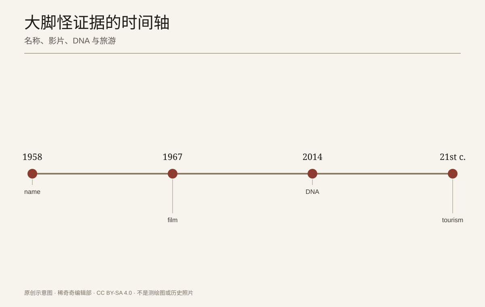

## 一、名称与形象

“Bigfoot”这个名字在 1950 年代后期进入美国报纸，源自加州北部发现的大型脚印报道；“Sasquatch”则来自太平洋西北部原住民语言中的类似词。现代形象是一个直立行走、全身覆毛、身高两米以上的类猿生物，出没于森林和山地。这个形象并不是古老的固定传说，而是原住民叙事、边疆故事、马戏怪谈和大众媒体在 20 世纪逐渐合成的结果。

## 二、证据的类型

支持者常举出四类材料：脚印与石膏铸模、毛发与组织样本、录音与叫声、目击叙述与照片/影片。问题在于，这些材料大多来自事后提交，缺少可追溯的采集链条；脚印可以伪造，毛发可能来自熊或鹿，录音可能是已知动物或人为，照片可能是模糊、合成或误认。真正有说服力的证据需要身体、骨骼、完整 DNA 或可重复的野外影像，而这些至今没有。

*原创示意图：大脚怪从 1950 年代名称流行到 DNA 检验的时间轴。不是测绘图。稀奇奇编辑部，CC BY-SA 4.0。*

## 三、DNA 与科学检验

2010 年代，多组研究者对所谓大脚怪毛发和粪便样本做 DNA 分析，结果主要指向熊、狼、鹿、狗和人类，没有发现未知灵长类。2014 年 Sykes 等人的研究分析了数十个样本，结论同样是没有 anomalous primate。也有研究者批评样本来源不严、污染严重。科学检验的关键不是“所有样本都假”，而是“没有一份样本能稳定地指向一种未知的大型灵长类”。

## 四、影像、铸模与骗局

1967 年的 Patterson–Gimlin 影片是最著名的影像：一个直立行走的毛茸生物在加州 Bluff Creek 走过河床。支持者认为它展示了真实的肌肉运动和步态；批评者指出画面模糊、比例可疑，且有多人承认或涉嫌制作骗局。1958 年加州 Humboldt 县的脚印事件，后来被指与 Ray Wallace 的恶作剧有关。骗局的存在不能证明所有报告都假，却说明证据链必须独立于叙述者。

*原创示意图：大脚怪的目击叙述、物证与科学检验三层证据。不是测绘图。稀奇奇编辑部，CC BY-SA 4.0。*

## 五、民俗与文化的根

大脚怪不只是一个“动物学问题”，也是北美民间文化的一部分。原住民有各自的森林生物叙事，欧洲移民带来了“野人”和“边疆怪物”的想象，20 世纪的大众媒体又把它们合并成 Sasquatch/Bigfoot。目击叙述往往发生在森林、夜间、道路边缘和露营场景，这些地点本身就带有恐惧与神秘感。研究这些叙事，能理解人们如何划分“文明”与“荒野”，而不必先假定生物存在。

## 六、旅游、社群与批判思维

今天的大脚怪围绕旅游、播客、纪录片和商品形成产业：小镇有雕像和节庆，组织有目击数据库，爱好者有年度聚会。对参与者来说，它是一种探险和社群；对科学来说，它仍是一个未确认假说。最有用的态度不是嘲笑，也不是轻信，而是追问证据：样本从哪里来，谁经手，能否重复，是否有独立验证。这个问题比“大脚怪是否存在”更能训练判断力。

封面是「大脚怪：脚印、影像与一个未确认的灵长类」的 AI 辅助场景复原，不是现场照片；两张插图为原创示意图，不是测绘图。图片类型与许可逐行记录在 research/image-audit.csv。

## 档案位置

大脚怪没有“模式标本”，因此没有博物馆级的生物档案；现有材料分散在私人收藏、地方历史学会、大学民俗档案和媒体机构。史密森尼与多家动物学机构保存的是熊、鹿、狼等常见动物的标本与 DNA 参考数据，用来比对所谓大脚怪样本；美国民俗学会及大学民俗项目保存目击叙述、剪报和民间叙事研究。商业组织（如 BFRO）另建目击数据库，但采集标准、核实流程和访问权限不透明。本文使用的 DNA 结论来自已发表的同行评议研究；目击叙述只作为文化材料，不作为生物存在证据。

## 档案空白

大脚怪没有被科学确认，也没有任何身体、骨骼或可重复的 DNA 样本。所谓“证据”主要是脚印、毛发、录音、目击叙述和影像，其中许多可以被熊、人类、已知动物或骗局解释。民间传说、原住民叙事和现代流行文化又相互叠加，不能简单当作生物学记录。本文把“人们讲述了什么”与“是否存在一种未确认的大型灵长类”分开，前者可以研究，后者仍缺证据。

---

**来源与许可**：本文的事实来源见条目底部来源台账 S1–S3。文字与原创示意图采用 CC BY-SA 4.0。
