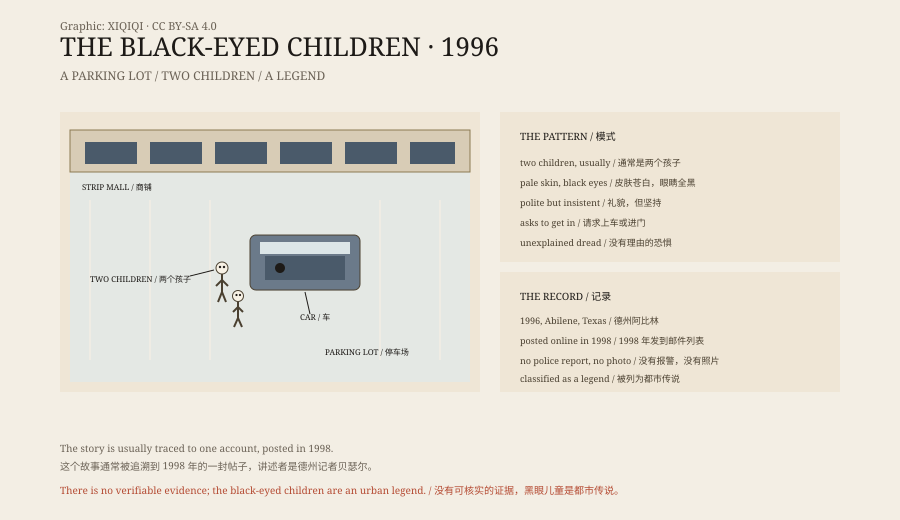

## 1. The parking lot

In 1996 Brian Bethel was a reporter for a newspaper in Abilene, Texas.

One night, after a late shift, he parked in the lot of a strip mall, sat in the driver's seat and began writing a cheque. The lot was almost empty, the lights were yellow.

Someone knocked on his window.

Two boys were standing outside. One looked about six or seven, the other older. They were pale, dressed in ordinary clothes, and said they needed a ride to their mother's house to get money for a film.

Bethel later recalled a sudden wave of fear. He could not say why. The way they spoke was wrong, like a rehearsed line, and their voices sounded older than their faces.

## 2. The eyes

He looked at their eyes.

They were not dark brown, and there was no white around the pupil. From lid to lid, the whole eye was black.

He refused. The boys said a few more words and asked him to open the door. He did not. They stepped back into the lot and stood there, watching him.

Bethel started the car and drove away. When he looked in the mirror, the lot was empty.

## 3. The mailing list

No police report was made, and nothing appeared in the paper.

In 1998 Bethel posted a detailed account to a ghost-related mailing list. The post was forwarded, archived and translated, and it travelled.

He changed jobs and moved, and people kept asking him about it. In 2012 he told the story again on a television programme. He said he could not explain it, but that he was not lying.

## 4. The pattern

After Bethel's story spread, other accounts began to appear.

They share certain features. Children, usually two. Very pale skin. Eyes that are entirely black. Polite but insistent speech. A request to get into a car, or into a house. A sense of dread that the witness cannot explain.

In some versions the children say, “We can't come in unless you tell us it's okay.” That sounds like the rule in a vampire story, but it is not in Bethel's original account.

Others have linked the black-eyed children to cars, motels and hitchhikers at the side of the road. The more the story is told, the more the details converge.

*Original schematic: the 1996 parking lot, the features of the legend, and its path through the internet. Not a photograph of a sighting. Oddity Archive, CC BY-SA 4.0.*

## 5. Explanations

There is no police report, no photograph, and no second witness.

The science writer Sharon A. Hill searched the record and found no documented black-eyed child encounter. She argued that the stories are typical “friend of a friend” ghost stories — the person telling them is usually not the person who saw anything.

Snopes lists the black-eyed children as a legend, not a fact.

The most common practical explanation is sclera contact lenses. Lenses that cover the whole eye were available in the 1990s, turn the eye completely black, and are frightening at night. Others have suggested a prank, the prelude to a robbery, or a witness misreading a face in the dark.

None of these explanations can prove what Bethel saw that night. He says himself that he does not know.

## 6. Why children

The black-eyed children are frightening not because they look monstrous.

They are frightening because they are children. Children are supposed to be harmless. They are supposed to need help. They are supposed to make us lower our guard. Two children knocking on a car window at night usually get the door opened.

The story puts “someone who needs help” and “something that cannot be trusted” in the same small body. Refuse, and you may be leaving a child in danger. Agree, and you may have made a mistake.

The parking lot in 1996 may have held two boys in contact lenses, or nothing at all. But the story found a structure that holds, and it is still being told.

---

**Sources and licenses**: the factual sources are listed in the source ledger S1–S3 at the bottom of this entry. Text and original diagrams are licensed under CC BY-SA 4.0. This article separates Bethel's account, the later versions, the shared features, and the skeptical view; there is no verifiable police record or photographic evidence, and the black-eyed children are treated as an urban legend. The illustration is a scene reconstruction, not a photograph of a sighting.
