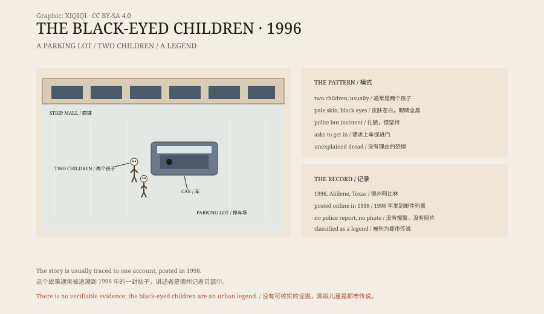

## 1. The parking lot

In 1996 Brian Bethel was a reporter for a newspaper in Abilene, Texas.  
After a late shift he parked in the lot of a strip mall, sat in the driver’s seat, and began writing a cheque. The lot was almost empty and the lights were yellow.  

Someone knocked on his window. Two boys stood outside: one looked about six or seven, the other older. They were pale, dressed in ordinary clothes, and said they needed a ride to their mother’s house to get money for a film.  

Bethel later recalled a sudden wave of fear. He could not say why. The way they spoke was rehearsed, and their voices sounded older than their faces.

## 2. The eyes

He looked at their eyes.  
They were not dark brown, and there was no white around the pupil. From lid to lid, the whole eye was black.  

He refused. The boys said a few more words and asked him to open the door. He did not. They stepped back into the lot and watched him.  

Bethel started the car and drove away. When he looked in the mirror, the lot was empty.

## 3. The mailing list

No police report was made, and nothing appeared in the paper.  
In 1998 Bethel posted a detailed account to a ghost‑related mailing list. The post was forwarded, archived, and translated, and it travelled.  

He changed jobs and moved, and people kept asking him about it. In 2012 he told the story again on a television programme. He said he could not explain it, but that he was not lying.

## 4. The pattern

After Bethel’s story spread, other accounts began to appear.  
They share certain features: children, usually two; very pale skin; eyes that are entirely black; polite but insistent speech; a request to get into a car or into a house; a sense of dread that the witness cannot explain.  

In some versions the children say, “We can’t come in unless you tell us it’s okay.” That sounds like a rule in a vampire story, but it is not in Bethel’s original account.  

Others have linked the black‑eyed children to cars, motels, and hitchhikers at the side of the road. The more the story is told, the more the details converge.

*Original schematic: the 1996 parking lot, the features of the legend, and its path through the internet. Not a photograph of a sighting. Oddity Archive, CC BY‑SA 4.0.*

## 5. Explanations

There is no police report, no photograph, and no second witness.  

Science writer Sharon A. Hill searched the record and found no documented black‑eyed child encounter. She argued that the stories are typical “friend of a friend” ghost stories—the person telling them is usually not the one who saw anything.  

Snopes lists the black‑eyed children as a legend, not a fact.  

The most common practical explanation is sclera contact lenses. Lenses that cover the whole eye were available in the 1990s, turn the eye completely black, and are frightening at night. Others have suggested a prank, the prelude to a robbery, or a witness misreading a face in the dark.  

None of these explanations can prove what Bethel saw that night. He says he does not know.

## 6. Why children

The black‑eyed children are frightening not because they look monstrous.  
They are frightening because they are children. Children are supposed to be harmless, to need help, and to make us lower our guard. Two children knocking on a car window at night usually get the door opened.  

The story places “someone who needs help” and “something that cannot be trusted” in the same small body. Refuse, and you may be leaving a child in danger. Agree, and you may have made a mistake.  

The parking lot in 1996 may have held two boys in contact lenses, or nothing at all. But the story found a structure that holds, and it is still being told.

## From Mail List to Television

The story of Bethel, not in the papers at the earliest, appeared in an e‑mail list of ghosts.  

In 1998 he wrote a growing post that he sent to the same people in the list. The post was archived, forwarded, translated, and distributed to forums in the English‑speaking world for several years. In 2012 he spoke on television, and this time he had lights, cameras and music.  

Changes in the way of transmission shift the focus of the story. The longer version in the mailing list retains Bethel’s hesitation and self‑skepticism; the shorter version on television focuses on the “black eyes” and the “unjustified fears.” The later version deletes the name and location and becomes a template that can be found in any parking lot.

## The pattern of the story

The story of black‑eyed children has a very stable structure.  

Usually at night, there is an empty parking lot, a side of the road, or a door. The two children appear nearby, with white skin, plain clothes, and politely. They make a specific request: a ride, a call, a door. Witnesses are afraid, refuse, and then leave. When they turn back, the child is gone.  

The structure and the “disappeared passenger” “the vampire knocks on the door” have the same skeleton: a stranger in need of help, a request that cannot be refused without taking it, a reflection that disappears after refusing.

## Why can't we verify it?

No police records, no photographs, no second witness.  

Bethel himself did not claim that it was a ghost. He said he did not know what he saw, but only remembers the fear. That uncertainty makes the story harder to prove and easier to believe: an uncertain witness is more credible than a certain liar.  

Sharon Hill and Snopes have checked the public records, and they have not found an event that can be independently verified. Black contact lenses, pranks, robbery preludes, night‑vision errors are all possible explanations.

## Why is the baby so scary?

In our daily experience, children represent harmlessness and protection. Black-eyed children turn this expectation on its head: people in need of protection become threatening, and a child's plea becomes a trap. That inversion is what makes the story durable.

---

**Sources and licenses**: the factual sources are listed in the source ledger S1–S3 at the bottom of this entry. Text and original diagrams are licensed under CC BY-SA 4.0. This article separates the original account, its spread on the internet, and the explanations offered by sceptics; there is no verified police record, photograph or second witness. The illustrations are scene reconstructions, not photographs of an event.
