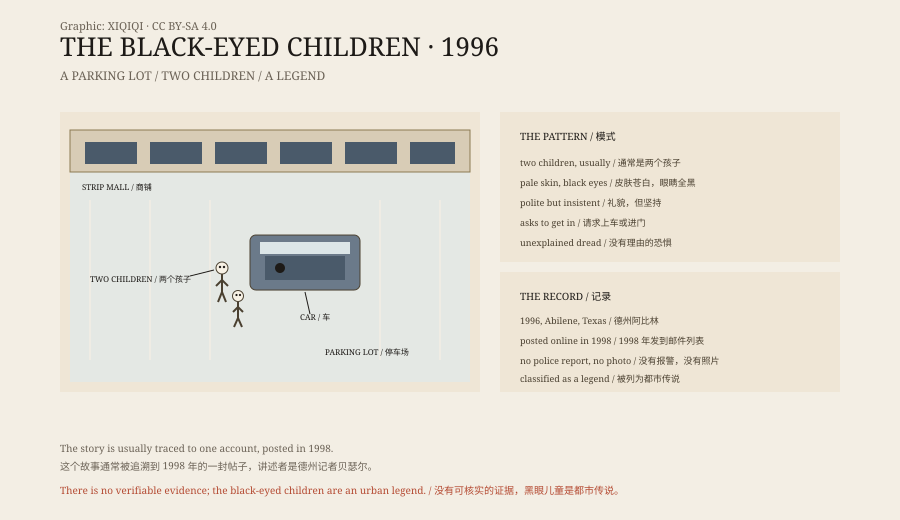

## 一、停车场

1996 年，布莱恩·贝瑟尔是阿比林一家报社的记者。

那天晚上，他加完班，把车停在一家商铺前的停车场里，坐在驾驶座上写一张支票。停车场很空，灯光发黄。

有人敲他的车窗。

外面站着两个男孩。一个看起来六七岁，另一个大一些。他们脸色很白，穿着普通的衣服，说要搭他的车去母亲家拿钱，再去看电影。

贝瑟尔后来回忆，他当时突然感到一阵恐惧。他说不清为什么。两个孩子说话的方式不对，像是背过的台词，声音也比他们的年纪老。

## 二、眼睛

他低头看他们的眼睛。

不是深棕色，也不是黑色瞳孔。是从眼白到瞳孔，整只眼睛都是黑的。

他拒绝了。两个孩子又说了几句，请他开门。他没有开。他们退回停车场里，站在那里看着他。

贝瑟尔发动车子，开走了。他从后视镜里看了一眼，停车场是空的。

## 三、邮件列表

这件事当时没有报警，也没有见报。

1998 年，贝瑟尔把一个详细的版本发到一个关于鬼怪的邮件列表里。帖子被转发、存档、翻译，越传越远。

后来他换过工作，搬过家，仍然会被人问起这件事。2012 年，他在电视节目里又讲了一遍。他说自己无法解释，但他没有说谎。

## 四、模式

贝瑟尔的故事传开之后，类似的叙述开始出现。

它们有一些共同点：孩子，通常是两个；皮肤很白；眼睛全黑；说话礼貌，但坚持；请求上车，或者请求进门；目击者会感到一种没有理由的恐惧。

有些版本里，孩子会说：“你不请我们进去，我们就不能进去。”这句话听起来像吸血鬼故事里的规矩，但贝瑟尔的原始叙述里没有。

也有人把黑眼儿童和轿车、旅馆、公路边的搭车人联系在一起。故事越传越多，细节越来越像。

*原创示意图：1996 年停车场、传说特征与网络传播路径。不是目击照片。稀奇奇编辑部，CC BY-SA 4.0。*

## 五、解释

没有警察报告，没有照片，没有第二个目击者。

科学作家莎伦·希尔查过资料，找不到任何可核实的黑眼儿童事件。她认为，这类故事和“黑狗”传说一样，是典型的“朋友的朋友”式鬼故事——讲述者本人往往不是目击者。

Snopes 把黑眼儿童列为传说，而不是事实。

最常见的现实解释是：全黑的隐形眼镜。这种镜片在 1990 年代就能买到，戴上之后整只眼睛会变成黑色，在夜里很吓人。也有人说是恶作剧、抢劫的前奏，或者是目击者在紧张中看错了。

但这些解释都不能证明贝瑟尔那晚看到了什么。他自己也说，他不知道。

## 六、为什么是孩子

黑眼儿童之所以吓人，不是因为他们长得可怕。

是因为他们是孩子。孩子应该无害，应该需要帮助，应该让人放下戒心。两个孩子在夜里敲车窗，大多数人的第一反应是帮忙。

故事把“需要帮助的人”和“不能信任的东西”放在同一个身体里。你拒绝，可能见死不救；你答应，可能上当了。

1996 年的那个停车场，也许只是两个戴了隐形眼镜的男孩，也许什么都不是。但这个故事找到了一个很稳的结构，所以它一直传到现在。

---

**来源与许可**：本文的事实来源见条目底部来源台账 S1–S3。文字与原创示意图采用 CC BY-SA 4.0。文中把贝瑟尔的叙述、后来的版本、共同特征与怀疑意见分开叙述；没有可核实的警方记录或影像证据，黑眼儿童被视为都市传说。插图是场景复原，不是目击照片。
