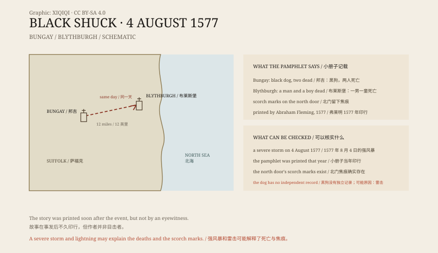

## 1. The storm of 1577

4 August 1577 was a Sunday.

In the town of Bungay, Suffolk, people were at service in St Mary's Church. The sky went dark, the thunder drowned out the prayers, and hail hammered the windows.

Then the church door burst open.

## 2. The black dog

In the legend, a huge black dog ran in.

It passed through the congregation, knocked down several people at prayer, ran the length of the church, and vanished. People were injured. Two died on the spot.

The church was in chaos. Outside was the storm; inside were the dead and the screaming.

At the same hour, twelve miles away in Blythburgh, Holy Trinity Church was also holding a service. The dog appeared again. It came in from the west, ran through the church, and left by the north door. A man and a boy died along its path.

On the wooden north door, several scorch marks were left behind.

*Original schematic: the positions of Bungay and Blythburgh, the order of events, and the surviving accounts. Not a historical map. Oddity Archive, CC BY-SA 4.0.*

## 3. A pamphlet

The event was written down in a pamphlet.

The author was Abraham Fleming, a clergyman. Soon after the event he published *A Straunge and Terrible Wunder*, recording what had happened at Bungay and Blythburgh.

Fleming's account had a clear religious purpose. He did not treat the dog as an ordinary animal but as a warning from God. The storm, the dog, and the deaths formed a chain of signs.

The pamphlet circulated. The story of the black dog was fixed in print and travelled.

## 4. What was the dog

In East Anglia, the black dog was already an old legend.

People called it Black Shuck, or Old Shuck. It was described as a large black dog with red eyes, seen near marshes, crossroads, churches, and graveyards. Some said it brought death; others said it merely passed by.

The Bungay and Blythburgh story is the most famous of these sightings. It has a date, a place, casualties, and a pamphlet printed at the time.

But a pamphlet is not an eyewitness record. Fleming was not in the church; he wrote down what others told him. The storm, the lightning, and the damage to the church may be real. The dog may be what people saw in the confusion, plus what later storytellers added.

## 5. Possible explanations

The most common explanation is lightning.

The storm was severe, and the church may have been struck, causing deaths and fire. In the panic, someone may have seen a dark shape, or a real dog running through the building, and connected it to the strike.

Others suggest it was simply a dog driven mad by the thunder. Another view is that the story was legend from the start, borrowing a real storm and real deaths.

None of these explanations can fully reconstruct what happened in the church that afternoon. What remains is the record of the deaths, the pamphlet, and the scorch marks on the north door.

## 6. Now

The north door of Holy Trinity, Blythburgh, is still there.

The scorch marks are still on it, and the church is a local landmark. A notice inside tells the story of the black dog of 1577.

St Mary's in Bungay is still standing too, and visitors can go inside.

A dog ran through a church in less than a minute. People have told the story for more than four hundred years.

---

**Sources and licenses**: the factual sources are listed in the source ledger S1–S3 at the bottom of this entry. Text and original diagrams are licensed under CC BY-SA 4.0. This article separates the storm of 1577, the casualties, the pamphlet, and the black dog legend; the event has no independent record, and lightning is a common explanation, though it cannot be fully proven.
