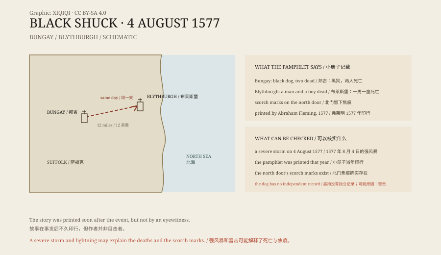

## 一、1577 年的暴风雨

1577 年 8 月 4 日，星期天。

萨福克郡的邦吉镇，人们正在圣玛丽教堂里做礼拜。外面突然变黑，雷声压过祷告声，冰雹砸在窗户上。

就在这时候，教堂的门被撞开了。

## 二、黑狗

传说里，一只巨大的黑狗冲了进来。

它从人群中间跑过，撞倒了几个正在祈祷的人，径直穿过教堂，然后消失。有人被撞伤，两个人当场死亡。

教堂里一片混乱。外面是暴风雨，里面是尸体和尖叫。

同一时刻，十二英里外的布莱斯堡，圣三一教堂也在做礼拜。黑狗又出现了。它从西边跑进来，穿过教堂，从北门出去。一个男人和一个男孩死在它经过的地方。

北门的木板上，留下了几道焦黑的痕迹。

*原创示意图：邦吉与布莱斯堡的位置、事件顺序与记载对照。不是历史地图。稀奇奇编辑部，CC BY-SA 4.0。*

## 三、一本小册子

这件事被写进了一本小册子。

作者是亚伯拉罕·弗莱明，一位神职人员。他在事发后不久出版了《一桩奇异而可怕的怪事》，把邦吉和布莱斯堡的经过记了下来。

弗莱明的写法带着明显的宗教意图。他没有把黑狗当成普通的动物，而是把它解释成上帝对当地人的警告。暴风雨、黑狗、死亡，在他笔下是一连串征兆。

小册子流传开来。黑狗的故事就这样被固定下来，越传越远。

## 四、黑狗是什么

在东盎格利亚，黑狗本来就是一个古老的传说。

人们叫它“黑夏克”，也叫“老沙克”。它被描述成一只大黑狗，眼睛发红，出现在沼泽、路口、教堂和墓园附近。有人说看到它会带来死亡，有人说它只是路过，不会伤人。

邦吉和布莱斯堡的故事，是这些传说里最有名的一件。因为它有日期、有地点、有伤亡，还有一本当时印出来的小册子。

但小册子不是现场记录。弗莱明不在教堂里，他写的是别人告诉他的事。暴风雨、雷击、教堂受损，这些可能是真的；黑狗的形象，则可能是人们在混乱中看到的东西，加上后来的加工。

## 五、可能的解释

最常见的解释是雷击。

那天的暴风雨很强烈，教堂可能被闪电击中，造成人员伤亡和火灾。慌乱中，有人看到一条黑影，或者一条真的狗跑过，于是把它和雷击联系在了一起。

也有人认为，这就是一条被雷声吓疯的狗。还有人认为，故事从一开始就是传说，只是借用了真实的风暴和死亡。

无论哪种解释，都无法完全还原那天下午教堂里发生了什么。留下来的，是死亡记录、小册子，和北门上那几道焦痕。

## 六、现在

布莱斯堡圣三一教堂的北门还在。

门上的焦痕还在，成了当地的一个景点。教堂里挂着说明牌，讲述 1577 年的黑狗。

邦吉的圣玛丽教堂也还在，游客可以进去看。

一只狗跑过教堂，用了不到一分钟。人们讲这个故事，讲了四百多年。

## 东盎格利亚的黑狗

黑狗不是邦吉独有的。

在东盎格利亚的沼泽、海岸和乡间道路上，早就流传着一只巨大的黑狗。人们叫它“黑夏克”“老沙克”，也叫“地狱犬”。它有时独自出现，有时成群；有时只是路过，有时被当成死亡的预告。

这些故事没有统一的形象。有的说它眼睛发红，有的说它没有眼睛；有的说它像小牛一样大，有的说它只有狗那么大。共同点是颜色：黑。

黑狗和风暴、沼泽、十字路口、教堂联系在一起。这些地方在夜里都很吓人，也都容易发生意外。故事把这些地方标成了“危险”。

## 1577 年的小册子

邦吉和布莱斯堡的事件，被写进了一本当时的小册子。

作者亚伯拉罕·弗莱明是一位神职人员。他在事件发生后不久，印出了《一桩奇异而可怕的怪事》，把两座教堂的经过、伤亡和目击者的说法记了下来。小册子的语气很重，通篇都是“警告”“惩罚”“悔改”。

弗莱明没有到过现场。他写的是别人告诉他的事，加上自己的解释。暴风雨、雷击、教堂受损，这些可能是真的；黑狗穿过教堂、留下焦痕，则是故事里最难核实的部分。

## 雷击与焦痕

最常见的解释是雷击。

1577 年 8 月 4 日的暴风雨很强烈。闪电击中教堂，可能造成石雕坠落、木结构起火和人员伤亡。慌乱中，一条被雷声吓疯的狗跑进教堂，也可能被人看成“黑狗”。

布莱斯堡圣三一教堂的北门上，确实有焦黑的痕迹。这些痕迹可能是雷击留下的，也可能是后来火灾或修缮的结果。教堂把它保留下来，作为故事的物证；但物证只能证明门被烧过，不能证明狗来过。

## 为什么是教堂

黑狗故事选择教堂，不是偶然。

在十六世纪的英国，教堂是村庄里最坚固、最公共的建筑。雷击教堂，会被解释成上帝对社区的警告。把一条黑狗放进教堂，比放进谷仓更有冲击力：它越过了最该安全的地方。

弗莱明的小册子也有宗教目的。当时英国正在宗教改革，天主教的旧仪式被废除，新教的神职人员需要证明“神会惩罚不敬”。一场风暴、两条人命、一只黑狗，正好组成一个道德故事。

黑狗的故事没有随风暴结束。它从教堂的北门走出来，走进酒吧、明信片和当地的鬼故事路线。一条被雷声吓坏的狗，最后成了东盎格利亚最持久的形象之一。

邦吉的教堂仍然开放。游客可以走进北门，看见那块被烧过的木头。讲解员会说，这是黑狗留下的；也有人会说，这是闪电留下的。两种说法共用同一块木头。

---

**来源与许可**：本文的事实来源见条目底部来源台账 S1–S3。文字与原创示意图采用 CC BY-SA 4.0。文中把 1577 年的风暴、教堂伤亡、小册子记载与黑狗传说分开叙述；事件本身缺乏独立记录，雷击是常见解释，但不能完全证实。
