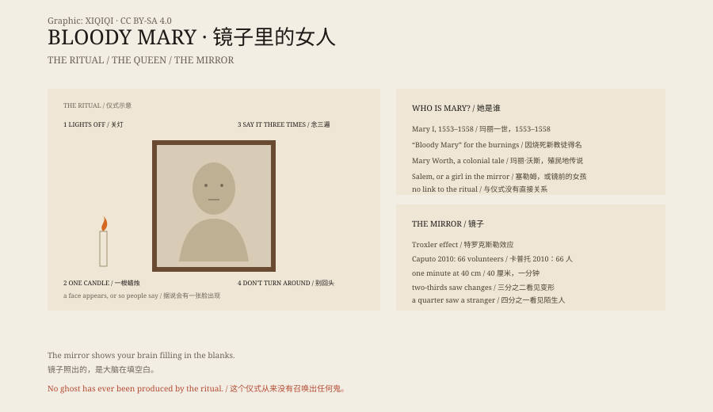

## 1. The Bathroom

Lights off. One candle. Stand in front of the mirror.

Look into your own eyes and say "Bloody Mary" three times.

It is one of the most common sleepover games in the English-speaking world. Versions vary: three times or thirteen; turn around once; a face appears and scratches you, or pulls you through.

No one has actually been pulled through. But many people say they saw something.

## 2. Who Was Mary?

The name "Bloody Mary" most readily brings to mind Mary I of England.

Mary reigned from 1553 to 1558. She restored Catholicism and burned several hundred Protestants, earning the nickname "Bloody Mary".

But she has no direct connection to the mirror game. Historians have found no evidence linking the queen to a bathroom ritual.

Another candidate is Mary Worth, a woman said to have been executed for witchcraft in colonial America. That story has no reliable source either.

Others say she was a victim of the Salem witch trials, or a girl who died in front of a mirror. The name is the same; the stories are not.

## 3. The Mirror Game

The first printed records of the mirror game appear only in the 1970s.

In 1976 an American anthology of children's folklore included the Mary Worth story. In 1978 the folklorist Janet Langlois wrote an academic paper on the ritual.

From there it spread through summer camps, dormitories and birthday parties, becoming one of the best-known "summoning" games in English.

## 4. Why Something Appears

If you stare at your own reflection in a dim room for a minute, your face will probably begin to change.

In 2010 the Italian psychologist Giovanni Caputo ran an experiment. He seated sixty-six volunteers about forty centimetres from a mirror and asked them to look at their own faces for one minute. About two-thirds reported significant distortions; more than a quarter saw the face of an unfamiliar person.

One cause is the Troxler effect: when an image in the periphery of vision stays unchanged, the brain stops registering it. Parts of the face fade, and the brain fills the gaps with something else.

Dim light, a flickering candle, tension and expectation make the effect stronger.

You have not summoned a ghost. You have seen your own brain filling in the blanks.

## 5. Why It Survives

The game delivers several things at once: it is cheap, needing only a mirror and a dark room; it feels like a ritual; it carries a risk that is small enough to enjoy; and it can be performed with friends and used to scare one another.

It is also a very good container for stories. Every school can add its own version: she wears red, she carries scissors, she counts to thirteen.

The real Bloody Mary was a queen in history. The one in the mirror was made by storytellers.

*Original schematic: the common steps of the mirror ritual, Mary I, and the psychological explanation of the mirror illusion. Not a photograph of a ritual. Oddity Archive, CC BY-SA 4.0.*

---

**Sources and licenses**: the factual sources are listed in the source ledger S1–S4 at the bottom of this entry. Text and original diagrams are licensed under CC BY-SA 4.0. This article separates the ritual versions, the historical figures, the folklore record and the psychological explanation; the mirror game has no supernatural evidence, and the distortions can be explained by the Troxler effect and the brain's filling-in. The illustration is a scene reconstruction, not a photograph of a ritual.
