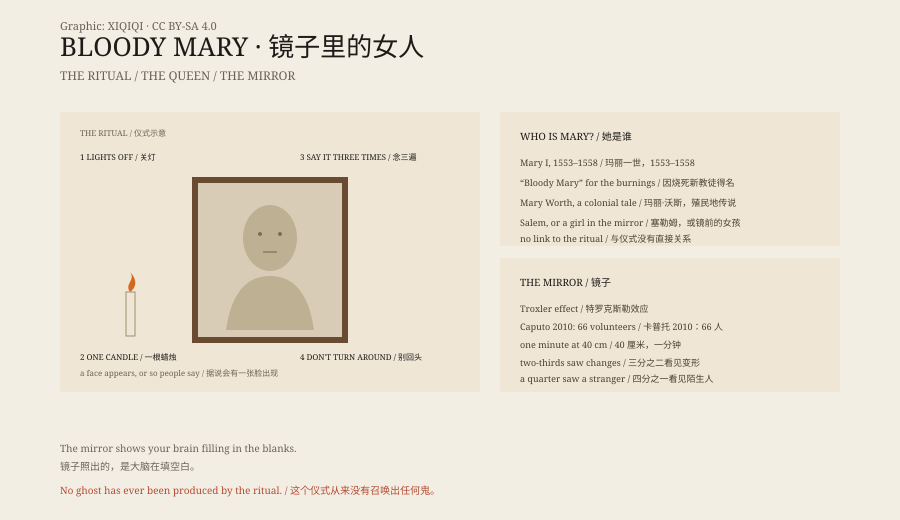

## 1. The Bathroom

Lights off. One candle. Stand in front of the mirror.

Look into your own eyes and say "Bloody Mary" three times.

It is one of the most common sleepover games in the English-speaking world. Versions vary: three times or thirteen; turn around once; a face appears and scratches you, or pulls you through.

No one has actually been pulled through. But many people say they saw something.

## 2. Who Was Mary?

The name "Bloody Mary" most readily brings to mind Mary I of England.

Mary reigned from 1553 to 1558. She restored Catholicism and burned several hundred Protestants, earning the nickname "Bloody Mary".

But she has no direct connection to the mirror game. Historians have found no evidence linking the queen to a bathroom ritual.

Another candidate is Mary Worth, a woman said to have been executed for witchcraft in colonial America. That story has no reliable source either.

Others say she was a victim of the Salem witch trials, or a girl who died in front of a mirror. The name is the same; the stories are not.

## 3. The Mirror Game

The first printed records of the mirror game appear only in the 1970s.

In 1976 an American anthology of children's folklore included the Mary Worth story. In 1978 the folklorist Janet Langlois wrote an academic paper on the ritual.

From there it spread through summer camps, dormitories and birthday parties, becoming one of the best-known "summoning" games in English.

## 4. Why Something Appears

If you stare at your own reflection in a dim room for a minute, your face will probably begin to change.

In 2010 the Italian psychologist Giovanni Caputo ran an experiment. He seated sixty-six volunteers about forty centimetres from a mirror and asked them to look at their own faces for one minute. About two-thirds reported significant distortions; more than a quarter saw the face of an unfamiliar person.

One cause is the Troxler effect: when an image in the periphery of vision stays unchanged, the brain stops registering it. Parts of the face fade, and the brain fills the gaps with something else.

Dim light, a flickering candle, tension and expectation make the effect stronger.

You have not summoned a ghost. You have seen your own brain filling in the blanks.

## 5. Why It Survives

The game delivers several things at once: it is cheap, needing only a mirror and a dark room; it feels like a ritual; it carries a risk that is small enough to enjoy; and it can be performed with friends and used to scare one another.

It is also a very good container for stories. Every school can add its own version: she wears red, she carries scissors, she counts to thirteen.

The real Bloody Mary was a queen in history. The one in the mirror was made by storytellers.

*Original schematic: the common steps of the mirror ritual, Mary I, and the psychological explanation of the mirror illusion. Not a photograph of a ritual. Oddity Archive, CC BY-SA 4.0.*

## Mary I

The moniker “Bloody Mary” originates from the English monarch Mary I. She ascended to the throne in 1553 and died in 1558. During her reign, she restored Catholicism and violently suppressed Protestantism, leading to the execution of several hundred Protestants. Later propaganda amplified that figure, cementing “Bloody Mary” as a political nickname. Contrary to the myth, the queen has no connection to the mirror‑game; the practice of appropriating her name for a séance dates to the twentieth century. A historical figure lent her a dramatic, bloody name that proved ideal for fright.

## Mary Woss

Another frequently cited name is “Mary Woss.” According to various accounts, she was a colonial‑era woman who either was executed for witchcraft or died in front of a mirror due to a disfigurement. The story shifts under different timelines, spellings, and accusations. In 1978, folklorist Janet Langloua published a paper tracing the spread of the Mary Woss legend in summer camps and on campuses, noting that the tale lacks a fixed historical basis. The name first emerged; the narrative then filled in to accommodate it.

## The Face in the Mirror

Staring at a mirror for a minute can genuinely alter one’s appearance. One explanation is the Troxler effect: images at the periphery of vision that remain unchanged for a prolonged period are ignored by the brain. Certain facial features fade, and the brain reconstructs the missing parts into a new shape. Dim lighting, flickering candlelight, tension, and anticipation exacerbate this completion, making the changes seem exaggerated.

## Why the Game Works

The mirror‑game succeeds for several pragmatic reasons.

* It’s inexpensive: all you need is a mirror, a candle, and a dark room.
* It carries ritualistic weight—reciting a line three times, turning once, turning off the light—making each step feel purposeful.
* The danger is minimal but tangible.
* Friends can participate, taking turns to scare one another.

Moreover, the game is highly adaptable. Each school can add its own twists: a red dress, a pair of scissors, counting to thirteen, or refusing to light the lamp. The more variants, the more authentic the story feels.

The original Bloody Mary was a historical monarch; the one you see in the mirror is a creation of players, camps, and online communities. Thus, the woman in the glass is not a fixed apparition. She is a placeholder onto which each participant projects their own fears—whether it's darkness, a distorted face, or a lurking presence behind them. The mirror simply amplifies those anxieties for a brief moment.

The game’s greatest power lies in its lack of requirement for belief. Stand before the mirror, recite the lines, and leave the rest to the darkness. Even if nothing manifests, the minute you experience it is unforgettable.

## Additional Notes

It should be noted that the ritual varies widely across schools and countries. Some versions call for the lights to be turned off, others for a candle to be lit, some require midnight, and others simply an inky bathroom. The name also shifts—sometimes “Bloody Mary,” sometimes “Mary Woss,” sometimes a nameless woman. The sheer variety underscores that the legend is not a fixed ghost but a game that localizes itself.

---

**Sources and licenses**: the factual sources are listed in the source ledger S1–S4 at the bottom of this entry. Text and original diagrams are licensed under CC BY-SA 4.0. This article separates the ritual versions, the historical figures, the folklore record and the psychological explanation; the mirror game has no supernatural evidence, and the distortions can be explained by the Troxler effect and the brain's filling-in. The illustration is a scene reconstruction, not a photograph of a ritual.
