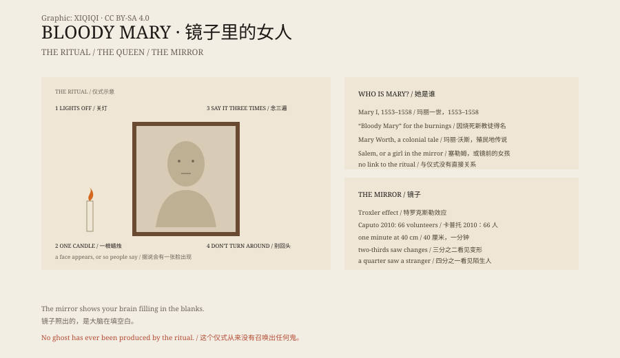

## 一、浴室

关灯，点一根蜡烛，站在镜子前。

看着自己的眼睛，念三遍“Bloody Mary”。

这是英语世界里最常见的宿舍游戏之一。版本很多：有的说念三遍，有的说念十三遍；有的要转一圈；有的说镜子里会出现一张脸，抓破你的脸，或者把你拖进去。

没有人真的被拖进去。但很多人说，他们看见了什么。

## 二、她是谁

“Bloody Mary”这个名字，最容易让人想到英格兰女王玛丽一世。

玛丽一世 1553 年到 1558 年在位。她恢复天主教，烧死了几百名新教徒，因此被叫做“血腥玛丽”。

但她和镜子游戏没有直接关系。历史学家找不到把女王和浴室仪式联系起来的证据。

另一个候选人是“玛丽·沃斯”（Mary Worth），一个据说在殖民地时期因为巫术被处死的女人。这个故事也没有可靠来源。

还有人说，她是塞勒姆女巫审判的受害者，或者是一个在镜子前死去的女孩。名字一样，故事不一样。

## 三、镜子游戏

镜子游戏的文字记录，要到 1970 年代才出现。

1976 年，一本美国儿童民俗选集收录了“玛丽·沃斯”的故事。1978 年，民俗学家珍妮特·朗格卢瓦写了关于这个仪式的论文。

从那以后，它从夏令营、女生宿舍和生日聚会传开，变成了英语世界最著名的“召灵”游戏之一。

## 四、镜子里为什么有东西

如果你在昏暗的房间里盯着镜子里的自己看一分钟，很可能会看到脸变形。

2010 年，意大利心理学家乔瓦尼·卡普托做了一个实验。他让 66 名志愿者坐在离镜子 40 厘米的地方，盯着自己的脸看一分钟。大约三分之二的人说，他们的脸发生了明显变化；超过四分之一的人说，他们看见了一张陌生人的脸。

原因之一是“特罗克斯勒效应”：当视野边缘的图像长时间不变，大脑会把它忽略掉。脸的一部分消失，剩下的部分被大脑补成别的形状。

昏暗的光线、蜡烛的闪动、紧张和期待，会让这个过程更明显。

你没有召唤出鬼。你看见的是自己的大脑在填空白。

## 五、为什么还在传

镜子游戏满足了几件事：它便宜，只需要一面镜子和一个黑暗的房间；它有仪式感；它有风险，但风险很小；它可以和朋友一起做，然后互相吓唬。

它也是一个很好的故事容器。每一所学校都可以往里加自己的版本：她穿红衣服，她拿着剪刀，她数到十三。

真正的血腥玛丽，是历史里的女王。镜子里的那一个，是讲故事的人造出来的。

*原创示意图：镜子仪式的常见步骤、玛丽一世与镜中错觉的科学解释。不是现场照片。稀奇奇编辑部，CC BY-SA 4.0。*

---

**来源与许可**：本文的事实来源见条目底部来源台账 S1–S4。文字与原创示意图采用 CC BY-SA 4.0。文中把仪式版本、历史人物、民俗记录与心理学解释分开叙述；镜子游戏没有超自然证据，镜中变形可以用特罗克斯勒效应和大脑补全解释。插图是场景复原，不是现场照片。
