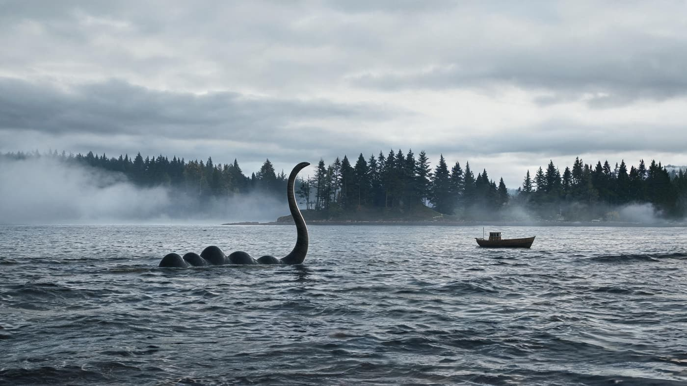
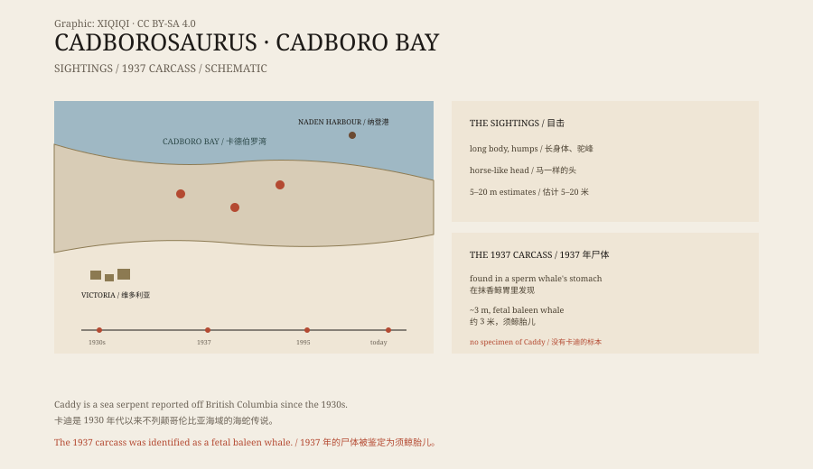

## 1. Cadboro Bay

Cadboro Bay is in British Columbia, Canada, near Victoria.

In the 1930s, local sailors and fishermen began reporting something strange in the bay: a long body, a dark back, and now and then a neck and head breaking the surface.

Mornings in the bay were often foggy. A sailor would see a neck rise, then sink, leaving only a ring on the water.

The newspapers gave it a name: “Cadborosaurus”, or “Caddy”.

*Reconstruction: the long-necked creature in Cadboro Bay in the 1930s. Not a photograph of a sighting. XIQIQI Editorial, CC BY-SA 4.0.*

## 2. The description

Witnesses did not all describe the same thing, but they shared some features.

It had a long body, like a snake or an eel. Its back had several humps, like a camel. Its head was like a horse's or a camel's, on a long neck. Some saw flippers; some saw the body arch in several curves.

Estimates of its size ranged from five to twenty metres.

## 3. The 1937 carcass

October 1937, the Naden Harbour whaling station.

Workers cutting up a sperm whale found a curled carcass in its stomach. It was about three metres long, with a slender body, a small head, and a pair of flippers.

The stomach had digested half of it. The carcass was curled, the skin pale, the shape unlike a living animal.

They photographed it. In the photographs, it did look like a small sea serpent.

Part of the carcass was sent to the provincial museum in Victoria. The director, Francis Kermode, examined it and concluded that it was a fetal baleen whale. A whale fetus, half digested in the stomach, can take on a very strange shape.

*Original schematic: the Cadboro Bay sightings and the 1937 Naden Harbour carcass and identification. Not a photograph. XIQIQI Editorial, CC BY-SA 4.0.*

## 4. The name

The name “Cadborosaurus” dates from the 1930s.

In 1995, two researchers proposed that, if the animal existed, it should have the scientific name “Cadborosaurus willsi”. But the name has no specimen behind it and has not been formally accepted by the zoological nomenclature commission.

Without a holotype, there is no species.

A name can be coined. A specimen cannot.

## 5. What it might have been

The most common explanation is misidentification.

Reflections, seaweed, driftwood, breaching whales, and sea lions can all look like a long-necked monster at a distance. A humpback whale showing part of its back can look like several humps and a head.

The 1937 carcass is best explained as a whale fetus. Its “long neck” and “small head” were the result of partial digestion in the stomach.

Others have suggested a sea snake, a giant eel, or an escaped aquarium animal. But no specimen proves any of it.

## 6. Now

Today there is no photograph, skeleton, or body of Caddy.

The name survives in books, on websites, and in the coastal legends of Vancouver Island. Occasionally someone stands by the sea for a long time, hoping to see that long neck break the surface.

The sea is large enough to hold many stories. Caddy is one of them.

## 1930s Newspapers

The name “Caddy” was coined by the press. In the 1930s, newspapers on Vancouver Island and mainland Victoria began reporting on a “sea serpent” in the Gulf. They labeled it Cadborosaurus, which readers soon shortened to Caddy. This type of tale—local, mysterious, requiring no hard evidence, and able to attract tourists—loved the papers.

Witnesses were mostly mariners, fishermen, and boaters. Their long years at sea meant they’d seen whales, seals, seaweed, and driftwood. Yet glare, distance, and fatigue could make a snapped neck appear as a creature.

## The 1937 Body

In October 1937, at a whaling station in Naden Harbour, workers discovered a curled carcass inside the stomach of an orca. It measured about three metres, slender, with a small head and a pair of fins. A photograph of it found its way into the papers, and for a moment it did look like a little sea serpent.

The provincial museum curator, Francis Keamode, examined it and identified it as a juvenile sperm whale. A fetus swallowed by a whale can be digested, compressed, and distorted—longer neck, smaller head, paler skin—producing a silhouette that could be mistaken for a mythic creature. The explanation did not silence the tale; instead it added another layer: a picture and two interpretations.

## Scientific Name

In 1995, two researchers proposed that, if Caddy truly existed, it should bear a Latin binomen: *Cadborosaurus willsi*. Without a type specimen—no physical skeleton, no tissue that could yield DNA—any proposed name remains just a suggestion. The International Commission on Zoological Nomenclature did not accept it, and later scholars have treated it as an informal label rather than a valid species.

A name can be coined before a specimen exists, but the specimen must exist before the name can be formally adopted. The crux of the Caddy debate is not the absence of a name but the lack of evidence.

## Misidentifications on the Surface

Most Caddy sightings can be explained by ordinary sea‑surface phenomena. A seal’s neck as it surfaces can resemble a long‑necked animal; a sea otter swimming upside‑down might look like a sliver of dark wood; a whale’s arched back can appear as a series of humps; drifting seaweed and floating timber can give the impression of movement.

The 1937 carcass, the most plausible explanation being a whale fetus, neither proves Caddy’s existence nor discredits all prior sightings. It simply illustrates that an image resembling a sea monster could arise from a drowned whale.

The story of Caddy continues to the present. Reports of “long‑snouted” creatures persist on the coast of British Columbia, at Wena Bean Lake, and in Okanagan Lake, using the same vocabulary—humps, necks, black silhouettes. What they share is the same fundamental problem: no specimen.

Caddy never entered the scientific literature, but it entered place names and tourist guides. There are still vessels and shops on Victoria’s waterfront named after it. An uncaptured animal has become a brand.

## Supplementary Notes

The most valuable parts of Caddy’s dossier are not the conclusion that it exists but the precise locations of the sightings: Victoria Harbour, Naden Harbour, the British Columbian coast. These coordinates pin an unsubstantiated creature onto an actual map. Future researchers may follow them to either investigate or remain skeptical.

Finally, most reports of Caddy lack detailed coordinates and weather records, making it hard for later scholars to revisit sites or exclude familiar explanations such as seals, seaweed, or wave action. The coarse nature of the evidence is itself part of the story.

---

---

**Sources and licenses**: the factual sources are listed in the source ledger S1–S3 at the bottom of this entry. Text and original diagrams are licensed under CC BY-SA 4.0. This article separates the sighting descriptions, the 1937 carcass, the naming, and the possible explanations; the Naden Harbour carcass was identified by the museum as a fetal baleen whale, and there is no reliable specimen or photograph of Caddy.
