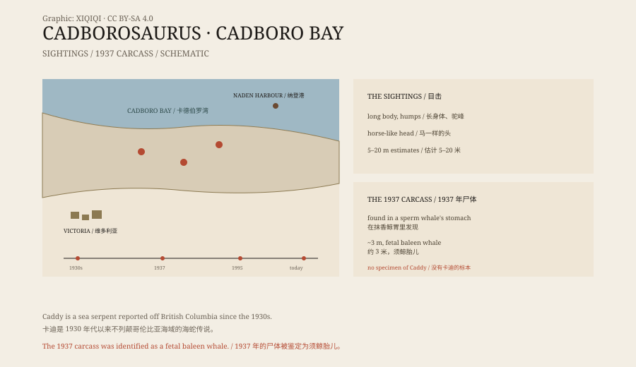

## 1. Cadboro Bay

Cadboro Bay is in British Columbia, Canada, near Victoria.

In the 1930s, local sailors and fishermen began reporting something strange in the bay: a long body, a dark back, and now and then a neck and head breaking the surface.

The newspapers gave it a name: “Cadborosaurus”, or “Caddy”.

## 2. The description

Witnesses did not all describe the same thing, but they shared some features.

It had a long body, like a snake or an eel. Its back had several humps, like a camel. Its head was like a horse's or a camel's, on a long neck. Some saw flippers; some saw the body arch in several curves.

Estimates of its size ranged from five to twenty metres.

## 3. The 1937 carcass

October 1937, the Naden Harbour whaling station.

Workers cutting up a sperm whale found a curled carcass in its stomach. It was about three metres long, with a slender body, a small head, and a pair of flippers.

They photographed it. In the photographs, it did look like a small sea serpent.

Part of the carcass was sent to the provincial museum in Victoria. The director, Francis Kermode, examined it and concluded that it was a fetal baleen whale. A whale fetus, half digested in the stomach, can take on a very strange shape.

*Original schematic: the Cadboro Bay sightings and the 1937 Naden Harbour carcass and identification. Not a photograph. Oddity Archive, CC BY-SA 4.0.*

## 4. The name

The name “Cadborosaurus” dates from the 1930s.

In 1995, two researchers proposed that, if the animal existed, it should have the scientific name “Cadborosaurus willsi”. But the name has no specimen behind it and has not been formally accepted by the zoological nomenclature commission.

Without a holotype, there is no species.

## 5. What it might have been

The most common explanation is misidentification.

Reflections, seaweed, driftwood, breaching whales, and sea lions can all look like a long-necked monster at a distance. A humpback whale showing part of its back can look like several humps and a head.

The 1937 carcass is best explained as a whale fetus. Its “long neck” and “small head” were the result of partial digestion in the stomach.

Others have suggested a sea snake, a giant eel, or an escaped aquarium animal. But no specimen proves any of it.

## 6. Now

Today there is no photograph, skeleton, or body of Caddy.

The name survives in books, on websites, and in the coastal legends of Vancouver Island. Occasionally someone stands by the sea for a long time, hoping to see that long neck break the surface.

The sea is large enough to hold many stories. Caddy is one of them.

---

**Sources and licenses**: the factual sources are listed in the source ledger S1–S3 at the bottom of this entry. Text and original diagrams are licensed under CC BY-SA 4.0. This article separates the sighting descriptions, the 1937 carcass, the naming, and the possible explanations; the Naden Harbour carcass was identified by the museum as a fetal baleen whale, and there is no reliable specimen or photograph of Caddy.
