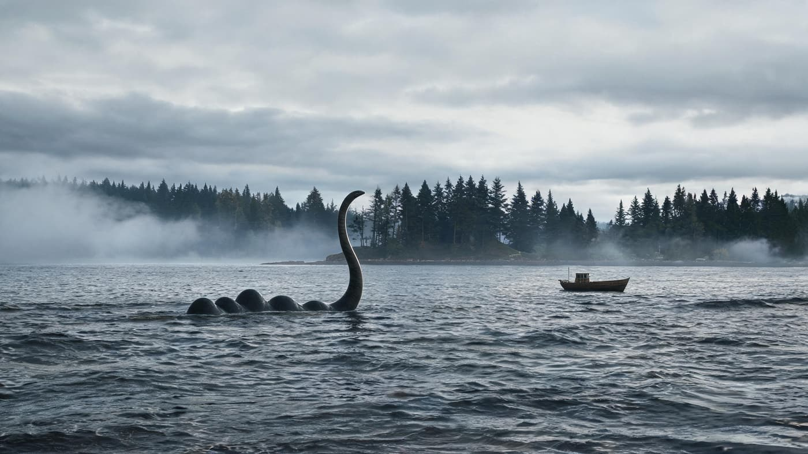
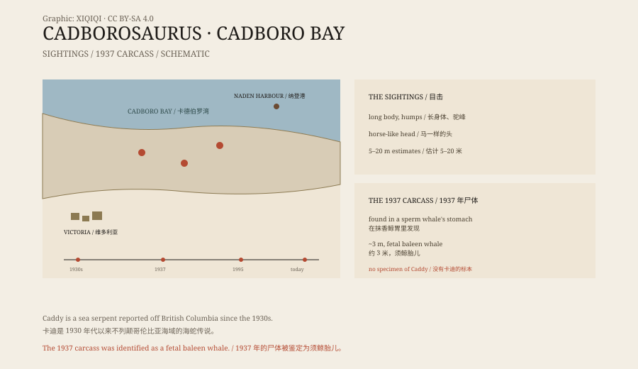

## 一、卡德伯罗湾

卡德伯罗湾在加拿大不列颠哥伦比亚省，靠近维多利亚。

1930 年代，当地的水手和渔民开始报告，说湾里有一条奇怪的东西：长长的身体，黑色的背，偶尔露出水面的脖子和头。

海湾的早晨常有雾。水手看见水面露出一截脖子，又沉下去，只留下一个圈。

报纸给它起了个名字：“卡德伯罗龙”，简称“卡迪”。

*场景复原：1930 年代卡德伯罗湾中的长颈海怪。不是目击照片。稀奇奇编辑部，CC BY-SA 4.0。*

## 二、描述

目击者的描述不完全一样，但有一些共同点。

它有一条很长的身体，像蛇，也像鳗鱼。背上有几个隆起，像驼峰。头像马，或者像骆驼，脖子很长。有人看到它有鳍，有人看到它把身体弯成几道弧。

体型估计从五米到二十米不等。

## 三、1937 年的尸体

1937 年 10 月，纳登港的捕鲸站。

工人在一条抹香鲸的胃里，发现了一具蜷缩的尸体。它大约三米长，有一条细长的身体，一个小脑袋，还有一对鳍。

胃里的东西已经消化了一半。尸体蜷着，皮肤发白，形状和活着的动物不一样。

他们拍了照片。照片里的东西，看起来确实像一条小海蛇。

尸体的一部分被送到维多利亚的省博物馆。馆长弗朗西斯·凯莫德看过后，认为这是一头须鲸的胎儿。鲸鱼的胎儿在胃里被消化了一半，形状会变得很奇怪。

*原创示意图：卡德伯罗湾的目击、1937 年纳登港尸体与鉴定。不是目击照片。稀奇奇编辑部，CC BY-SA 4.0。*

## 四、名字

“卡德伯罗龙”这个名字，是 1930 年代起的。

1995 年，两位研究者提出，如果这种动物真的存在，应该给它一个学名：“Cadborosaurus willsi”。但这个学名没有标本支持，也没有被动物命名委员会正式接受。

没有正模标本，就没有物种。

名字可以先起，标本不能先有。

## 五、可能是什么

最常见的解释是：看错了。

海面反光、海藻、漂木、跃出水面的鲸鱼、海狮，都可能在远处看起来像一条长脖子的怪物。一头弓背的鲸鱼，露出水面的部分，确实像几个驼峰加一个头。

1937 年的尸体，最合理的解释是鲸鱼胎儿。它的“长脖子”和“小头”，是尸体被胃液消化后变形的结果。

也有人说是海蛇、巨型鳗鱼，或者从水族馆逃出来的动物。但没有一件标本能证明。

## 六、现在

今天，没有卡迪的照片、骨骼或尸体。

它的名字还留在书里、网站上，以及温哥华岛的海边传说里。偶尔有人在海边站很久，希望能看到那个长脖子露出水面。

海很大，能装下很多故事。卡迪是其中一个。

---

**来源与许可**：本文的事实来源见条目底部来源台账 S1–S3。文字与原创示意图采用 CC BY-SA 4.0。文中把目击描述、1937 年尸体、命名与可能解释分开叙述；纳登港尸体被博物馆鉴定为须鲸胎儿，卡迪没有可靠的标本或照片。
