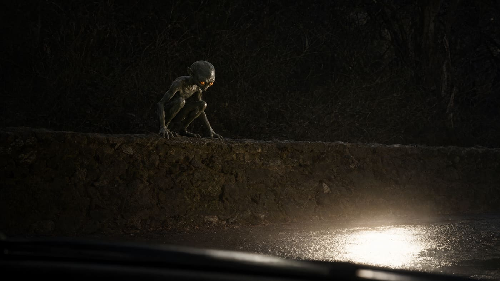
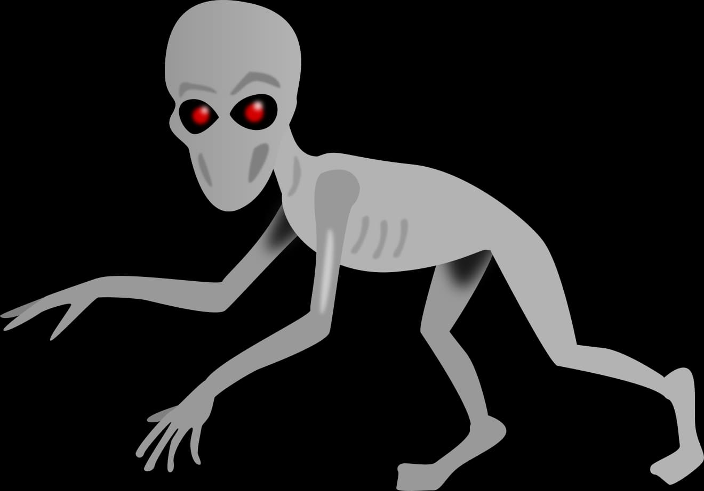
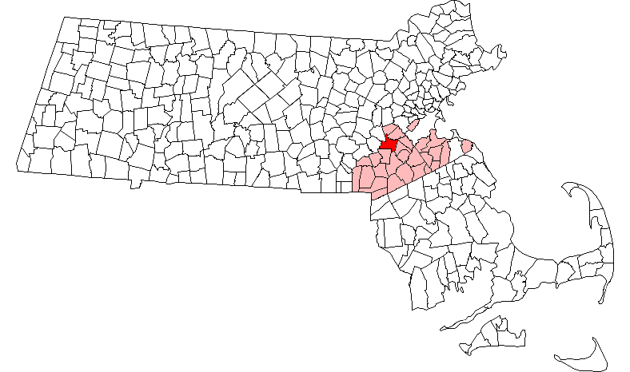
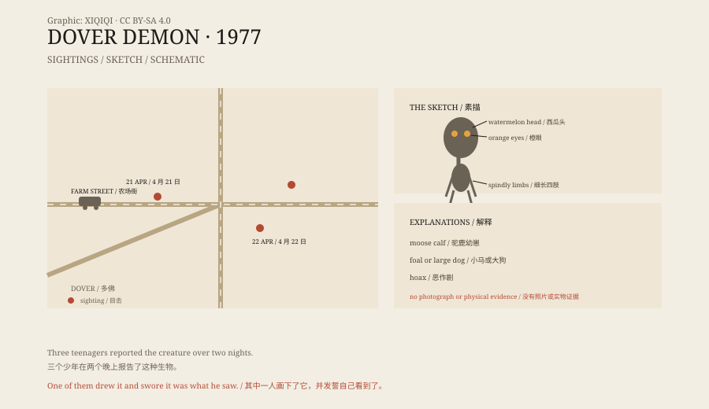
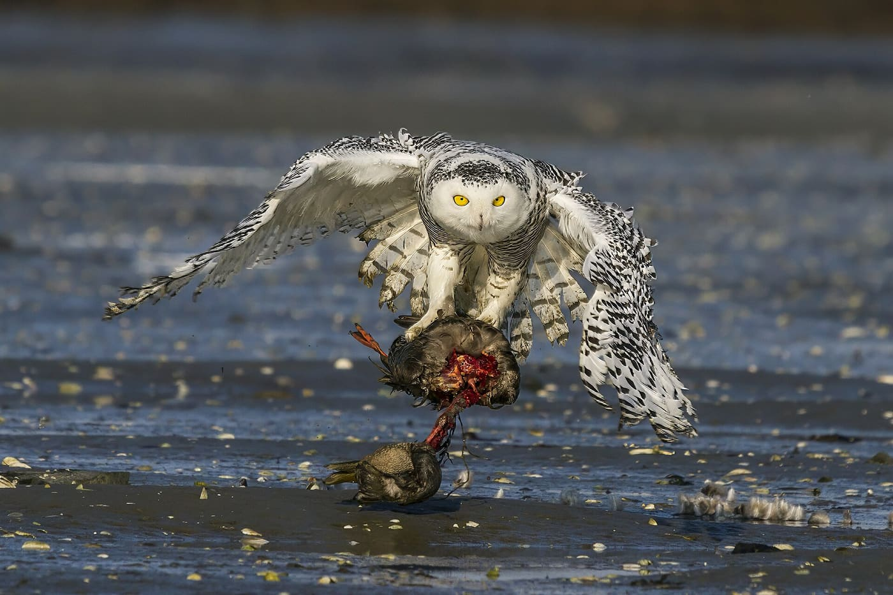

## 1. The stone wall on Farm Street

Night, 21 April 1977. Farm Street, Dover, Massachusetts. Seventeen-year-old Bill Bartlett is driving with two friends.

The headlights sweep a low, broken fieldstone wall at the roadside, and something is perched on it. The April night is still cold; the lit asphalt looks pale, and the grass behind the wall is uncut. Bartlett's later description: about four feet tall, a head shaped like a watermelon, no visible nose or mouth, eyes glowing orange. Limbs out of all proportion, thin as sticks.

The car passes. He turns back. The wall is empty.

*Reconstruction: an imagined night view of Farm Street in April 1977 — headlights, the stone wall, a crouched figure. Not a photograph of a sighting. Oddity Archive, CC BY-SA 4.0.*

## 2. A drawing, and a stack of Bibles

Home again, Bartlett draws it from memory: thin neck, long arms, splayed fingers, crouched. Beside the drawing he writes: "I, Bill Bartlett, swear on a stack of Bibles that I saw this creature." Swearing on a stack of Bibles was the heaviest oath format a 1970s American teenager could reach for; it weights the attitude, not the evidence.

He was not the only one with a pencil. The other two witnesses each produced sketches of their own. The three drawings do not coincide: pose, proportion and eye colour each go their own way. The "standard image" that later circulates is a compromise between the three, redrawn again and again by illustrators and film — including the one used in this article. The evidence never grew; the image grew more certain.

*Illustration: Di, CC BY-SA 4.0 (Wikimedia Commons), drawn in 2023 after the reported descriptions; not a photograph of a sighting. The witnesses never agreed on the eye colour.*

*Map: municipalities of Massachusetts, Norfolk County in pale red, Dover in dark red. CC BY-SA 3.0 (Wikimedia Commons).*

## 3. Three roads, one straight line

The same evening, fifteen-year-old John Baxter sees something similar standing at the roadside on Miller Hill Road. His eyes differ again: a colourless glow, or no colour he can name.

The next night, fifteen-year-old Abby Brabham, in a car on Springdale Avenue, sees it on all fours, hairless, eyes glowing green.

Orange, white, green. The three teenagers know each other, yet their accounts cannot agree on a colour. A local paper later plots the three sighting points on a map: they fall almost on a straight line, running more than two miles.

Police take statements. No footprints, no hair, no physical trace of any kind. All three witnesses are local secondary-school pupils who know each other; that fact supports both the "collusion" suspicion and the "independent descriptions converging" reading — the two readings use the same set of facts.

*Original schematic: the three sighting points, times and description differences of 21–22 April 1977. Not a survey map. Oddity Archive, CC BY-SA 4.0.*

## 4. It only reaches the press in May

The story does not travel at once. Reports appear only in the first half of May. On 16 May 1977 the Associated Press quotes Dover police: the descriptions were "probably nothing more than a school vacation hoax."

Cryptozoologist Loren Coleman says at the time that the figure reminds him of the Kelly–Hopkinsville case of 1955 in Kentucky — another family, another set of small, big-eyed, floating things. Nobody reports a UFO, yet organisations like MUFON investigate anyway; a 2005 Milford Daily News retrospective says the case bears a striking resemblance to reports of such creatures at sites of UFO activity. When the Boston Globe revisits the case in 2006, the map joining the three sighting points into a straight line becomes the standard fixture of every retelling after it.

## 5. A snowy owl, a foal, a moose calf

The skeptics' shortlist is plain: a foal, a moose calf, or a snowy owl.

Joe Nickell leans toward the owl: yellow headlights of older cars on white plumage could throw back the peach-orange Bartlett reported, and the "long spindly arms and fingers" may be a half-opened wing with the feathers splayed at its tip.

*Site photograph: 28 December 2013, Chuck Homler / Focus On Wildlife, CC BY-SA 3.0 (Wikimedia Commons). A snowy owl with prey; Nickell suggests the splayed wingtip feathers could be misread as "spindly fingers".*

Brian Dunning does not accept it. His objection is blunt: granted, an owl in the right conditions might fool one person, "but if it happened to four people in town in just 24 hours, it must be a very compelling illusion. Yet the illusion never fooled anyone, ever, before or since."

Ben Radford points to another influence: 1977 is the year of Star Wars and Close Encounters of the Third Kind. His mechanism is specific: the aliens on screen have just defined what "big head, thin limbs, glowing eyes" should look like, and night-time sightings lean toward that shape. Dunning discounts at least the latter — the film opened a full eight months after the sightings.

Zoom out and this "owl list" has other names on it: the small beings of Kelly–Hopkinsville in 1955 were proposed as great horned owls, the Flatwoods monster of 1952 as a barn owl, West Virginia's Mothman as a barred owl. Every case has someone proposing an owl, and every case has someone refusing it.

Dunning states his own position plainly: "I'm not calling the kids liars. Nothing unusual having happened is simply our null hypothesis, our default assumption, in the lack of any compelling evidence to the contrary. The alternatives all range from illogical to completely implausible."

## 6. The shape of the evidence

Lay the evidence out: three statements, three drawings, one straight line on a map, zero physical traces. Statements contaminate each other, drawings imitate each other, and a straight line can be coincidence — New England's road network already strings several towns along one line. The only thing that cannot contaminate each other is physical evidence, and physical evidence is zero.

## 7. It leaves only three drawings

Later it moves into television and comics: a 2009 episode of Lost Tapes, appearances in Proof and The Perhapanauts, a crustacean alien in Dandadan. The image hardens with each retelling; the evidence never grows by a single item.

No photograph, no specimen, no footprint. The stone wall on Farm Street is still there, and the oath on the drawing paper is still there. A thing seen by three people, drawn by three people, and then gone from every road — that fact is harder to explain than what the thing was.

---

**Sources and licenses**: factual sources are in the ledger S1–S5 below. Text and original schematics are CC BY-SA 4.0. The illustration, locator map and snowy-owl photograph are credited Wikimedia Commons works, licenses in the ledger; the reconstruction is not a photograph of a sighting. The Dover Demon has no photographic or physical evidence; misidentified animals, hoax and cultural influence are all possible explanations, and this article does not choose between them for the reader.