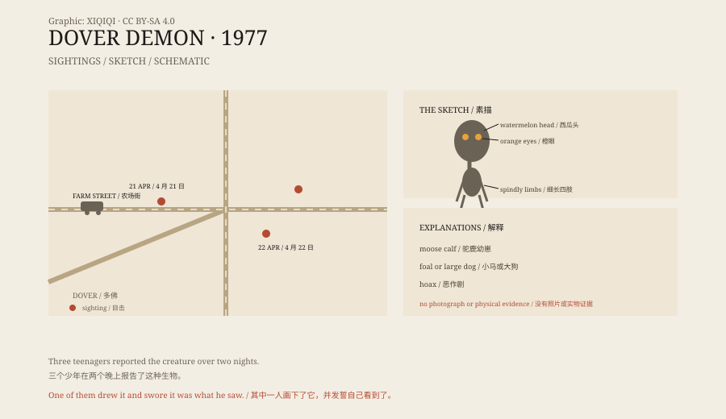

## 一、4 月 21 日

1977 年 4 月 21 日，晚上十点半左右。

马萨诸塞州多佛镇，农场街。十七岁的比尔·巴特利特开着车，车上有两个朋友，安迪·布罗迪和艾比·布拉巴姆。

巴特利特说，他看到路边的石墙上有一个东西。它蹲在那里，身体很瘦，头很大。车灯照过去，它的眼睛反出橙色的光。

车开过去之后，他掉头回来，那个东西已经不在了。

## 二、描述

巴特利特回家后，凭记忆画了一张素描。

画里的生物大约三到四英尺高。头像一个西瓜，脖子很细，身体是长条形的，四肢又细又长。眼睛是圆的，发橙光。没有明显的嘴和耳朵。皮肤像湿沙纸。

他在画的下方写了一句话：“我，比尔·巴特利特，对着《圣经》发誓，我看到过这个生物。”

这张画，后来成了“多佛恶魔”的标准形象。

*原创示意图：多佛镇的目击地点、时间线与形象特征。不是目击照片。稀奇奇编辑部，CC BY-SA 4.0。*

## 三、第二天

第二天晚上，也就是 4 月 22 日夜里，又有人看到了它。

十五岁的约翰·巴克斯特说，他在回家的路上看到一个类似的生物，站在路边。同一天夜里，艾比·布拉巴姆也说，她在车里看到了一个有大头和橙眼睛的东西。

三个目击者彼此认识，都是当地的中学生。他们的描述不完全一样，但核心特征相同：大头、细身体、橙色的眼睛。

警察做了记录，但没有找到脚印、毛发或其他物证。

## 四、名字

“多佛恶魔”这个名字，是后来起的。

美国神秘动物学家洛伦·科尔曼在调查这个案子时，用了这个称呼。他把它写进书里，名字就传开了。

“恶魔”这个词有点夸张。目击者没有说它有角、有尾巴，或者伤害过谁。它只是站在路边，看了他们一眼，然后消失。

## 五、可能是什么

最常见的解释是：一只动物。

有人说是一只驼鹿幼崽。驼鹿的腿很长，头很大，站在路边，从车里看，比例确实奇怪。也有人说是小马、大丹犬，或者一只被车灯吓到的鹿。

另一种可能是恶作剧。三个少年互相认识，画和描述之间可能互相影响。但巴特利特当时确实很害怕，他的父亲也证实了这一点。

还有一种说法是，目击者看到的是一个人穿着道具服。但没有人找到道具，也没有人承认。

## 六、现在

今天，没有多佛恶魔的照片，也没有它的标本。

那张素描还在，被印在书、杂志和网站的图片里。多佛镇没有为它立牌，也没有博物馆。

故事发生在三条路交叉的地方，前后不过几天。它没有留下尸体，也没有留下脚印，只留下了一张画和一个名字。

---

**来源与许可**：本文的事实来源见条目底部来源台账 S1–S3。文字与原创示意图采用 CC BY-SA 4.0。文中把目击经过、形象描述、后续报告与可能解释分开叙述；多佛恶魔没有照片或实物证据，动物误认和恶作剧都是可能解释。
