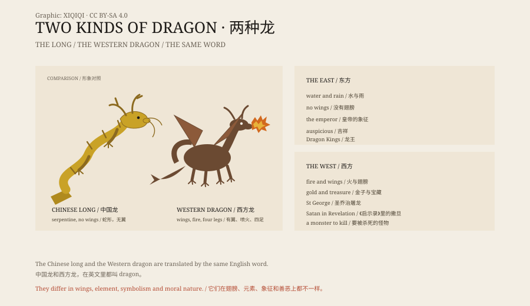

## 1. Two kinds of dragon

If you say “long” in Chinese, you think of a serpentine creature without wings, flying through the clouds.

If you say “dragon” in English, you think of a four-legged lizard with wings, breathing fire.

The two images are very different. They are translated by the same word, but in their own cultures they mean entirely different things.

## 2. The Chinese dragon

The Chinese dragon has a body like a snake, with scales, horns and whiskers, and usually no wings. It flies, but not on wings; it rides the clouds and the wind.

It lives in water and controls the rain. Farmers prayed for rain at the temples of the Dragon Kings. There was not one Dragon King but a set: the kings of the East, South, West and North Seas, each with his own territory.

The dragon was also a symbol of the emperor. The emperor wore a dragon robe, sat on a dragon throne, and his face was called the dragon countenance. Dragons cover the steps, roof ridges and beams of the Forbidden City.

In popular culture the dragon is auspicious. Dragon dances, dragon-boat races and the dragon in the zodiac are all good things.

## 3. The Western dragon

The European dragon took its shape in the Middle Ages.

It has wings, horns, four legs and scales, and it breathes fire. It lives in a cave, guards a pile of gold, carries off princesses, burns villages and makes the ideal opponent for a knight.

St George killing the dragon is the most famous dragon story in Europe. The patron saint of England is the man who speared a dragon.

In Norse myth, Fafnir was a dwarf who became a dragon through greed and was killed by the hero Sigurd. In Beowulf, the dragon guards a hoard and dies fighting the hero.

In the Book of Revelation the dragon is the image of Satan. That image shaped the Western dragon for the whole Middle Ages.

## 4. Dragons and dinosaurs

In China there is a medicine called “dragon bone”.

It is actually fossil bone, much of it from ancient mammals, and some from dinosaurs. When Western palaeontologists found dinosaur fossils in China in the nineteenth century, local people called them “dragon teeth” and “dragon bones”.

This does not mean that ancient people saw dragons. It means that when they dug up huge bones, “dragon” was a natural explanation.

## 5. Real dragons

Some real animals are called dragons.

The Komodo dragon was described by science in 1910. It grows to three metres, can kill a water buffalo, and does not breathe fire.

Flying lizards of the genus Draco, sometimes called “flying dragons”, glide between trees on a membrane stretched over their ribs.

And deep-sea animals such as the oarfish and the giant squid, when washed ashore, have often been taken for sea dragons or sea serpents.

## 6. Why dragons are everywhere

Dragons appear in almost every civilisation.

Snakes, crocodiles, lizards, fossils, lightning, tornadoes and clouds are combined in different places into similar images. People fear snakes and revere them; they dig up bones and imagine giant creatures.

The dragon is a useful container. You can put fear, power, rain, treasure and ancestors into it.

## 7. Now

The dragon is still with us.

In films, games and novels it is one of the most common monsters. In China it is a national symbol; in Europe it is a foundation of fantasy.

In recent years some people have proposed translating the Chinese dragon as “loong” rather than “dragon”, to avoid confusion with the Western one. The proposal itself shows how different the two creatures are.

*Original schematic: the features of the Chinese dragon and the Western dragon compared. Not a photograph of an object. Oddity Archive, CC BY-SA 4.0.*

---

**Sources and licenses**: the factual sources are listed in the source ledger S1–S3 at the bottom of this entry. Text and original diagrams are licensed under CC BY-SA 4.0. This article separates the Chinese dragon, the Western dragon, fossils and real animals; dragons are mythical creatures with no biological evidence, and “dragon bones” are fossils, not the remains of dragons. The illustration is a scene reconstruction, not a photograph of an object.
