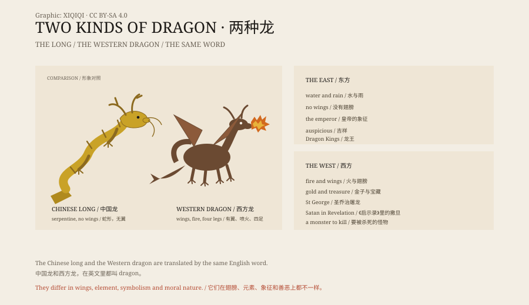

## 一、两种龙

如果你在中文里说“龙”，你会想到一条蛇形的、没有翅膀的、在云里飞的东西。

如果你在英文里说“dragon”，你会想到一条有翅膀的、四条腿的、会喷火的蜥蜴。

这两个形象，差别很大。它们被翻译成同一个词，但在各自的文化里，意思完全不同。

## 二、中国龙

中国龙的身体像蛇，有鳞、有角、有须，通常没有翅膀。它能飞，但靠的不是翅膀，是云和风。

龙住在水里，管下雨。农民求雨，会去龙王庙。龙王不是一只，是一套：东海龙王、南海龙王、西海龙王、北海龙王，各有各的辖区。

龙也是皇帝的象征。皇帝穿龙袍，坐龙椅，脸叫龙颜。故宫的台阶、屋脊、梁柱上，到处都是龙。

在民间，龙是吉祥的。舞龙、赛龙舟、十二生肖里的龙，都是好事情。

## 三、西方龙

欧洲的龙，形象在中世纪定型。

它有翅膀，有角，四条腿，身上有鳞，嘴里喷火。它住在山洞里，守着一堆金子。它抓走公主，烧毁村庄，是骑士证明自己的最好对手。

圣乔治屠龙，是欧洲最著名的龙故事。英格兰的守护圣人，就是用长矛刺死一条龙的人。

在北欧，龙叫 Fafnir，原本是人，因为贪财变成了龙，最后被英雄西格德杀死。在《贝奥武夫》里，龙守着宝藏，最后和主角同归于尽。

在《启示录》里，龙是撒旦的化身。这个形象影响了整个中世纪的西方龙。

## 四、龙与恐龙

中国有一种药材，叫“龙骨”。

它其实是化石，很多是古代哺乳动物的骨头，也有恐龙的。19 世纪，西方古生物学家在中国发现恐龙化石，当地人称它们为“龙牙”“龙骨”。

这并不是说古人见过龙。它说明，古人在地下挖到巨大的骨头，很自然地用“龙”来解释。

## 五、真实的龙

现实里，有一些动物被叫作“龙”。

科莫多巨蜥，英文叫 Komodo dragon，1910 年被科学描述。它有三米长，能杀死水牛，但不会喷火。

飞蜥属的蜥蜴，叫“飞龙”，靠肋骨撑开的皮膜在树间滑翔。

还有皇带鱼、大王乌贼，这些深海动物被冲上岸时，常被当成海龙或海蛇。

## 六、为什么到处都有龙

龙几乎出现在所有文明里。

蛇、鳄鱼、蜥蜴、化石、雷电、龙卷风、云，这些元素在不同地方被组合成类似的形象。人害怕蛇，也敬畏蛇；人挖到骨头，也想象巨大的生物。

龙是一个很好用的容器。你可以把恐惧、权力、雨水、宝藏、祖先，都装进去。

## 七、现在

龙还在。

在电影、游戏、小说里，龙是最常见的怪物之一。在中国，龙是民族符号；在欧洲，龙是奇幻世界的基础设定。

近年来，有人提出把中国龙翻译成“loong”，而不是“dragon”，以免和西方龙混淆。这个建议本身，就说明了两种龙有多不一样。

*原创示意图：中国龙与西方龙的形象要素对照。不是文物照片。稀奇奇编辑部，CC BY-SA 4.0。*

---

**来源与许可**：本文的事实来源见条目底部来源台账 S1–S3。文字与原创示意图采用 CC BY-SA 4.0。文中把中国龙、西方龙、化石与真实动物分开叙述；龙是神话生物，没有生物学证据，“龙骨”是化石而非龙的遗骸。插图是场景复原，不是文物照片。
