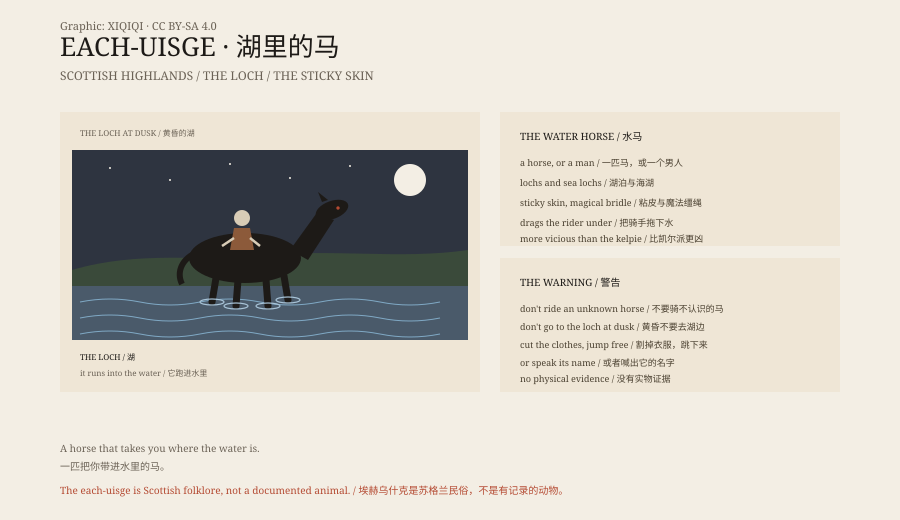

## 1. The Horse by the Loch

Dusk, by a loch in the Scottish Highlands. You see a horse.

It is handsome, its coat glossy, standing at the water's edge without fear.

You approach; it does not run. You mount; it begins to move.

It runs towards the loch. You cannot hold on; your legs stick to its back. It plunges in, and you are dragged under.

This is the each-uisge, the water horse.

## 2. The Kelpie

It resembles the kelpie, but it is worse.

The kelpie lives in rivers and streams and is sometimes merely mischievous. The each-uisge lives in lochs and sea lochs, and it almost always kills.

Its skin is sticky. A rider's hands and legs are held fast. It also has a magical bridle that prevents escape.

## 3. As a Man

It can also take human form.

A handsome stranger appears by the loch or at a market. There may be weed in his hair, or his clothes are always wet.

Some stories say you can recognise him by sand in his hair, or by the way he speaks of water.

## 4. The Only Escape

In some versions the rider cuts away the clothes stuck to the creature's back and jumps off before it reaches the water.

In others, speaking its name makes it stop.

But in most stories, no one comes back.

## 5. Why

The water horse was a warning told to children by the loch.

Do not go near a horse you do not know. Do not go to the loch at dusk. Do not ride a horse that is too willing.

In an age when drowning was common, the story was more useful than "mind the deep water".

## 6. Water

Today the water horse survives in Scottish tourism and local legend.

It has never been photographed, and it has left no bones.

But if you see a horse standing by the water at dusk, you may remember it.

*Original schematic: the water horse's two forms, its sticky skin and the dusk warning. Not a photograph of a site. Oddity Archive, CC BY-SA 4.0.*

---

**Sources and licenses**: the factual sources are listed in the source ledger S1–S3 at the bottom of this entry. Text and original diagrams are licensed under CC BY-SA 4.0. This article separates the Scottish folklore, the difference from the kelpie and the loch warning; the water horse is a folkloric creature with no physical evidence. The illustration is a scene reconstruction, not a photograph of a site.
