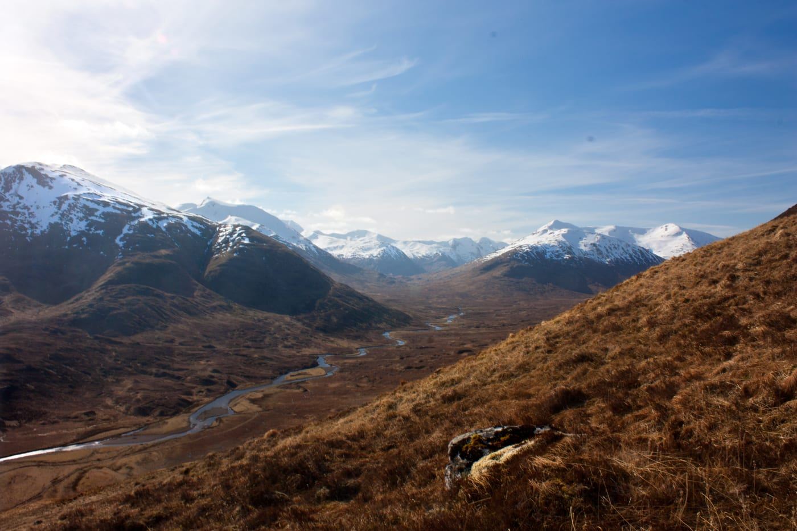
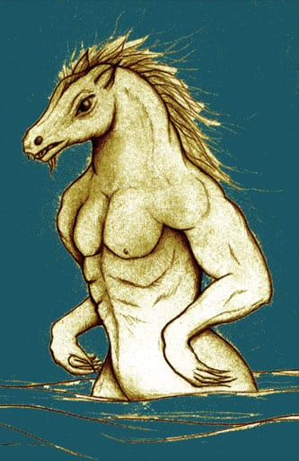
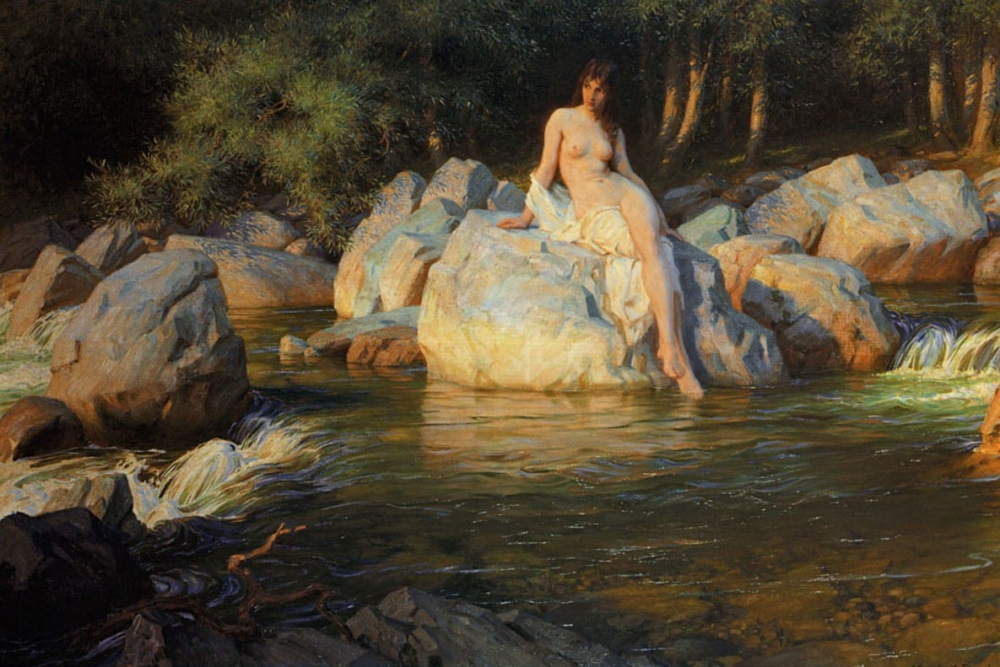
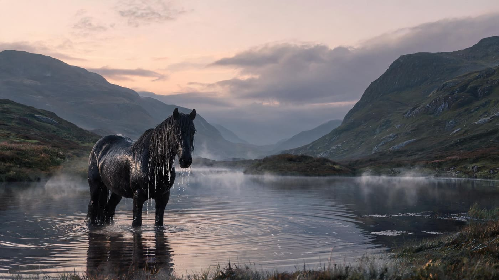
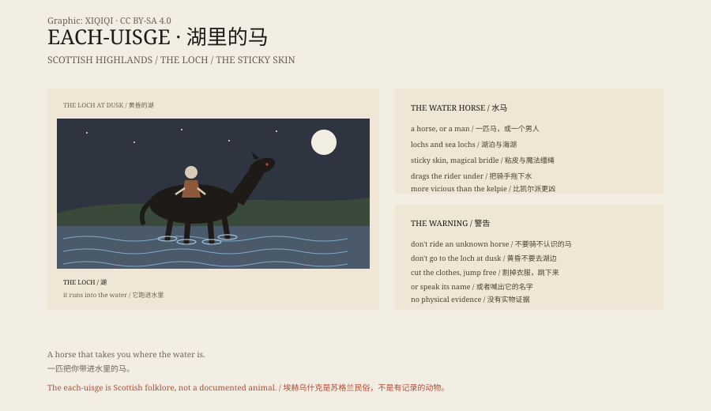

## 1. The Horse by the Water

Before dark, on a Highland loch. A horse stands at the edge, coat shining, unafraid.

It does not whinny and it does not move off. You come close; it lowers its head. You put a hand on its mane; it stands. You mount.

It starts to run. Not back along the shore — into the water. Your hands stick to its back, your legs too, as if held down. The water reaches its legs, then your knees, then the whole horse goes under.

Highlanders call it the each-uisge. The word means water horse.

*Site photograph: glen and loch country in the Scottish Highlands, 2014. Photographer credited as Each-uisge, CC BY-SA 4.0 (Wikimedia Commons). Terrain, not a water horse.*

## 2. The Name

In the Highlands the name is each-uisge; in Ireland each-uisce, anglicised as aughisky or ech-ushkya. On the Isle of Man the equivalent is cabyll-ushtey. The spellings differ; the thing is the same: a horse that lives in water.

Katharine Briggs put it plainly: it is "perhaps the fiercest and most dangerous of all the water-horses."

What makes it dangerous is its range. The kelpie keeps to burns and rivers, and the encounter usually ends when the rider goes under. The each-uisge lives in the sea, in sea lochs and in deep freshwater lochs. On land it is a horse; in water it is a weight that can pull a person down.

*Illustration: the each-uisge as tradition describes it, 2006. Liza Phoenix, CC BY-SA 3.0 (Wikimedia Commons). A later drawing from the legend, not a witness record.*

## 3. The Kelpie

The two are easily confused.

Both are horses in water, both can take human shape, both take people under. The differences are in the details: the kelpie belongs to streams and riverbanks, the each-uisge to lochs and the sea; in kelpie stories someone occasionally escapes, in each-uisge stories the escapee is the exception.

There is also the body. The each-uisge's skin is sticky. Once a rider's hands are on its back, they do not come off. Some versions give one way out: cut away the clothes that have stuck to the hide and jump free before the horse reaches deep water.

Others say that speaking its name stops it. The name works a little like a charm: to know what it is, is not to be fooled by it.

*Historical painting: Herbert James Draper, The Kelpie, 1913. Public domain (Wikimedia Commons). This is a kelpie, not an each-uisge; the two are often confused.*

## 4. The Hillock on Lewis

On the Isle of Lewis there is a knoll called Cnoc-na-Bèist, the Hillock of the Monster. Beside it is a freshwater loch, Loch a' Mhuileinn, the Loch of the Mill.

In the story, an each-uisge tried to seduce a woman. Her brother followed it to the loch and killed it, and the knoll took its name from that. The place-name survived. The horse did not.

This pattern is common in the Highlands: the monster dies and the place-name lives. You can find the spot on a map where it was killed. You cannot find it.

## 5. Two Horses of the Spey

Affleck Gray recorded two water horses on the River Spey.

One was An t-Each Ban, the white horse. It was not the usual black, but its habits were traditional: it came out on stormy nights, found travellers on the road, and carried them into deep pools.

The other was the yellow horse of the Spey, an even rarer colour. Its preferred victims were married couples.

Gray also noted a detail: Highland each-uisges "appear to have been richly caparisoned". If a woman could get hold of the rich bridle and replace it with a cow shackle, she would have power over the each-uisge for the rest of her life, and the bridle would bring her good fortune.

It is one of the few versions in which a person comes out ahead. The condition is that she gets the bridle first.

## 6. A Head in Her Lap

Campbell wrote a hard sentence: "any woman upon whom it set its mark was certain at last to become its victim."

The stories give very concrete ways of recognising it. A young woman was herding cattle when a handsome young man appeared, laid his head in her lap and fell asleep. When he stretched, she saw that his feet were hooves. Some versions have her find water weed and sand in his hair instead.

She left quietly.

In another version the water horse came in human shape to a woman living alone and tried to court her. Her answer was a kettle of boiling water, thrown between his legs. He ran out of the house screaming.

A third version is harder. A father and his three sons planned to kill a water horse that came to the house to see the daughter. When they seized him he reverted to horse shape and nearly carried all of them into the loch. They killed him indoors with their dirks.

## 7. The Isle of Man

The Manx cabyll-ushtey came out of the Awin Dhoo, the Black River, ate a farmer's cow, and later took his teenage daughter.

There are fewer Manx versions, but the structure is the same: first the livestock, then the person. Nothing in between is negotiated.

*Reconstruction: the water horse by a loch at dusk. Not a historical photograph. Oddity Archive, CC BY-SA 4.0.*

## 8. The Skin That Holds

In every version the hardest detail is the sticky skin.

It needs no magic and no curse. A person mounts an unfamiliar horse, the hands will not come off the back, and the horse walks into deep water. That picture explains the outcome by itself. There were no railings on the Highland lochs, and children went down to the water at dusk. Telling them not to ride that horse was more use than telling them the water was deep.

Scottish tourist leaflets still carry the water horse. It has never been photographed, left no bones, and produced no verifiable sighting. What it has left is a set of place-names: the Hillock of the Monster, the Loch of the Mill, the white horse of the Spey.

At dusk, if a horse is standing still by the water and is not afraid of you, it is better to walk on.

*Original schematic: the water horse's horse and human forms, its sticky skin and the dusk warning. Not a photograph of a site. Oddity Archive, CC BY-SA 4.0.*

---

**Sources and licenses**: sources are listed in the ledger S1–S5 at the foot of this entry. Text and original diagrams are CC BY-SA 4.0. The article keeps apart the Scottish and Irish folklore records, the place-name legends and modern tourist telling; the water horse is a folkloric creature with no physical evidence. The reconstruction is not a historical photograph, and Draper's painting is a kelpie, not an each-uisge.
