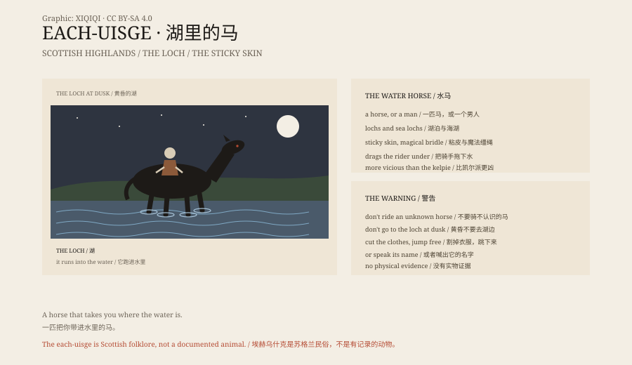

## 一、湖边的马

苏格兰高地的湖边，黄昏。你看见一匹马。

它很漂亮，毛色发亮，站在水边，不怕人。

你走近，它不跑。你骑上去，它开始跑。

它跑向湖。你抓不住，脚像粘在它的背上。它冲进水里，你被拖下去。

这是 each-uisge，水马。

## 二、和凯尔派

它和凯尔派很像，但更凶。

凯尔派多在河流、溪流里，有时只是捣蛋；each-uisge 在湖泊和海湖里，几乎总是杀人。

它的皮是粘的。骑上去的人，手和腿会被粘住。它还有一套魔法缰绳，让人挣不开。

## 三、变成人

它也会变成人。

一个英俊的陌生人，出现在湖边或集市上。他的头发里可能有水草，或者他的衣服总是湿的。

有的故事说，只要看见他头上有沙子，或者听见他提到水，就能认出他。

## 四、唯一的活路

有的版本里，骑手在它冲进水里之前，割掉自己粘在它背上的衣服，跳下来。

还有的版本说，只要喊出它的名字，它就会停下来。

但大多数故事里，没有人回来。

## 五、为什么

水马的故事，是给湖边孩子听的警告。

不要靠近不认识的马。不要在黄昏去湖边。不要骑一匹太听话的马。

在那个溺亡很常见的年代，这个故事比“小心水深”更有用。

## 六、水

今天，苏格兰的湖边还有水马的旅游传说。

它没有被拍到，也没有留下骨头。

但如果你在黄昏看见一匹站在水边的马，你可能会想起它。

*原创示意图：水马的两种形态、粘皮与黄昏警告。不是现场照片。稀奇奇编辑部，CC BY-SA 4.0。*

---

**来源与许可**：本文的事实来源见条目底部来源台账 S1–S3。文字与原创示意图采用 CC BY-SA 4.0。文中把苏格兰民俗、与凯尔派的区别和湖边警告分开叙述；水马是民俗生物，没有实物证据。插图是场景复原，不是现场照片。
