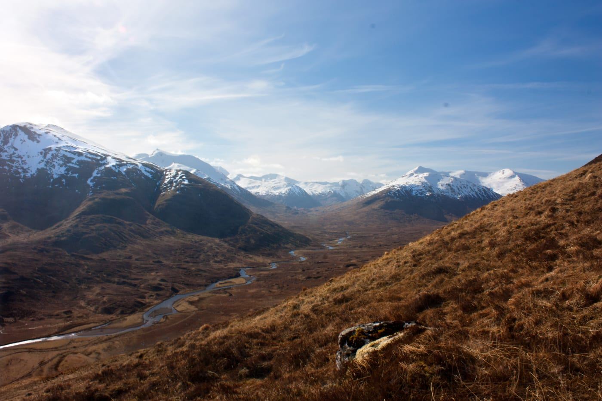
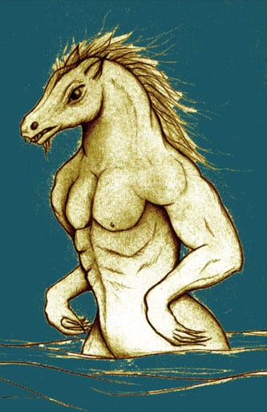
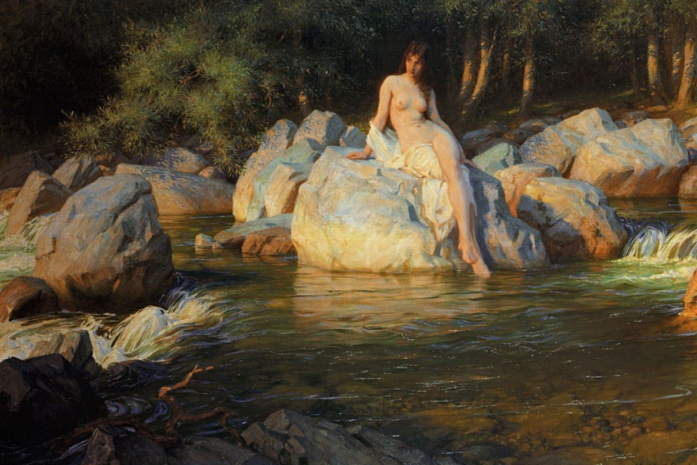
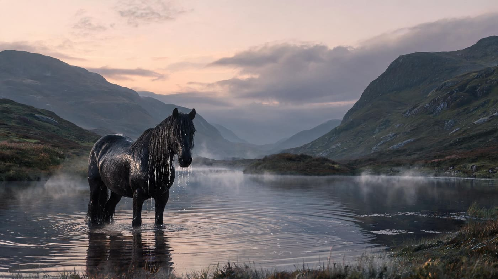
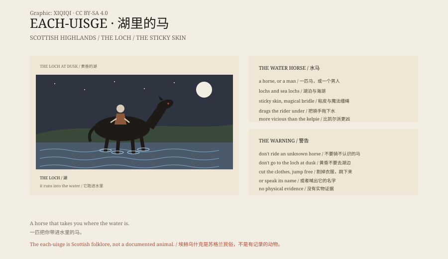

## 一、湖边的马

苏格兰高地的湖边，天黑之前。你看见一匹马站在水边，毛色发亮，不怕人。

它不嘶叫，也不走开。你走近，它低着头。你伸手摸它的鬃毛，它不动。你骑上去。

它开始跑。不是往回跑，是往湖里跑。你的手粘在它的背上，腿也粘住了，像被按住。水没过马腿，没过你的膝盖，然后整匹马沉下去。

高地人说，这是 each-uisge。字面的意思是“水马”。

*现场照片：苏格兰高地的山谷与湖泊地貌，2014 年。摄影师署名 Each-uisge，CC BY-SA 4.0（Wikimedia Commons）。照片是地形，不是水马。*

## 二、名字

这个名字在苏格兰高地写作 each-uisge，在爱尔兰写作 each-uisce，英语里转写成 aughisky 或 ech-ushkya。马恩岛上的同类叫 cabyll-ushtey。几种写法指的是同一种东西：住在水里的马。

民俗学者凯瑟琳·布里格斯（Katharine Briggs）给它的定位很直接：它“也许是所有水马中最凶猛、最危险的一头”。

危险在于它不挑地方。凯尔派守着小溪和河流，把人拖进水里就结束；水马住在海里、海湖里，也住淡水的深湖里。它上岸时是一匹马，下水时是一团能拖动人的重量。

*插画：each-uisge 的传说形象，2006 年。Liza Phoenix，CC BY-SA 3.0（Wikimedia Commons）。这是后人据传说绘制的图，不是目击记录。*

## 三、和凯尔派

最容易混的是凯尔派。

两者都是水里的马，都会变成人，都会把人带下水。区别在细节：凯尔派多在溪流和河边，水马在湖泊与海；凯尔派的传说里偶尔有人逃回来，水马的故事里，逃回来的人是少数。

高地人日常的规矩也能看出来。因为分不清水边的东西是什么，他们对水边单独出现的动物、水边单独出现的陌生人，都保持距离。这条规矩不需要相信怪兽，只要知道有溺死的人就够了。

还有一处区别是身体。水马的皮是粘的。骑上去的人，手贴在马背上就分不开。有些故事说，唯一的办法是在它入水之前割掉自己粘住的那层衣服，光着身子跳下来。

另一些故事说，只要喊出它的名字，它就会停住。名字在这里有点像咒：知道它是什么，就不容易被它骗。

*历史画作：赫伯特·詹姆斯·德雷珀《凯尔派》，1913 年。公有领域（Wikimedia Commons）。画的是凯尔派，不是 each-uisge；两者常被混为一谈。*

## 四、刘易斯岛上的土丘

外赫布里底群岛的刘易斯岛上，有一个土丘叫 Cnoc-na-Bèist，“怪兽之丘”。旁边是淡水湖 Loch a' Mhuileinn，“磨坊之湖”。

传说里，一头水马想引诱一个女人。女人的兄弟追到湖边，把马杀了，土丘因此得名。地名留下来了，马没有。

这类故事在高地很常见：怪兽死了，地名活着。你在地图上能看到它被杀的地方，看不到它。

## 五、斯佩河的两匹马

民俗学者阿弗莱克·格雷记录过斯佩河上的两头水马。

一头叫 An t-Each Ban，“白色的马”。它不像传说里的水马那样是黑的，但行为很传统：在暴风雨的夜里上岸，找路上的旅人，驮着人往深水潭里跳。

另一头是斯佩河上的黄马，颜色更少见。它偏爱的猎物是夫妻。

格雷还记下一个细节：高地传说里的水马“似乎都配着华丽的马具”。如果一个女人能抓住那副缰绳，把它换成一副牛枷，她就一辈子能管住这头水马；那副缰绳还会给她带来好运。

这是水马传说里少有的、人占上风的版本。前提是她先抓住缰绳。多数故事里，人连靠近的机会都没有。

## 六、把头放在膝上

坎贝尔（Campbell）写过一句很重的话：“任何被它标记过的女人，最终一定会成为它的猎物。”

故事里的识别方法很具体。一个年轻女人在草地上放牛，来了一个英俊的年轻人，躺在她的膝上睡着了。他伸懒腰的时候，她看见他的脚是马蹄。有的版本说，她是在他的头发里发现了水草和沙子。

她悄悄走了。

另一个版本里，水马变成人形，到独居的女人家里求爱。她给他的回答是一壶开水，泼在两腿之间。他惨叫着跑出屋子。

还有一个版本更狠：父亲和三个儿子合谋，等水马进门来看女儿时动手。抓住他的时候，他变回马形，差点把几个人一起拖进湖里。他们用短剑把它刺死在屋里。

## 七、马恩岛

马恩岛的 cabyll-ushtey 从 Awin Dhoo（黑河）里出来，先吃掉一个农夫的一头牛，后来又带走了他十几岁的女儿。

马恩岛的版本不多，但结构一样：先牲畜，再人。中间没有谈判。

*场景复原：黄昏站在湖边的水马。不是历史照片。稀奇奇编辑部，CC BY-SA 4.0。*

## 八、粘住的那一层

所有版本里，最硬的一处细节是那层粘皮。

它不需要魔法，也不需要诅咒。一个人骑上一匹不认识的马，手贴在马背上分不开，马往深水里走——这个画面本身就能讲清后果。高地的湖边没有护栏，孩子在黄昏会去水边。告诉他们“不要骑那匹马”，比告诉他们“水很深”有用。

水马和凯尔派的区别，最后落在能不能回来这件事上。能回来的故事讲运气，回不来的故事讲规矩。

今天苏格兰的旅游手册里还有水马。它没有被拍到，没有留下骨头，也没有留下可验证的目击记录。留下的是一串地名：怪兽之丘、磨坊之湖、斯佩河上的白马。

黄昏的湖边，如果有一匹马站着不动，不怕人，最好还是走开。

*原创示意图：水马的马形与人形、粘皮与黄昏警告。不是现场照片。稀奇奇编辑部，CC BY-SA 4.0。*

---

**来源与许可**：事实来源见条目底部来源台账 S1–S6。文字与原创示意图采用 CC BY-SA 4.0。文中把苏格兰与爱尔兰的民俗记录、地名传说和现代旅游叙述分开；水马是民俗生物，没有实物证据。场景复原不是历史照片，德雷珀的画是凯尔派，不是水马。
