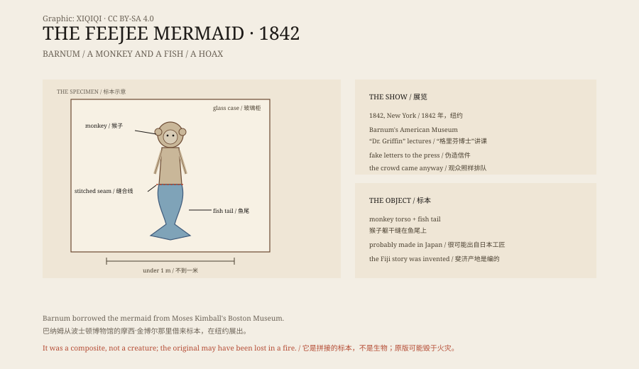

## 1. New York, 1842

In the summer of 1842, Barnum's American Museum on Broadway put up a poster.

It announced a real mermaid, caught alive in the Fiji Islands, preserved as a specimen.

A queue formed outside the museum. Newspapers began arguing about whether it was genuine. Some called it a “missing link” that connected humans and fish.

## 2. Barnum

The owner of the museum was P. T. Barnum. He later became famous for his circus, but in 1842 he was in the museum business.

The mermaid was not his. It belonged to Moses Kimball, who ran the Boston Museum. Barnum borrowed it and built a campaign around it.

He printed fake letters saying that an English naturalist, “Dr. Griffin”, had examined the specimen. He arranged for “Dr. Griffin” to give a lecture in New York. The lecturer was an actor.

Barnum did not say outright that the mermaid was real. He let the newspapers argue and left the public to decide. The more they argued, the longer the queue.

## 3. What it was

The specimen was less than a metre long.

The upper half was the head and torso of a monkey, with hair, teeth and claws. The lower half was a fish tail, with scales and fins. The two halves were sewn together, with the seam hidden under fur and scales.

It was probably made by Japanese craftsmen. Japan had a tradition of making “ningyo” — mermaid figures built from monkey and fish parts and sold to sailors and collectors. Objects like this travelled across the Pacific and reached the West.

Barnum said it came from Fiji, which is why it was called the Feejee Mermaid. Fiji was simply where the story said it came from.

## 4. Fiji

In the nineteenth century, European ships often stopped in the Pacific. Many of the “mermaids” sailors brought back were composite specimens made in Japan or Southeast Asia.

To the audience of 1842, Fiji was a remote place. Remote places can contain anything. That mattered more than the specimen itself.

## 5. Afterwards

Barnum's museum burned down in 1865. Kimball's collection eventually went to Harvard's Peabody Museum, including a mermaid.

Whether the Peabody's mermaid is the one exhibited in 1842 is uncertain. It has a monkey's upper body and a fish tail, but it does not match the prints and descriptions exactly.

The original may have been destroyed in the fire, or altered. Most of the mermaids on display in museums today are replicas.

## 6. The mermaid mistake

In earlier history, mermaids were not a hoax but a misidentification.

Manatees and dugongs are mammals. They breathe air and nurse their young at the surface. Their front limbs look like arms, and their bodies are rounded. Seen from a distance, they can resemble a human figure.

In 1493 Columbus wrote in the Caribbean that he had seen “sirens”, but that they were “not as beautiful as they are painted.” He was probably looking at manatees.

Sailors spent months at sea. A blurred shape became a story, and the story became a picture. The mermaid was passed down that way.

## 7. Now

The mermaid is still with us.

In films, advertising and children's books she is a romantic figure. In marine biology, “mermaid” is another name for the manatee and the dugong.

The specimen of 1842 sewed the two together — an old mistake and a modern marketing campaign.

*Original schematic: the monkey torso and fish tail, the New York exhibition of 1842, and the later collection history. Not a photograph of the object. Oddity Archive, CC BY-SA 4.0.*

---

**Sources and licenses**: the factual sources are listed in the source ledger S1–S3 at the bottom of this entry. Text and original diagrams are licensed under CC BY-SA 4.0. This article separates the 1842 exhibition, the construction of the specimen, the Fiji story and the mermaid tradition; the Feejee Mermaid was a composite hoax, and the fate of the original is uncertain. The illustration is a scene reconstruction, not a photograph of the object.
