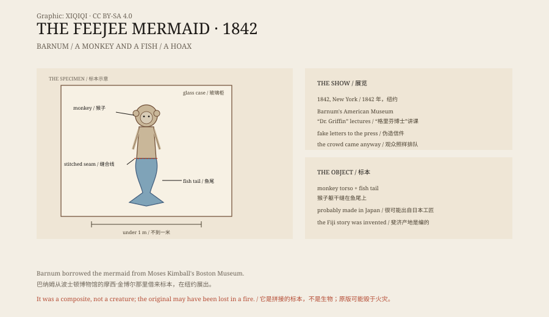

## 一、1842 年的纽约

1842 年夏天，纽约百老汇的巴纳姆美国博物馆挂出一张海报。

海报上写着：一条真正的美人鱼，来自斐济群岛，活捉，制成标本。

博物馆门口排起了队。报纸开始争论它是不是真的。有人说它是“缺失的一环”，能把人和鱼连起来。

## 二、巴纳姆

博物馆的老板叫 P.T. 巴纳姆。他后来以马戏团出名，但在 1842 年，他主要做博物馆生意。

这条美人鱼不是他的。它属于波士顿博物馆的老板摩西·金博尔。巴纳姆把标本借来，做了一轮宣传。

他印了假信件，说有一位英国博物学家“格里芬博士”研究过标本。他还安排“格里芬博士”在纽约讲课。其实那是一位替身演员。

巴纳姆没有直接说“这是真的”。他让报纸去争，让观众自己判断。越争，队排得越长。

## 三、它是什么

标本不到一米长。

上半身是猴子的头和躯干，有头发、牙齿和爪子。下半身是一条鱼尾，有鳞片和鳍。两截被缝在一起，接缝藏在毛发和鳞片下面。

它很可能出自日本工匠之手。日本有一种叫“人鱼”的工艺品，用猴子和鱼的部件拼成，卖给水手和收藏家。这样的东西经过太平洋贸易，被带到了西方。

巴纳姆说它来自斐济，所以叫“斐济美人鱼”。斐济只是故事里的产地。

## 四、斐济

19 世纪，欧洲船只经常在太平洋停靠。水手带回来的“美人鱼”，很多是日本或东南亚做的拼接标本。

对当时的观众来说，斐济是一个遥远的地方。遥远的地方可以发生任何事。这比标本本身更重要。

## 五、后来

巴纳姆的博物馆在 1865 年烧毁。金博尔的收藏后来转入哈佛大学的皮博迪博物馆，其中有一条美人鱼。

皮博迪的那条是不是 1842 年展出的那一条，没有人能确定。它有猴子的上半身和鱼尾，但和当年的版画、描述并不完全一致。

原版可能毁于火灾，也可能被改装过。今天在博物馆里看到的，大多是复制品。

## 六、美人鱼的误会

在更早的历史里，美人鱼不是骗局，是误认。

海牛和儒艮是哺乳动物，用肺呼吸，在水面喂奶。它们的前肢像手臂，身体粗圆，远远看去，确实有点像人。

1493 年，哥伦布在加勒比海写道，他见过“美人鱼”，但“没有画里那么美”。他看到的很可能是海牛。

水手在海上漂几个月，看见一个模糊的轮廓，讲成一个故事，故事再被画成图。美人鱼就这样一代代传下来。

## 七、现在

美人鱼还在。

在电影、广告、儿童读物里，她是浪漫的形象。在海洋生物学里，她是海牛和儒艮的另一个名字。

1842 年的那条标本，把这两件事缝在了一起：一个古老的误会，加上一场现代的营销。

*原创示意图：标本的猴子躯干与鱼尾结构、1842 年纽约展出与后来的收藏路径。不是文物照片。稀奇奇编辑部，CC BY-SA 4.0。*

---

**来源与许可**：本文的事实来源见条目底部来源台账 S1–S3。文字与原创示意图采用 CC BY-SA 4.0。文中把 1842 年展出、标本构造、斐济产地说法与美人鱼传说分开叙述；斐济美人鱼是拼接的骗局标本，原版的下落没有定论。插图是场景复原，不是文物照片。
