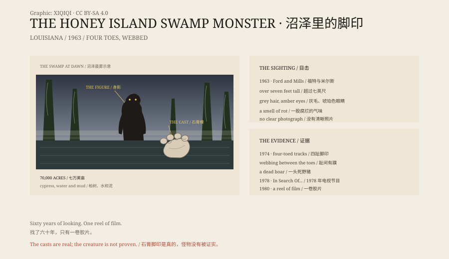

## 1. Honey Island

Honey Island Swamp lies near Slidell, Louisiana, between the East and West Pearl Rivers. It covers about seventy thousand acres.

Cypress, tupelo, water hyacinth, alligators. The channels are narrow, and the surface is often closed over by plants, so a boat parts it like a curtain. In summer the air is heavy and alive.

If you wanted to hide something seven feet tall, this would not be a bad place.

## 2. 1963

Harlan Ford and Billy Mills were air traffic controllers, and both spent their free time outdoors.

In 1963 they flew over a remote part of the swamp, saw a good campsite and later went in to use it. Ford said he saw something large ahead of him and took it for a bear. Then it turned around.

He described an upright figure more than seven feet tall, covered in shaggy hair, with amber eyes and a face that looked like a person's. Later versions made the hair grey and the eyes yellow or red, and added a smell of rot.

Ford did not shoot. He said the thing looked too human.

## 3. 1974

Eleven years later, Ford and Mills went back into the swamp.

They said they found strange tracks and the body of a wild boar with its throat torn open. Ford made plaster casts of the prints.

The tracks had four toes, with webbing between them. The shape did not match any known primate. It made people think of something half ape, half alligator.

The casts survived. Copies were passed around among enthusiasts.

## 4. 1978

In 1978 the television series *In Search Of...* devoted an episode to the swamp monster. Ford appeared and described what he had seen.

His granddaughter, Dana Holyfield, later said the broadcast turned a small local story into national news. For a while, Slidell was full of people looking for the monster.

## 5. Doubt

Not everyone was pleased.

Some neighbours said Ford and his friends had invented the creature to keep other hunters out of their part of the swamp. One critic said the tracks were made by someone with a carved foot fixed to a shoe, walking through the mud.

Ford withdrew from public attention. He died in 1980.

## 6. The Film

After Ford's death, his family found a reel of Super 8 film in his belongings, along with an unpublished letter. The film showed a large, hairy figure walking through the swamp.

It was later shown on television. One programme recreated it with a man in a camouflage ghillie suit and concluded that Ford might have seen something ordinary in poor light. Another explanation said the famous smell was methane rising from rotting plants.

In 2001 the investigator Joe Nickell toured the swamp with the ecologist Paul Wagner. They found no evidence. Neither did most of the people who worked on the water every day.

## 7. The Casts

Ford's plaster casts still exist. Copies are on display at the Abita Mystery House.

In 2019 the Irish novelist Eoin Colfer used the creature in his novel *Highfire*.

Sixty years on, the clearest evidence is still a few plaster casts and one old reel of film. The swamp neither proves nor denies. It just keeps growing.

*Original schematic: the 1963–2019 sightings, the plaster tracks and the film evidence. Not a photograph of the site. Oddity Archive, CC BY-SA 4.0.*

---

**Sources and licenses**: the factual sources are listed in the source ledger S1–S3 at the bottom of this entry. Text and original diagrams are licensed under CC BY-SA 4.0. This article separates the witnesses' descriptions, the tracks and film, and the sceptics' explanations; no body or clear photograph confirms the creature. The illustration is a scene reconstruction, not a photograph of the site.
