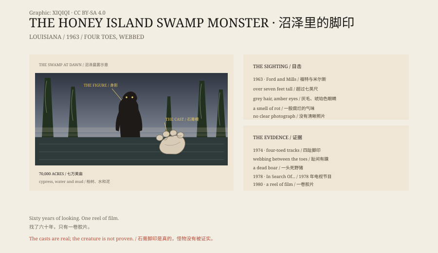

## 一、蜜岛

蜜岛沼泽在路易斯安那州斯莱德尔附近，东珍珠河和西珍珠河之间，约七万英亩。

柏树、水紫树、水葫芦、鳄鱼。水道窄，水面被植物盖住，船开过去像掀开一道帘子。夏天闷热，空气里全是活物。

如果要藏一个七英尺高的东西，这里不算坏地方。

## 二、1963 年

哈兰·福特和比利·米尔斯是空中交通管制员，也是常年在户外跑的人。

1963 年，他们开飞机经过沼泽深处，看见一块不错的营地，后来专门进去。福特说，他先看见前面有个大东西，以为是熊。那东西转过身来。

他描述的是一个直立的身影，超过七英尺，从头到脚都是蓬乱的长毛，眼睛是琥珀色，脸像人。后来的版本把毛说成灰色，把眼睛说成黄色或红色，还加上了腐烂的臭味。

福特没有开枪。他说，那东西太像人了。

## 三、1974 年

十一年后，福特和米尔斯又进了沼泽。

他们说发现了奇怪的脚印，还找到一头死去的野猪，喉咙被撕开。 福特用石膏给脚印翻了模。 脚印有四个脚趾，趾间有蹼。

脚印有四个脚趾，趾间有蹼。这个形状不像任何已知的灵长类，倒让人想到“半猿半鳄鱼”。

石膏模留了下来，复制品在爱好者之间传来传去。

## 四、1978 年

1978 年，电视纪录片《寻找……》做了一集沼泽怪物。福特上了节目，讲了他看见的东西。

他的孙女达娜·霍利菲尔德后来说，那期节目把一个小地方的故事变成了全国新闻，斯莱德尔一度全是找怪物的人。

## 五、怀疑

不是所有人都高兴。

有邻居说，福特和朋友们编出怪物，是为了把别的猎人挡在他们那片沼泽外面。一个批评者说，那些脚印是有人把雕刻的脚绑在鞋底上，在泥里走出来的。

福特后来很少再公开谈这件事。1980 年，他去世。

## 六、胶片

福特死后，家人在他的遗物里找到一卷超 8 毫米胶片，还有一封没有发表的信。胶片里有一个高大的、长毛的身影在沼泽里走。

胶片后来在电视上播过。一个节目用穿着伪装服的人重拍了类似的画面，结论是福特可能在光线不好的时候看见了什么普通的东西。另一个解释是，所谓的臭味只是沼泽植物腐烂冒出的甲烷。

2001 年，调查员乔·尼克尔和生态学家保罗·瓦格纳一起坐船进沼泽。他们没找到证据。天天在水上的人，大多也没有。

## 七、脚印

今天，福特的石膏模还在，复制品在阿比塔神秘屋展出。

2019 年，爱尔兰作家约恩·科尔弗把这个怪物写进了小说《Highfire》。

六十年过去，最清楚的证据还是几块石膏和一卷旧胶片。沼泽不证明，也不否认。它只是继续长。

*原创示意图：1963–2019 年的目击、石膏脚印与胶片证据。不是现场照片。稀奇奇编辑部，CC BY-SA 4.0。*

## 时间线

- **1963 年**：1963 年，他们开飞机经过沼泽深处，看见一块不错的营地，后来专门进去
- **1978 年**：1978 年，电视纪录片《寻找……》做了一集沼泽怪物
- **1980 年**：1980 年，他去世
- **2001 年**：2001 年，调查员乔·尼克尔和生态学家保罗·瓦格纳一起坐船进沼泽
- **2019 年**：2019 年，爱尔兰作家约恩·科尔弗把这个怪物写进了小说《Highfire》

## 来源与证据

本条目的事实底座以 1 条独立来源为主。S2（Gods and Monsters）覆盖沼泽地理、福特与米尔斯的经历、邻居的造假指控、怀疑者调查。
原创插图只提供场景复原、结构示意或地图，不作为历史照片使用。正文把可核对记录、后来解释与传说分开叙述；同一件事在不同来源中的版本差异，保留在行文中，不强行合并。

## 档案位置

蜂蜜岛沼泽怪物的档案由地方报纸特写、猎人访谈和后来的旅游文案组成；没有标本、足迹石膏或经独立复核的照片。

## 档案空白

目击记录多为事后追述，缺少清晰影像、足迹石膏或可独立复核的实物；传说层越丰富，越需要把“有人这样说”与“确实发生过”分开。
这条档案把记录与未答的问题并排放置，不替读者做出超出证据的结论。
就可信度而言，本条目标为“folklore”。这个标签描述的是当前证据状态，不是对传说真伪的终审；新档案出现时，标签应随之调整。

## 档案补记

以下补记保留正文没有展开的档案侧面：来源、技术细节与后续影响。
**补记**。 蜜岛沼泽的故事没有因为怀疑而结束。每年仍有猎人、博物学爱好者和电视摄制组进去。他们带着相机、录音机和脚印石膏，出来时通常只带着泥。但下一次，还是会有人进去。

蜂蜜岛沼泽怪的传说，在 1950 年代被猎人福特带火。他拍了胶片，也留下了一封信。电视节目后来用伪装服重拍，结论是误认。蜂蜜岛的农场，后来荒废了。沼泽还在，故事也还在。

蜂蜜岛的沼泽，后来被划为自然保护区。怪物没有标本，保护区里只有蚊子和泥。故事还在，猎人福特的名字也还在。

---

**来源与许可**：本文的事实来源见条目底部来源台账 S1–S3。文字与原创示意图采用 CC BY-SA 4.0。文中把目击者的描述、脚印与胶片证据、怀疑者的解释分开叙述；没有尸体或清晰照片能确认这种生物。插图是场景复原，不是现场照片。

本条目的版本差异与对应段落见文末来源 S1–S3，正文按可核实材料取捨。

本条目的部分细节在不同来源中存在异文，正文优先采用可核对且能互相印证的版本；具体出处见文末 S1–S3。
