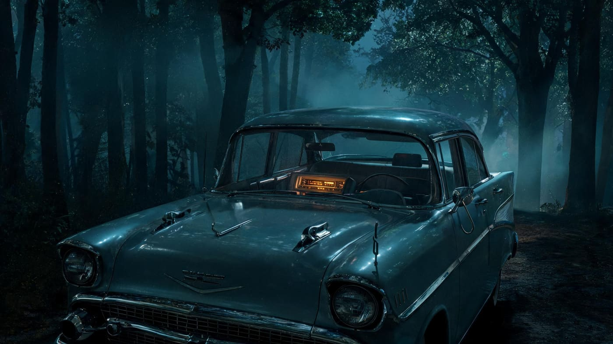
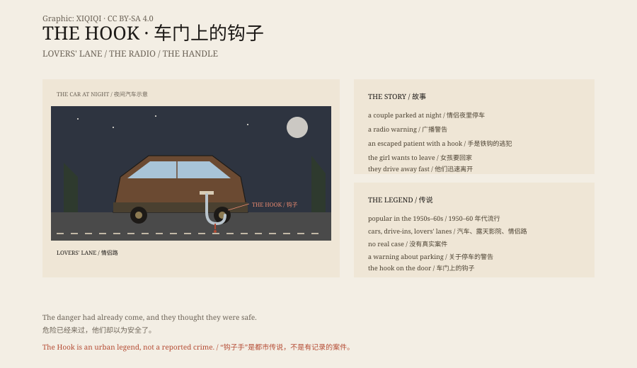

## 1. The Story

A young couple park on a lonely road at night.

It is 1950s America. The car is big, the road is empty. The boy parks at the edge of the trees, kills the engine, and leaves only the radio on. Outside is black; the dashboard lights are a small orange island.

The radio is on. Suddenly a news bulletin interrupts: a patient has escaped from a nearby asylum, and one of his hands is a steel hook.

The girl is frightened and wants to go home. The boy is reluctant, but he starts the car.

*Reconstruction: a 1950s American lovers' lane, a steel hook hanging from the door handle. Not a photograph of a site. Oddity Archive, CC BY-SA 4.0.*

## 2. Home

They drive to the girl's house.

The boy gets out, walks around the car and opens her door.

On the door handle hangs a steel hook.

There is blood on it.

They never know when the hook was hung there. Maybe while they were parked. Maybe while they were talking. The doors stayed shut, and the windows stayed black.

## 3. Versions

There are many versions.

In some, the hook scraped along the window; in others it is on the door handle; in others the boy sees it first and does not tell the girl.

The common point is that danger came, and they did not know.

## 4. Origin

"The Hook" was popular among American teenagers in the 1950s and 1960s.

It appeared alongside cars, drive-in cinemas and lovers' lanes.

Cars changed how young people dated, and they changed the shape of fear: a private space that could move, parked far from home and streetlights. The story turned "someone is out there" into "he was at your door just now."

It was a warning: do not park in a lonely place, do not turn off the lights, do not ignore the girl.

## 5. True or False

There is no real "hook man" case.

It is an urban legend, not news.

But the image of the hook on the door is so effective that it has survived.

## 6. The Hook

The most frightening thing is not the hook man.

It is that the hook was already on the door while the people in the car were still laughing.

Danger had already come, and they thought they were safe.

*Original schematic: the lovers' lane, the radio warning and the hook on the door. Not a photograph of a site. Oddity Archive, CC BY-SA 4.0.*

---

**Sources and licenses**: the factual sources are listed in the source ledger S1–S3 at the bottom of this entry. Text and original diagrams are licensed under CC BY-SA 4.0. This article separates the story versions, the period setting and urban-legend research; no real case supports the "hook man". The illustration is a scene reconstruction, not a photograph of a site.
