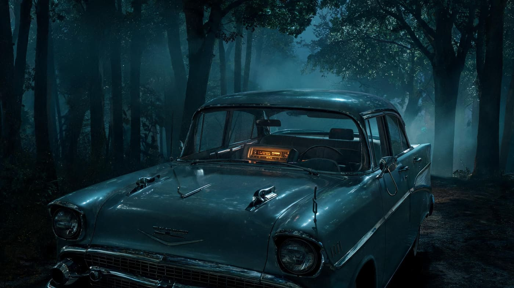
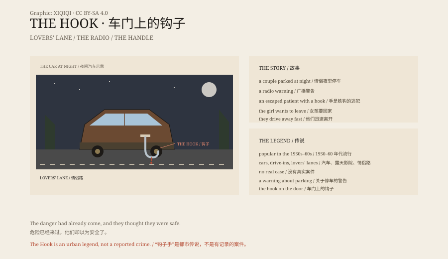

## 1. The Door

The story ends beside a parked car.

The boy gets out, walks round, and opens the door for the girl. A steel hook hangs from the handle. There is blood on it.

They never learn when it was hung there. Perhaps while they were parked. Perhaps while they were talking. Perhaps in the second when he started the engine and pulled away.

The story never shows the hook man. It shows the hook he left behind.

*Reconstruction: a 1950s American lovers' lane and the hook on the door handle. Not a historical photograph. XIQIQI Editorial, CC BY-SA 4.0.*

## 2. The Cars of the 1950s

Three things in the story are new: the car, the drive-in, and the empty road at the edge of town.

After the war, American teenagers had cars. The car moved courtship out of the front parlour and away from parents, onto a stretch of road with no streetlights. The back row of the drive-in, the bend by the river, the clearing at the edge of the woods — later all of it had one name: lovers' lane.

A car is a private space that can move. It stops far from home; the doors close and the outside goes black. The story uses that black: the danger is not far away, it is on the other side of a sheet of steel.

## 3. 1960, the Advice Column

The folklorist Jan Harold Brunvand dates the story to the 1950s. By 1959 it was widespread among American teenagers, and through the 1960s it kept spreading.

What carried it beyond the parking lot was an advice column. In 1960 "Dear Abby" printed a version as a letter from a reader. The column ran in papers across the country, and a story told in cars and at campfires came out in type.

Printing fixed it. Later versions changed details; the frame stayed: two people, one car, a warning, a hook.

## 4. Texarkana, 1946

There is no real hook man. The setting, however, has a real shadow.

In 1946, in Texarkana on the Texas–Arkansas line, someone began shooting at young couples parked on lonely roads. Over ten weeks the attacker struck several couples; some of the dead were teenagers. The case was never solved, and locally it was called the Moonlight Murders.

David Mikkelson of Snopes has suggested that real lovers' lane killings of this kind supplied the scene for the hook story, and the fear that goes with it. Not the same killer; the same kind of night.

The suggestion can be neither proved nor disproved. It explains why the story has the shape it has, not where it came from.

## 5. Versions

The story has a long family tree.

The commonest version puts the hook on the door handle. Another has the hook scrape along the roof; the boy hears it and will not stop. A third has the boy see the hook first and say nothing until they reach her house.

Some versions deliver the warning by radio, some by a petrol station attendant, some by a sign at the roadside. What changes is the messenger. What never changes is that the message arrives too late.

## 6. On Screen

The hook man reached the cinema early. In Dick Tracy's Dilemma (1947) the killer has a hook for a hand. In Meatballs (1979) Bill Murray's character tells the story to campers around a fire.

Horror films fixed it. The critic Mark Kermode has noted how often the hook appears in slasher films, where it works as a moral archetype: young people in a car are punished. He Knows You're Alone (1980) opens with a couple attacked in a parked car. Final Exam opens the same way. Campfire Tales (1997) retells the legend in its first segment, and I Know What You Did Last Summer (1997) has its characters tell it around a campfire. The Candyman films centre on it, and Lovers Lane (1999) takes its title from the setting.

Television used it too: an episode of Millennium in 1998 opens with it, and the seventh episode of Supernatural's first season, aired in 2005, makes the hook man the villain. Animation parodied it: the Shrek the Halls special of 2007 has Gingy tell a version of the tale.

## 7. One Sentence

In the 2010s the story came back on the internet.

A version appeared on 4chan in broken English, ending with a string of nouns: "Man door hand hook car door." The line became a meme, printed on T-shirts and cut into short videos, and it now stands for the whole story.

A 1950s American urban legend ended up circulating in another century because of a sentence with no grammar. The plot no longer matters. The shape of the sentence does.

## 8. The Hook

Back to the door.

There is no fight, no chase, no police. There is a man driving a woman home, walking round the car, opening her door. Then he sees the hook.

What makes it work is that the danger has already come and gone, and the people inside believed they were safe. That feeling needs no ghost and no monster: a car, a dark road, and a piece of iron in the wrong place are enough.

And when the story ends, what does the listener do? Check the door.

*Original schematic: the lovers' lane, the radio warning and the hook on the door. Not a photograph of a site. XIQIQI Editorial, CC BY-SA 4.0.*

---

**Sources and licenses**: Text and original diagrams are licensed CC BY-SA 4.0; third-party image and source licences are listed in the source ledger below.
