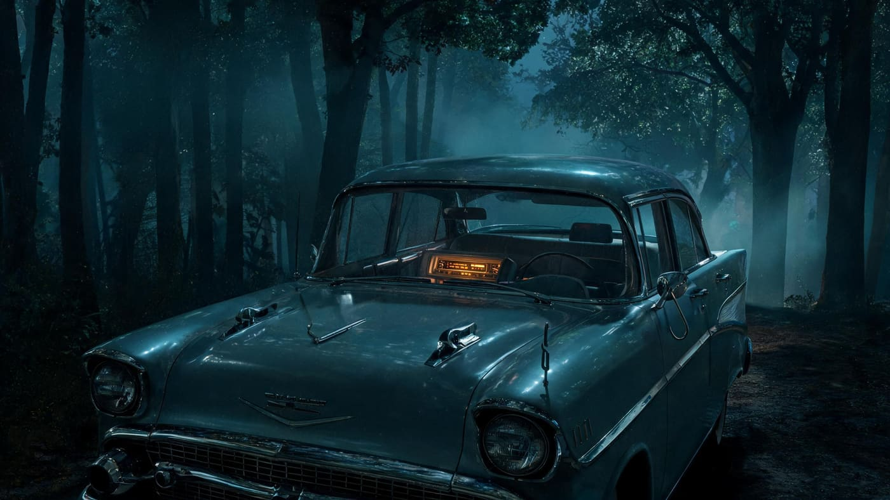
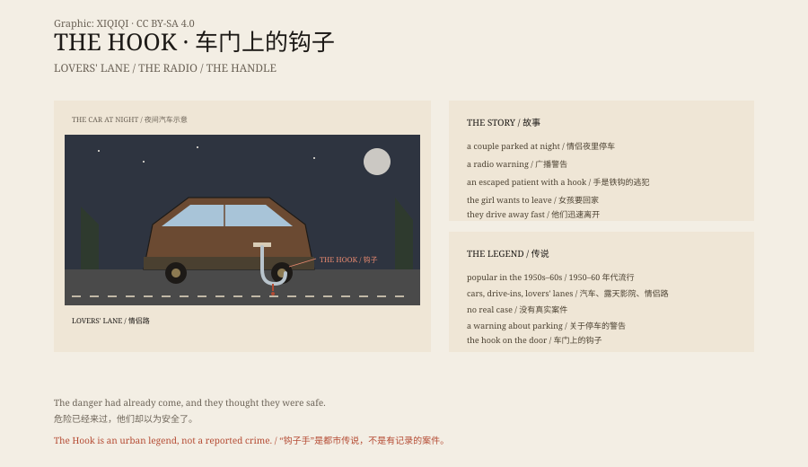

## 一、故事

一对年轻情侣，夜里把车停在偏僻的路边。

那是 1950 年代的美国，车很大，路很空。男孩把车停在树林边，熄了火，只留着收音机。窗外是黑的，仪表盘上的灯像一小块橙色的岛。

收音机开着。突然，新闻插播：一个精神病院的逃犯，一只手是铁钩，正在附近。

女孩害怕，要回家。男孩不情愿，还是发动了车。

*场景复原：1950 年代美国的情侣路，车门把手上挂着一只铁钩。不是现场照片。稀奇奇编辑部，CC BY-SA 4.0。*

## 二、到家

他们开到女孩家门口。

男孩下车，绕到另一边，给女孩开门。

车门把手上，挂着一个铁钩。

钩子上有血。

他们不知道钩子是什么时候挂上去的。也许是在停车的时候，也许是在说话的时候。车门一直关着，窗外一直黑着。

## 三、版本

这个故事有很多版本。

有的说，钩子是从车窗上刮下来的；有的说，钩子挂在门把上；有的说，男孩先看见，没敢告诉女孩。

共同点是：危险来过，但他们不知道。

## 四、起源

“钩子手”在 1950 到 1960 年代的美国青少年中流行。

它和汽车、露天电影院、情侣路一起出现。

汽车改变了年轻人的约会方式，也改变了恐惧的形状：一个可以移动的私密空间，停在离家和路灯都很远的地方。故事把“外面有人”变成了“他刚才就在你门外”。

它是一个警告：不要在偏僻的地方停车，不要关掉灯，不要不听女孩的话。

## 五、真假

没有真实的“钩子手”案件。

它是都市传说，不是新闻。

但“车门上的钩子”这个画面太有效了，所以它一直活着。

## 六、钩子

故事最吓人的地方，不是钩子手。

是那个钩子已经挂在门上，而车里的人还在笑。

危险已经来过，他们却以为安全了。

*原创示意图：情侣路停车、广播警告与车门上的钩子。不是现场照片。稀奇奇编辑部，CC BY-SA 4.0。*

---

**来源与许可**：本文的事实来源见条目底部来源台账 S1–S3。文字与原创示意图采用 CC BY-SA 4.0。文中把故事版本、时代背景和都市传说研究分开叙述；没有真实案件支持“钩子手”。插图是场景复原，不是现场照片。
