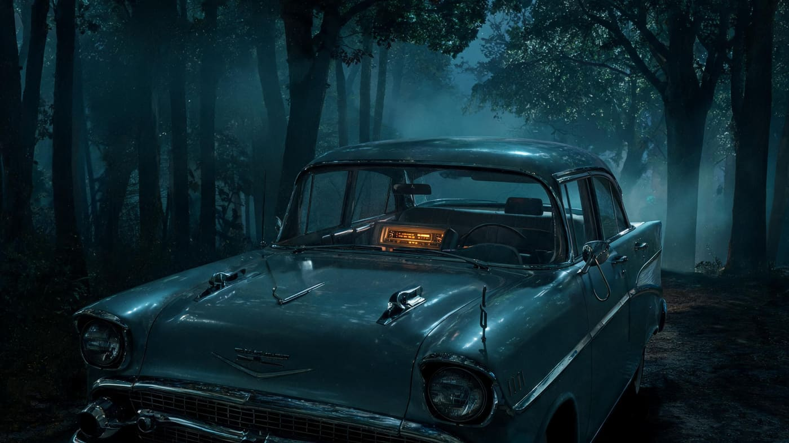
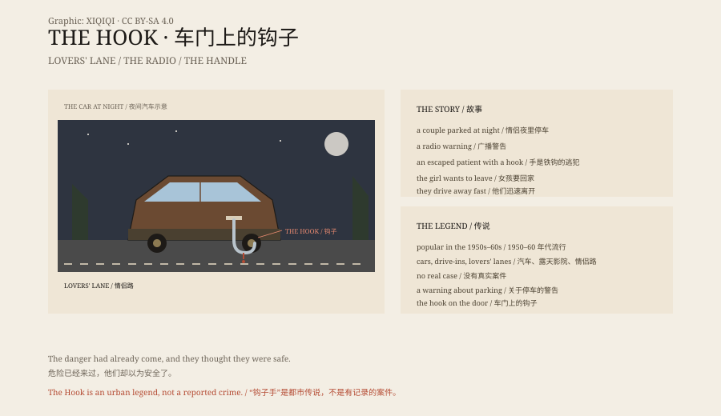

## 一、车门

故事结束在一辆停下的车旁边。

男孩下车，绕到另一边，替女孩开门。车门把手上挂着一只铁钩。钩子上有血。

他们一路上没有说话，或者说了很多话，都不重要。重要的是这只钩子挂上去的时候，车里的人不知道。它可能是在他们停车的时候挂上的，可能是在他们说笑的时候，也可能就在他们发动车子、踩下油门的那一秒。

故事从来不写钩子手本人。它只写这只钩子留在了门上。

*场景复原：1950 年代美国的情侣路与车门把手上的铁钩。不是历史照片。稀奇奇编辑部，CC BY-SA 4.0。*

## 二、1950 年代的车

这个故事的骨架里，有几样东西是新的：汽车、露天电影院、城郊的空路。

战后美国的年轻人有了车。车把约会从家门口、从客厅、从父母的视线里挪走，挪到一段没有路灯的路上。露天电影院的最后一排，河边的转弯处，树林边的一块空地——这些地方后来有个统称，叫“情侣路”。

车是一个可以移动的私密空间。它停在离家很远的地方，车门一关，外面就是黑的。故事把这种黑用上了：危险不在远处，危险就在车门外，隔着一层铁皮。

## 三、1960 年，报纸专栏

民俗学者扬·哈罗德·布鲁万德（Jan Harold Brunvand）把这个故事的时间定在 1950 年代。到 1959 年，它已经在美国青少年里传得很广，1960 年代继续扩散。

真正让它出圈的是 1960 年。那一年，报纸上的问答专栏“亲爱的阿比”（Dear Abby）把它当成一封读者来信登了出来。专栏有全国发行量，一个在停车场和露营地里口耳相传的故事，就这样印成了铅字。

从口传到印刷，故事定型了。后来的版本再怎么改，基本结构不变：两个人、一辆车、一条警告、一只钩子。

专栏的读者不只是青少年，还有他们的父母。故事进了家庭报纸，就不再只是宿舍和停车场里的悄悄话。

## 四、1946 年，特克萨卡纳

“钩子手”没有对应的真实案件。但它的场景有一个真实的影子。

1946 年，得克萨斯与阿肯色交界处的特克萨卡纳，接连发生针对停在路边的情侣的枪击。凶手在十周里袭击了多对坐在车里的年轻人，死者中有几个是青少年。案子一直没破，当地叫它“月光凶杀”。

斯诺普斯（Snopes）的戴维·米克尔森提出过一种可能：这类真实的情侣路凶案，给“钩子手”提供了场景和恐惧的原料。不是同一个凶手，是同一种夜晚。

这个说法没法证实，也没法否证。它解释的是故事为什么长成这个样子，不是故事从哪里来。

## 五、版本

这个故事有一棵很长的版本树。

最常见的一版是钩子挂在车门把手上。另一版说，钩子是在车顶刮出来的，男孩听见了声音，没敢停。还有一版说，男孩先看见了钩子，一路没告诉女孩，到了家门口才让她下车。

有的版本把警告换成广播，有的换成加油站老板的提醒，有的换成路边警示牌。换掉的都是传递消息的人，不变的是消息到得太晚。

## 六、银幕

钩子手进电影院很早。1947 年的《迪克·崔西的困境》里，凶手的手就是一只钩子。1979 年的《肉丸》里，比尔·默里演的角色在营火边给孩子们讲这个故事。

真正把它固定下来的是恐怖片。影评人马克·科莫德说过，钩子手在砍杀电影里最常出现，功能是当一个道德寓言：在车里亲热的年轻人，会招来惩罚。这些片子大多没有拍出钩子手的样子，只拍那只钩子。1980 年的《他知道你孤独》开场就是车里的一对情侣被袭击；《最后的考试》开场也是；1997 年的《篝火故事》第一段直接重讲这个传说；同年的《我知道你去年夏天干了什么》让主角们在营火边讲它；《糖果人》系列把它当作核心；1999 年的《情人路》干脆把片名定成了故事的发生地。

电视剧也用：1998 年《千禧年》第二季有一集以它开场，2005 年《邪恶力量》第一季第七集的反派就是钩子手。动画片里也有戏仿：2007 年《怪物史莱克》的圣诞特辑让姜饼人讲了一个改编版。

## 七、一句话

2010 年代，这个故事在互联网上又活了一次。

4chan 上出现了一个英文很破的版本，结尾写成了一串名词：“Man door hand hook car door”。这句话成了梗，被印在 T 恤上，被做成短视频，被用来指代整个故事。

一个 1950 年代的美国都市传说，最后靠一句语法不通的英文，在另一个世纪的网络上重新流行。故事的内容已经不重要了，重要的是那句话的形状。梗的生命力，有时比故事本身更长。

## 八、钩子

回到车门。

故事里没有搏斗，没有追车，没有警察。只有一个男人开车送一个女人回家，绕到另一边，替她开门。然后他看见那只钩子。

它最有效的地方在于：危险已经来过，而车里的人以为自己是安全的。这个感觉不需要鬼，也不需要怪物，一辆车、一段黑路、一只挂错地方的铁钩就够了。

这个故事被无数人讲过，每一次都少一点细节，多一点确定。到了最后，大家记住的不是情节，是那只钩子挂错了地方。

故事讲完，听的人会做什么？检查一下车门。

*原创示意图：情侣路停车、广播警告与车门上的钩子。不是现场照片。稀奇奇编辑部，CC BY-SA 4.0。*

---

**来源与许可**：事实来源见条目底部来源台账 S1–S3。文字与原创示意图采用 CC BY-SA 4.0。文中把故事版本、1950 年代的社会背景、1946 年特克萨卡纳案件与影视改编分开叙述；没有真实案件支持“钩子手”，米克尔森的推测仅为一种可能。场景复原不是历史照片。
