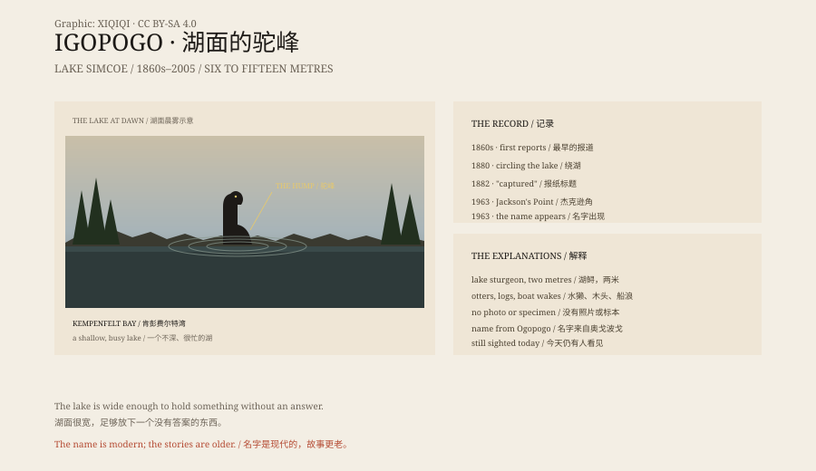

## 1. The Lake

Lake Simcoe lies north of Toronto, in southern Ontario, and covers about 722 square kilometres.

It is shallow, and in summer it is crowded with boats. Kempenfelt Bay cuts into the north shore; Jackson's Point sits on the east. The water is dark, and in a wind the waves are short.

It is a hard place to hide a large animal. It is also an easy place to misread one.

## 2. The 1860s

The Simcoe County Archives trace the lake monster stories back at least to the 1860s.

The newspaper descriptions are consistent: a dark, serpentine thing, six to fifteen metres long, moving just below the surface, sometimes showing a long neck and head.

In 1880 an Orillia paper reported that the "sea serpent" had been circling the lake. In 1882 another paper ran the headline "The Sea Serpent Captured". It appeared again in 1900 and 1912.

There are no photographs, no specimens, only witnesses and reporters.

## 3. 1963

In July 1963, near Jackson's Point, Bradford resident Neil Lathangue and his family saw something in the water from their boat.

On 24 July the Barrie Examiner ran the headline "Igopogo Looms its Ugly Head".

The name seems to have settled then. It echoes Ogopogo, the lake monster of British Columbia, and plays on the 1952 comic *I Go Pogo*.

On different shores it is also called Kempenfelt Kelly and Beaverton Bessie.

## 4. The Description

The usual version has a grey, seal-like body, a dog-like head, and a neck as thick as a stovepipe.

Lengths run from three and a half to fifteen metres. It does not so much swim as arch its body in sections.

In 1979 a woman near Willow Beach saw a large hump moving toward the shore. In 1991 someone shot video of something in the lake; the footage is too blurred to identify.

In 2005 a retired local businessman, Arch Brown, said he had seen it four times: ten feet long, dark grey, with a dog-shaped head.

## 5. The Sturgeon

The Simcoe County Archives offer the plainest explanation: the lake sturgeon.

Lake sturgeon is Canada's largest freshwater fish. It can reach two metres and 180 kilograms, has a ridged back, and looks prehistoric. It was once common in the lake. It is now endangered, and fishing for it is illegal.

A two-metre sturgeon arching its back at the surface, seen from a distance, could look like a sea serpent.

Then there are otters, logs, boat wakes and tired eyes.

## 6. The Lake

The name Igopogo is a twentieth-century invention. The stories are older.

The lake is wide enough to hold something without an answer.

But every sighting ends without a body, a scale or anything that could go into a museum.

The lake is still there. So are the boats.

*Original schematic: the newspaper record from the 1860s to 2005, the descriptions and the lake sturgeon comparison. Not a photograph of the site. Oddity Archive, CC BY-SA 4.0.*

---

**Sources and licenses**: the factual sources are listed in the source ledger S1–S3 at the bottom of this entry. Text and original diagrams are licensed under CC BY-SA 4.0. This article separates the newspaper record, the witnesses' descriptions and explanations such as the sturgeon; no specimen or clear photograph confirms the creature. The illustration is a scene reconstruction, not a photograph of the site.
