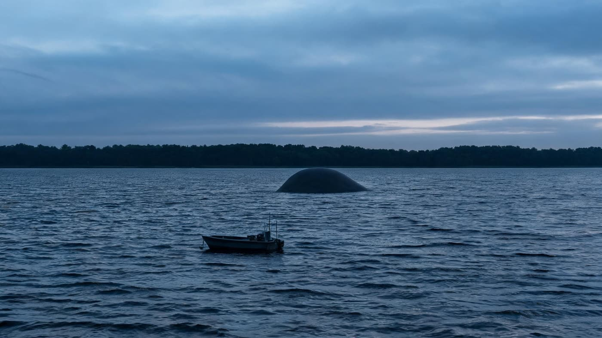
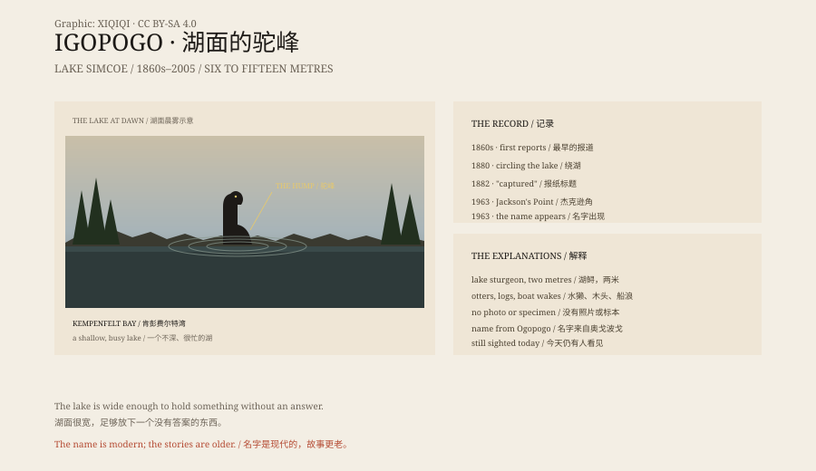

## 一、湖

西姆科湖在多伦多以北，安大略省南部，约七百二十二平方公里。

湖不深，夏天挤满船。北岸有肯彭费尔特湾，东岸有杰克逊角。水是暗的，风起来的时候，浪很短。

这是一个很难藏住大型动物的地方。但也是一个很容易看错东西的地方。

傍晚的湖面是平的。风停以后，水变成一块暗蓝色的布。远处有船，马达声传得很慢。就在船和岸之间，水面拱起一个灰色的弧，像一块石头浮上来，又慢慢沉下去。等你想看清，那里只剩一圈散开的波纹。

*场景复原：黄昏的西姆科湖、小船与远处露出水面的驼峰。不是目击照片。稀奇奇编辑部，CC BY-SA 4.0。*

## 二、1860 年代

西姆科县档案馆的记录说，湖怪的目击至少可以追溯到 1860 年代。

报纸上的描述差不多：一条深色的、蛇一样的东西，六到十五米长，贴着水面移动，有时露出长脖子和头。

1880 年，奥里利亚的报纸写“海蛇”在湖里绕行。1882 年，另一家报纸写“海蛇被捕”。1900 年、1912 年，它又出现。

这些报道没有照片，没有标本，只有目击者的嘴和记者的笔。

## 三、1963 年

1963 年 7 月，杰克逊角附近。布拉德福德居民尼尔·拉坦格带着家人在船上，看见水里有东西。

《巴里观察家报》7 月 24 日的标题是：“伊戈波戈探出丑头。”

名字大概就是这时候定下来的。它模仿了不列颠哥伦比亚的奥戈波戈，也借了 1952 年漫画《I Go Pogo》的谐音。

在不同岸边，它还有别的名字：肯彭费尔特·凯利、比弗顿贝西。

## 四、描述

最常见的版本是：灰色的、像海豹的身体，狗一样的头，脖子有火炉烟囱那么粗。

长度从三米半到十五米都有。它在水里不像是游泳，更像是把身体一节一节地拱起来。

1979 年，一位女士在柳树滩附近看见水里有一个大驼峰往岸边移动。1991 年，有人拍到一段录像，画面很模糊，无法确认。

2005 年，本地退休商人阿奇·布朗说，他见过四次，十英尺长，深灰色，狗头。

## 五、鲟鱼

西姆科县档案馆自己给出了最朴素的解释：湖鲟。

湖鲟是加拿大最大的淡水鱼，能长到两米、一百八十公斤，背上有棱，游起来像史前动物。它曾经在湖里很常见，现在濒危，捕钓违法。

一条两米长的鲟鱼，在水面拱起背，远处看，确实可以像一条海蛇。

还有水獭、木头、船浪、疲劳的眼睛。

## 六、湖

伊戈波戈的名字是 20 世纪造的。湖怪的故事更老。

湖面很宽，足够放下一个没有答案的东西。

但每次有人看见驼峰，最后都没有尸体、没有鳞片、没有一片能放进博物馆的东西。

湖还在那里。船也还在那里。

*原创示意图：1860 年代–2005 年的报纸记录、目击描述与湖鲟对照。不是现场照片。稀奇奇编辑部，CC BY-SA 4.0。*

---

**来源与许可**：本文的事实来源见条目底部来源台账 S1–S3。文字与原创示意图采用 CC BY-SA 4.0。文中把报纸记录、目击者描述与鲟鱼等解释分开叙述；没有标本或清晰照片能确认这种生物。插图是场景复原，不是现场照片。
