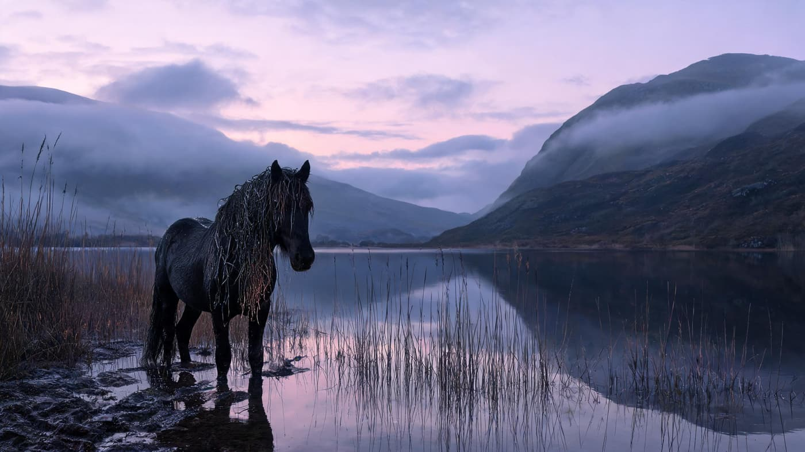
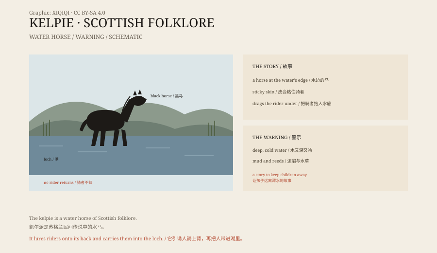

## 1. The horse by the water

In Scottish folklore, a horse often stands by a loch.

It is usually black, with a glossy coat and a mane like waterweed. It stands quietly at the edge, looking like a lost farm horse. Sometimes it lets people touch it; sometimes it lowers its head, as if waiting to be ridden.

If you climb on, it changes.

Its skin sticks to your legs and you cannot get off. Then it turns, walks into the loch, goes deeper and deeper, and finally dives. You are taken to the bottom and never come up.

This is the kelpie.

At dusk the loch is lead grey. The horse stands at the water's edge, hooves sunk in mud, mane hanging, water dripping from the ends. It does not call and does not move. It watches you. You come closer and it does not shy; you reach out and it lowers its head. Only when your hand touches its neck do you find that the coat is wet and cold, as if just pulled from the water.

*Reconstruction: a black water horse at a Highland loch at dusk. Not a photograph of a sighting. XIQIQI Editorial, CC BY-SA 4.0.*

## 2. The stories

There are many versions of the kelpie story.

Some say it drags the drowning to the bottom and devours them. Some say it only pulls people under and then disappears. Others say the kelpie can take human form, stand in a market, or sit by a river combing its hair.

In the Scottish Highlands there is a more dangerous variant called the each-uisge, which means “water horse”. It is fiercer than the Lowland kelpie and appears in the sea and in deep lochs. When it takes human form, its hair may contain sand or waterweed, and that is how you can tell.

## 3. How to deal with it

In the stories, the kelpie is not entirely impossible to handle.

Some say that if you can get a bridle on it, it will obey you and pull a mill or carry loads. Others say that if you call out a blessing, it loses its power and becomes an ordinary horse.

But these methods are risky. The kelpie is clever; it may pretend to submit, wait until you relax, and then drag you into the water.

*Original schematic: the kelpie's forms, the elements of the legend, and its warning function. Not a photograph. XIQIQI Editorial, CC BY-SA 4.0.*

## 4. Why the story exists

The kelpie story is probably a safety warning.

Scottish lochs and rivers are deep and cold, and the banks have mud and reeds. A child playing at the edge can easily slip in. A story about “a horse in the water” may work better than “stay away from the water”.

The story also explains drowning. When someone falls into a loch and the body is not found, people say “the water horse took them”. Death gets an explanation, and the loch gets a personality.

## 5. Not the Loch Ness Monster

The kelpie is not the Loch Ness Monster.

Nessie is a modern legend, spread through photographs and sightings. The kelpie is an older folk belief; it does not need photographs or evidence. It lives in stories, passed from one generation to the next.

In Scotland the two are often mixed together, but they are not the same. One is a horse at the water's edge; the other is a long-necked creature in a loch.

## 6. Now

Today the kelpie is a cultural symbol.

In 2014, two huge horse-head sculptures called The Kelpies were built at Falkirk in Scotland. They are thirty metres high, made of steel, stand beside the canal, and light up at night. They were designed by Andy Scott, who turned the horse heads into abstract geometry: from a distance they look like two towers; up close they become horses.

A story meant to warn children ended up as a tourist landmark. The horse is still there; it just no longer drags anyone into the water.

## Timeline

- **2014**: In 2014, two huge horse-head sculptures called The Kelpies were built at Falkirk in Scotland. They are thirt...

## Sources and evidence

The factual base of this entry rests on 1 independent source(s). S1 (Scottish Language Dictionaries) covers the relevant institutional record.
The original illustrations are scene reconstructions, diagrams, or maps, not historical photographs. The text separates documented record, later interpretation, and folklore; where sources disagree, the disagreement is left visible rather than smoothed away.

## Limits of the record

Most sightings are recollections set down after the fact. Clear images, plaster casts, and independently examinable physical traces are missing; the richer the folklore, the more carefully 'someone said so' must be separated from 'it happened'.
The archive keeps the recording and the unanswered question side by side.
In credibility terms, this entry is marked 'folklore'. The label describes the present state of evidence, not a final verdict on the story; it should change when new archival material appears.

## Archival note

The following note preserves archival sides of the story that the main text does not expand: provenance, technical detail, and aftermath.
In the Kilpie stories the horse itself is not the scariest element. The real terror lies in its seeming rideability. It stands calm and appealing on the shore, inviting a rider, only to rush into deep water. The danger is not its appearance but the false sense of trust it engenders—a motif many horror tales later adopted.

The tales also remind us that folklore is not always one‑sided. It offers no protection, only a warning. If you heed the lesson, you survive; if you ignore it, the waters claim you. The rule is straightforward and brutally honest.

In various versions of the legend, the Kilpie may even take on the guise of a handsome man, a trick that further lures victims. Whether in the Lowlands or the Highlands, the creature—sometimes depicted as a horse, sometimes as a cow—always leads people into the water. These stories continue to instruct children to stay away from deep pools and explain the real danger of drowning.

Furthermore, the Kilpie may transform into a human in marketplaces, silent and merely smiling. After its grin, the water surges past the horse’s back.

Poets have also rendered the legend in verse, likening the water‑side horse to temptation. In these poems, the horse symbolizes desire, yet it bears no name.

---

**Sources and licenses**: the factual sources are listed in the source ledger S1–S3 at the bottom of this entry. Text and original diagrams are licensed under CC BY-SA 4.0. This article separates the legendary forms, the story types, the counters, and the warning function; the kelpie is folklore, with no physical evidence, and The Kelpies at Falkirk is a modern public artwork completed in 2014.
