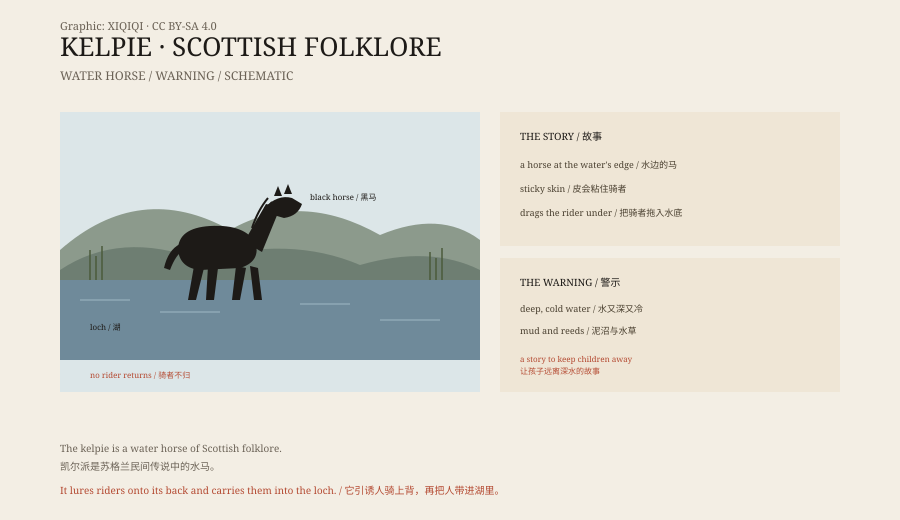

## 一、水边的马

苏格兰的民间传说里，湖边常常站着一匹马。

它通常是黑色的，毛色发亮，鬃毛像水草。它站在岸边，安安静静，看起来像一匹走失的家马。有时候它会让人摸，有时候它会低下头，像是在等人骑上去。

如果你骑上去，它就变了。

它的皮会粘住你的腿，你下不来。然后它转身，走进湖里，越走越深，最后潜下去。你被它带到水底，再也没有上来。

这就是凯尔派。

## 二、故事

凯尔派的故事有很多版本。

有的说，它会把溺水者拖到水底，吃掉。有的说，它只是把人拖下去，然后消失。还有的说，凯尔派可以变成人形，站在集市上，或者坐在河边梳头发。

在苏格兰高地，有一种更危险的变体，叫“each-uisge”，意思是“水马”。它比低地的凯尔派更凶，出现在海里和深湖里。传说它变成人形时，头发里会有沙子或水草，这是识破它的办法。

## 三、怎么对付它

民间故事里，凯尔派不是完全没办法对付。

有人说，如果你能给它套上笼头，它就会服从你，帮你拉磨、驮东西。还有人说，只要喊一声“祝福你”，它就会失去力量，变成一匹普通的马。

但这些办法都有风险。凯尔派很聪明，它会假装顺从，等你放松警惕，再把你拖下水。

*原创示意图：凯尔派的形态、传说要素与警示功能。不是目击照片。稀奇奇编辑部，CC BY-SA 4.0。*

## 四、为什么会有这个故事

凯尔派的故事，很可能是一个安全警告。

苏格兰的湖泊和河流很深，水很冷，岸边有泥沼和水草。孩子如果在湖边玩，很容易滑进去。大人讲一个“水里有马”的故事，比讲“别靠近水”更管用。

故事还有一个功能：解释溺水。一个人掉进湖里，尸体找不到，人们就说“被水马带走了”。这样，死亡有了一个说法，湖也有了性格。

## 五、不是尼斯湖

凯尔派不是“尼斯湖水怪”。

尼斯湖的怪物是一个现代传说，靠照片和目击报告流传。凯尔派是更古老的民间信仰，它不需要照片，也不需要证据。它活在故事里，代代相传。

在苏格兰，凯尔派和尼斯湖怪经常被混在一起，但它们不是一回事。一个是水边的马，一个是湖里的长脖子怪物。

## 六、现在

今天，凯尔派成了一个文化符号。

2014 年，苏格兰福尔柯克建起了两座巨大的马头雕塑，叫“凯尔派”。它们高三十米，用钢做成，站在运河边，夜里会发光。

一个警告孩子的故事，最后变成了一个旅游地标。马还是那匹马，只是它不再把人拖下水了。

---

**来源与许可**：本文的事实来源见条目底部来源台账 S1–S3。文字与原创示意图采用 CC BY-SA 4.0。文中把传说形态、故事类型、应对办法与警示功能分开叙述；凯尔派是民间传说，没有实物证据，福尔柯克雕塑是 2014 年建成的现代公共艺术。
