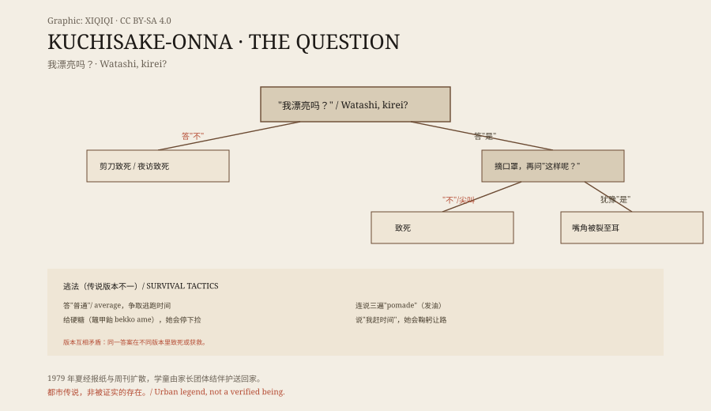
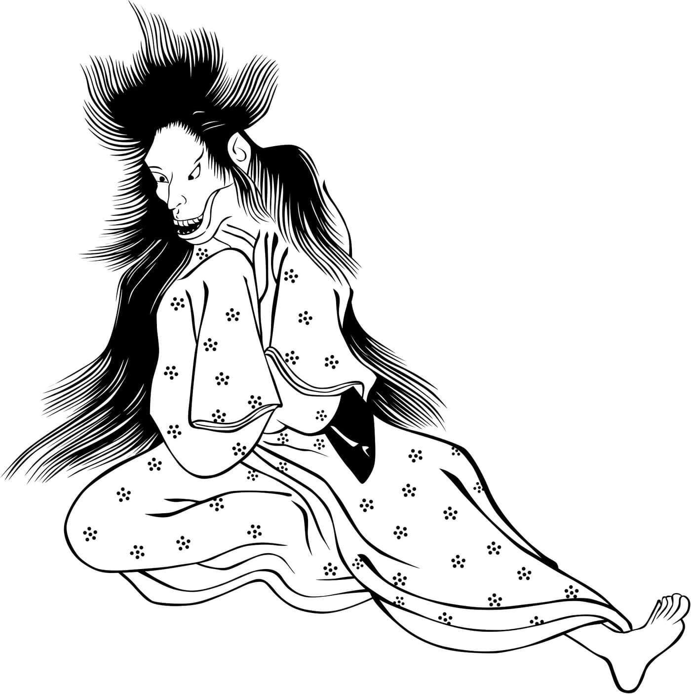

## 1. The summer of 1979

The modern Kuchisake-onna story originates in 1978, most acceptedly from Gifu Prefecture; but what made it a national phenomenon was the summer of 1979: the Gifu Nichi Nichi Shinbun on 26 January, Shukan Asahi on 23 March, and Shukan Shincho on 5 April reported it in turn, and the rumour spread across the country.

The consequence was concrete: primary-school children began walking home escorted in groups by parent-teacher association members. A legend changed real commuting routes and pickup arrangements — one of the few observable social effects of an urban legend.

## 2. Her question

The image is stable: a tall woman (often 175–180 cm), long straight black hair, pale skin, white hands, considered beautiful except for the mouth; the mouth covered by a mask, fan or handkerchief; carrying scissors, a knife or a scythe-like blade; possessing supernatural speed.

The question comes in two rounds. First: "Am I pretty?" (Watashi, kirei?). Answer no: killed on the spot with the scissors, or followed home and killed that night. Answer yes: she removes the mask, revealing a mouth slit from ear to ear, and asks the second round: "Even now?" (Kore demo?). Answer no or scream: killed. Answer a hesitant yes: the corners of your mouth are slit to match hers.

Note the structure: both answers lead to harm; the only "safe" reply lies outside yes and no.

*Original schematic: the two-round question's branch outcomes and the legend's survival tactics. Oddity Archive, CC BY-SA 4.0.*

## 3. Ways out

The legend offers several escapes, and the versions contradict each other: answer "average," and run while she hesitates; give her hard candy — especially bekko ame, caramelised sugar — and she stops to pick it up; say "pomade" three times; or say "I'm running late," and she bows and apologises and lets you pass.

The same answer kills in one version and saves in another, which shows these "escapes" are not a rulebook but variants in transmission: every reteller patches the story, and the patches are not compatible with each other.

## 4. Her origin

The origin versions split as well. The common Japanese version: she was mutilated in life by a jealous woman, often a sister, or by a botched plastic-surgery or dental procedure; the common Western version: she was the adulterous wife or mistress of a samurai, and the samurai, on learning of it, slit her mouth ear to ear as punishment. Other versions fill her mouth with sharp teeth. After death she returns as a vengeful spirit, an onryō.

*Historical image: the figure identified as Kuchisake-onna in Ehon Sayoshigure (1801, Hayami Shungyōsai) — the identification is disputed; scan uploaded by Tanapat, CC BY-SA 4.0 (Wikimedia Commons).*

This 1801 picture-book image is often cited as evidence that "the Edo period already had Kuchisake-onna": long hair, slit mouth, kimono, twisted posture. But note that identifying it as Kuchisake-onna is itself disputed — the line between image and name was drawn by later hands.

## 5. Yokai or urban legend

The yokai author Matthew Meyer traces the legend's roots to the Edo period (17th–19th centuries); the Japanese-literature professor Iikura Yoshiyuki dates it to the 1970s. Each has grounds: the former on similarity of images and motifs, the latter on checkable print records (those three 1979 reports).

The manga artist Shigeru Mizuki placed her in his yokai encyclopedia; the translator Zack Davisson says: "When Mizuki put her in one of his newest yokai encyclopedias, that's when she was officially considered a yokai." An interesting mechanism of classification: not evidence decides the category, an authoritative catalogue does.

## 6. Where she went

Afterwards she entered film and games: Studio Ghibli's Pom Poko (1994), a mention in Ring (1998), Carved: The Slit-Mouthed Woman (2007) and two sequels, Kuchisake-onna Returns and a found-footage series (2012); in Ghostwire: Tokyo she has two forms (white coat, white hat, mask / red coat, hat and mask dropped, slit mouth revealed); she appears in Jujutsu Kaisen, Dandadan and Mob Psycho 100; an episode of Constantine is based on her.

The image multiplies; the question never changes: "Am I pretty?" A question that demands an evaluation, a structure in which any evaluation wounds. Perhaps that is why she survives: she is not about the mouth, but about the moment of being asked to answer.

---

**Sources and licenses**: factual sources are in the ledger S1–S3 below. Text and original schematics are CC BY-SA 4.0. The picture-book image is a credited Wikimedia Commons scan (CC BY-SA 4.0), source in the ledger; its identification as Kuchisake-onna is disputed and noted here. Kuchisake-onna is an urban-legend / folklore figure, not a verified being; the two origin datings are presented in parallel.