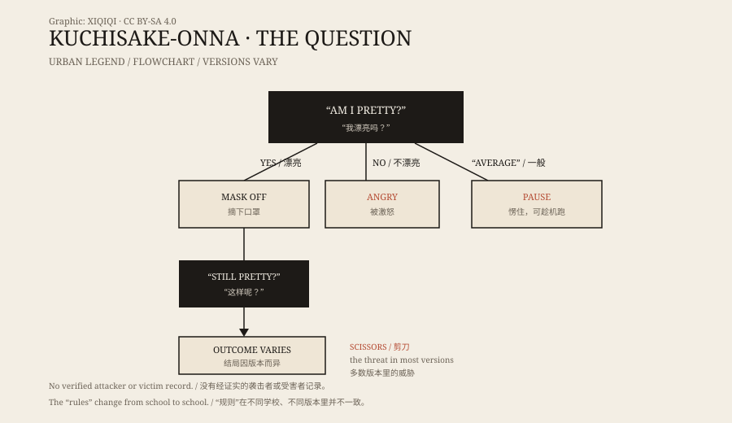

## 一、1979 年的放学路

1979 年，日本各地的小学里，流传着一个关于放学路的故事。

故事说，有一个女人站在路边。她戴着白色口罩，穿着普通的外套，手里可能拿着剪刀。她拦住孩子，问一句：

“我漂亮吗？”

如果孩子回答“漂亮”，她会摘下口罩。口罩下面，是一张从嘴角裂到耳根的脸。然后她再问一次：

“这样呢，还漂亮吗？”

## 二、没有安全答案

这个问题之所以吓人，是因为它没有简单的正确答案。

有的版本说，回答“漂亮”会被她带走，或者被她用剪刀伤害；回答“不漂亮”也会激怒她。还有版本说，如果回答“一般”，她会愣住，孩子可以趁机跑掉。

另一些版本提供了更具体的“解法”：说“涂了发油”或者给她糖果，她会离开。这些细节听起来像游戏规则，不像真实的逃生指南。

*原创示意图：裂口女传说的问答结构与 1979 年的校园传播。不是历史照片。稀奇奇编辑部，CC BY-SA 4.0。*

## 三、口罩下面

“裂口女”的形象很固定：长发、口罩、外套、剪刀。

口罩是故事的关键。它遮住了大部分脸，只露出眼睛，让人无法判断她是否在笑。摘下口罩的动作，是整个传说里最吓人的一刻。

有的版本说，她的嘴是被丈夫或恋人割开的；有的说是整容手术失败；还有的说，她原本是一个普通女人，因为事故毁容，后来变成了怨灵。这些来历互相矛盾，没有一种能被证实。

## 四、1979 年的恐慌

1979 年，这个传说在日本学校之间快速传播。

孩子们在课间讨论“遇到她该怎么办”，有人画出路线图，有人编出应对口诀。部分学校让学生结伴回家，家长也开始接送。一些地方传出了“有人看见她”的消息，但都没有可靠的证据。

传播的速度，和当时的环境有关：电视、杂志、校园里的口耳相传，加上孩子对陌生人的恐惧。一个足够简单的故事，很快就能传遍全国。

## 五、故事从哪里来

裂口女的根源，可以追到更早的日本怪谈传统：嘴角裂开的女人、戴口罩的陌生人、在夜里拦住路人的妖怪。

但 1979 年的版本，是一个典型的现代都市传说。它发生在放学路上，主角是孩子，危险来自一个看起来普通的成年人，解决方式是一句暗号。这些元素都很适合在校园里传播。

没有找到对应的连环袭击者，也没有确切的受害者记录。它更像一个被反复讲述的故事，而不是一桩有卷宗的案件。

## 六、现在

裂口女已经成了日本流行文化的一部分。电影、漫画、游戏和万圣节装扮里，都能看到她的口罩和剪刀。

她仍然在放学路上等着，只不过现在等的是观众。故事没有消失，因为它太好讲了：一个问题，一个口罩，一个没有安全答案的选择。

---

**来源与许可**：本文的事实来源见条目底部来源台账 S1–S3。文字与原创示意图采用 CC BY-SA 4.0。文中把传说内容、1979 年的校园传播与可能的起源分开叙述；没有把裂口女认定为真实存在的袭击者。
