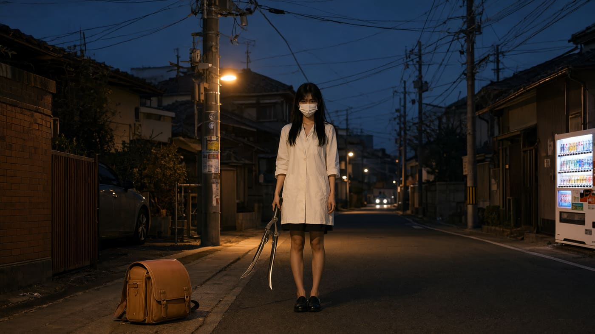
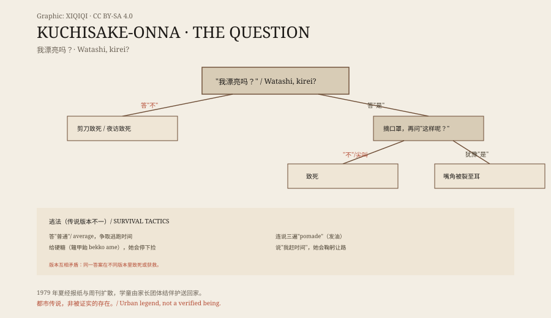
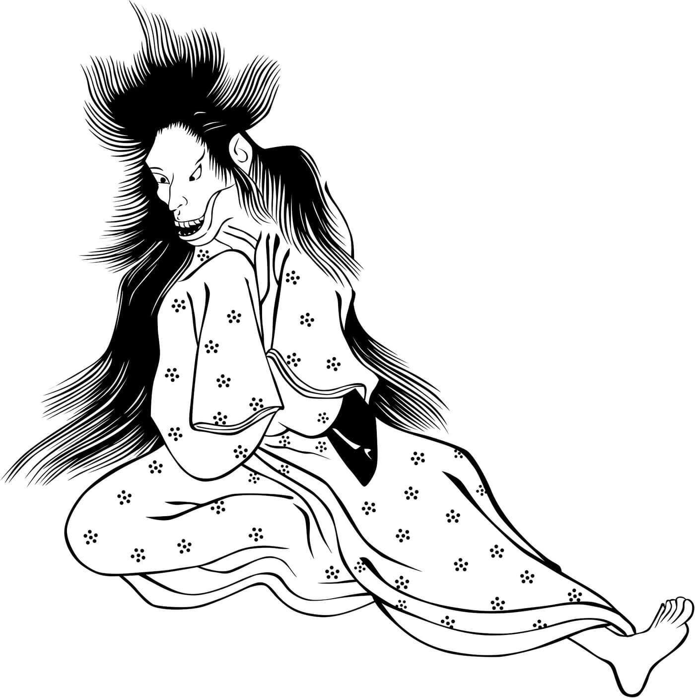

## 一、1979 年的夏天

现代裂口女故事起源于 1978 年，最被接受的说法是岐阜县；但真正让它成为全国现象的是 1979 年夏：1 月 26 日《岐阜日日新闻》、3 月 23 日《周刊朝日》、4 月 5 日《周刊新潮》相继报道，谣言随之扩散全国。

后果是具体的：小学生放学回家开始由家长团体（PTA）成员结伴护送。谣言主要在学童之间口耳相传，速度比报纸更快；一些地方调整了放学时间与路线，警察也收到询问。一个传说改变了真实的通勤路线与接送安排——这是都市传说少有的、可被观察的社会效应。

*场景复原：1979 年日本郊区暮色街道、戴口罩持剪刀的女人的想象画面。不是历史照片。稀奇奇编辑部，CC BY-SA 4.0。*

## 二、她的问题

形象是稳定的：高个女人（常描述为 175–180 厘米），长直黑发、皮肤苍白、手白，除嘴以外被认为漂亮；嘴用口罩、扇子或手帕遮住；携带剪刀、刀或镰刀类利器；有超常的速度。

问题分两轮。第一轮："我漂亮吗？"（Watashi, kirei?）。日语里 kirei（漂亮）与 kire（切）同音——问题本身就藏着刀。答"不"：当场被剪刀致死，或当夜被跟进家中杀害。答"是"：她摘下口罩，露出从耳根裂到耳根的嘴，再问第二轮："这样呢？"（Kore demo?）。答"不"或尖叫：致死。犹豫着答"是"：你的嘴角被裂成和她一样的形状。身高版本不一：常见 175–180 厘米，也有版本说她高达八英尺。口罩在现代版本里常被指定为外科口罩——一件日常医疗物品，被传说征用为遮羞与威胁的道具。

注意这个结构：两个答案都通向伤害，唯一"安全"的回答不在是非之内。

*原创示意图：两轮问答的分支后果与传说逃法。稀奇奇编辑部，CC BY-SA 4.0。*

## 三、逃法

传说给出了几种逃法，且版本互相矛盾：答"普通"（average），趁她犹豫逃跑；给她硬糖——特别是鼈甲飴（bekko ame，焦糖制）——她会停下来捡；连说三遍"pomade"（发油）；或说"我赶时间"，她会鞠躬道歉让路。给糖是一种"供奉"逻辑：用甜食换通行；"发油三遍"则更像无意义的咒语口诀——它的效力不来自语义，来自重复与确信。

同一答案在不同版本里致死或获救，说明这些"逃法"不是规则手册，而是传播中的变异体：每个转述者都在给故事打补丁，补丁之间并不兼容。

## 四、她的来历

来历版本同样分裂。日本常见版本：她生前被嫉妒的女人（常为姐妹）袭击，或毁于失败的整形/牙科手术；西方常见版本：她是武士的不贞妻子或情妇，武士发现后把她的嘴角裂到耳根作为惩罚。另有版本说她嘴里满是尖牙。死后她作为怨灵（onryō）返回。西方版本里那个"裂口"有一个道德名字：格拉斯哥微笑（Glasgow smile）式的刑罚标记；而她的两轮提问，恰好重演了当初那场审判——被问的人被迫给出评价，评价即判决。

*历史图像：绘草纸《佐夜时雨》（1801，速水春晓斋）中被认定为裂口女的形象（该认定有争议）；扫描上传 Tanapat，CC BY-SA 4.0（Wikimedia Commons）。*

这张 1801 年的绘草纸图像常被引为"江户已有裂口女"的证据：长发、裂口、和服，姿态扭曲。但要注意，把它认定为裂口女本身是有争议的——图像与名字之间的连线，是后人画上去的。

## 五、妖怪还是都市传说

妖怪作者马修·迈耶认为传说根源可追溯到江户时代（17–19 世纪）；日本文学教授饭仓义之则认为它起源于 1970 年代。两种说法各有依据：前者靠图像与母题的相似，后者靠可查的印刷记录（1979 年那三篇报道）。饭仓的关键论点是：1970 年代之前没有可确认的文本证据；图像相似不等于传说连续。

漫画家水木茂把她收进自己的妖怪百科；译者扎克·戴维斯森说："当水木把她放进最新妖怪百科时，她才'正式'成为妖怪。"这是一个有趣的认定机制：不是证据决定分类，是权威图鉴决定分类。

## 六、她去了哪里

此后她进入影视与游戏：1994 年吉卜力《平成狸合战》、1998 年《午夜凶铃》提及、2007 年《裂口女》及两部续作、2012 年《裂口女 Returns》与伪纪录片系列；游戏《World of Horror》里有以她为原型的"Scissor Woman"，《Ghostwire: Tokyo》里她有两种形态（白衣白帽戴口罩／红衣摘帽露裂口），《咒术回战》《Dandadan》《Mob Psycho 100》里也有她；美剧《康斯坦丁》"Danse Vaudou"一集以她为原型；漫画《Even If You Slit My Mouth》把她写成主角。

形象越传越多，问题却始终没变："我漂亮吗？"一个要求评价的问题，一个任何评价都会受伤的结构。也许这才是她存活的原因：她不是关于嘴，是关于被要求回答的那一刻。

## 七、为什么是口罩

把她放进都市传说的家族里看：血腥玛丽在镜子里、拉约罗娜在水边、非洲的 Madam Koi Koi 在宿舍走廊——每个传说都附着在一件日常物或一个日常时刻上。裂口女附着的是口罩与"被问话"的那一刻。口罩在 1979 年的日本已是日常医疗物品；传说把它变成"遮住真相又即将揭开"的开关。问题则是社交里最普通的一句客套——"我好看吗"——被推到极端：回答者无论怎么答都要付出代价。传说的恐怖不在剪刀，在那句无法安全回答的客套。把它和别的都市传说并置就更清楚：血腥玛丽要求你在镜前念名字，拉约罗娜要求你靠近水边，裂口女要求你回答一句客套——三者都把"日常行为"变成触发器，而裂口女的触发器最日常：说话。

---

**来源与许可**：事实来源见台账 S1–S3。文字与原创示意图 CC BY-SA 4.0。绘草纸图像为 Wikimedia Commons 署名扫描（CC BY-SA 4.0），出处见台账；其"裂口女"认定有争议，本文注明。裂口女为都市传说/民俗形象，非被证实的存在；起源年代两说并列。