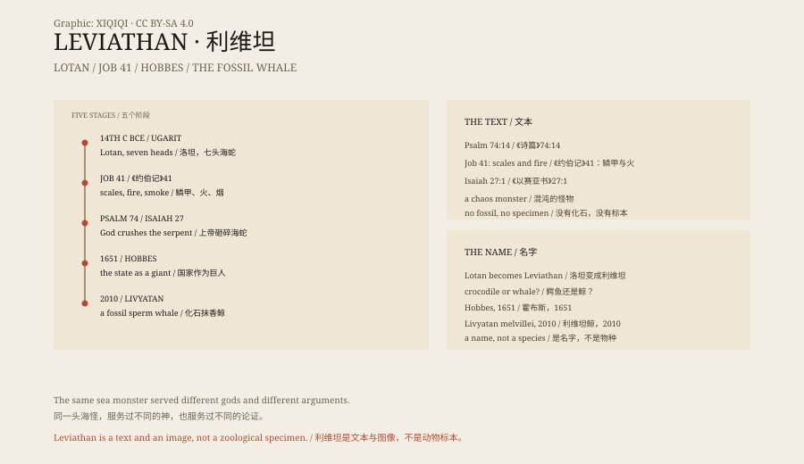

## 1. A Description

In the forty-first chapter of the Book of Job, God answers Job by describing an animal for an entire chapter.

Its scales are packed tight like shields; its sneezes flash light; burning torches come from its mouth; smoke pours from its nostrils like a boiling pot; it fears neither iron nor bronze. Sword, arrow and stone cannot hurt it.

Its name is Leviathan.

The text is more than two thousand years old. It does not say where Leviathan lives or how large it is. It says only that no one can catch it.

## 2. Older Than the Bible

Leviathan was not invented by the Bible.

At Ugarit on the Syrian coast, archaeologists found tablets from the fourteenth century BCE. They describe Lotan, a sea monster with seven heads, defeated by the storm god Baal.

The biblical writers knew the image. They renamed Lotan Leviathan and replaced Baal with Yahweh. Psalm 74 says God crushed the heads of Leviathan; Isaiah 27 says that on the last day God will punish the twisting serpent with a sword.

The same monster changed sides more than once.

## 3. What Was It?

There are several schools of thought.

One says crocodile. The Nile crocodile has scales, teeth and strength enough to frighten anyone. The fire in Job may be an exaggeration of a gaping, hissing mouth.

One says whale. Whales are enormous, blow spray like smoke, and look like mountains when they strand. Medieval sailors drew whales as sea monsters, and Leviathan became one of their names.

Another says Leviathan was never an animal at all. It is chaos personified: the sea, darkness and the abyss. In the ancient Near East, the world was believed to have been born from a divine victory; Leviathan was the enemy who was never entirely destroyed.

All three can be true at once. A word can hold different fears in different centuries.

## 4. Hobbes

In 1651 the English philosopher Thomas Hobbes published a book called Leviathan.

It was not about a sea monster. It was about the state. Hobbes argued that people, to stop killing one another, surrender their power to an absolute sovereign. That sovereign is a giant made of countless people, and its name is Leviathan.

The frontispiece shows a giant whose body is composed of hundreds of tiny figures, wearing a crown and holding a sword and a crozier, standing over hills and a city.

Ever since, Leviathan has had a second meaning in political thought: a state so powerful that no one can resist it.

## 5. The Later Monster

Leviathan did not stay in the ancient world.

In Melville's Moby-Dick, the white whale hunted by Captain Ahab is called "the Leviathan of the sea". In science fiction, film and games, giant sea monsters are often given the name.

In palaeontology, an extinct sperm whale has been named Livyatan melvillei, after fossils found in Peru. Its teeth could reach thirty-six centimetres, among the largest of any known predatory whale.

The name moved from myth into the fossil record. It is still enormous, still frightening, and no longer breathes fire.

## 6. No Bones

Leviathan has no fossils, no specimen, no measurable size.

The description in Job may be an exaggerated crocodile or whale, or a rewriting of older myth. It is not a zoological claim that can be tested; it is a text, and the imagination behind it.

That has not stopped it from surviving. Every age needs something enormous, unexplained and opposite to humanity. Leviathan is one of its names.

*Original schematic: a timeline from the Ugaritic Lotan and Job 41 to Hobbes and modern palaeontology. Not a photograph of an artefact. Oddity Archive, CC BY-SA 4.0.*

---

**Sources and licenses**: the factual sources are listed in the source ledger S1–S3 at the bottom of this entry. Text and original diagrams are licensed under CC BY-SA 4.0. This article separates the ancient texts, the Ugaritic myth, later interpretations and the palaeontological name; Leviathan is a mythological creature with no biological evidence, and "Livyatan" merely borrows the name. The illustration is a scene reconstruction, not a photograph of an artefact.
