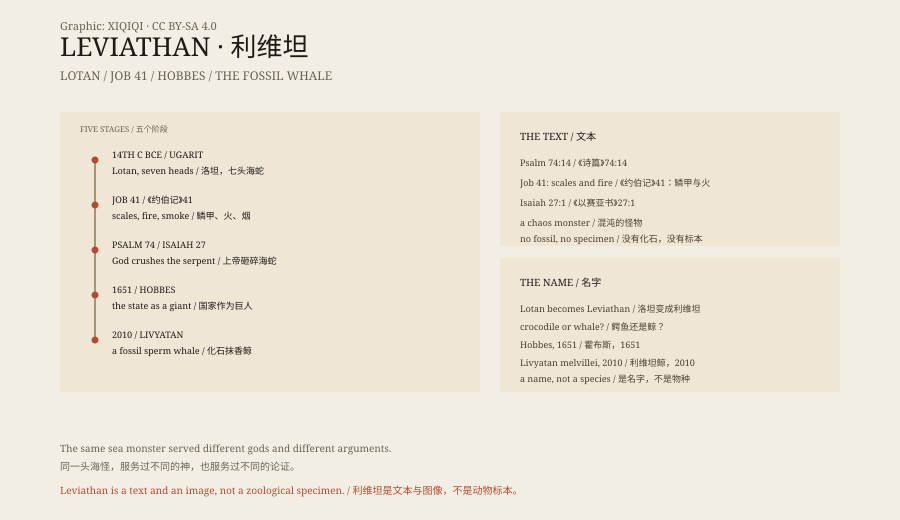

## 一、一段描述

《约伯记》第四十一章，上帝对约伯说话，用了整整一章描述一头动物。

它鳞甲紧密，像盾牌一样扣在一起；它打喷嚏，光就出来；它嘴里出去的是烧着的火把；它鼻子冒烟，像烧开的锅；它不怕铁，也不怕铜。刀剑、弓箭、石头，都伤不了它。

它叫利维坦。

这段文字写于两千多年前。它没有说利维坦住在哪里，也没有说它有多大。它只说：人抓不住它。

## 二、比《圣经》更早

利维坦不是《圣经》的发明。

在叙利亚海岸的乌加里特，考古学家挖出了公元前十四世纪的泥板。上面记着一个叫洛坦的海怪，有七个头，被风暴之神巴力打败。

《圣经》的作者知道这个形象。他们把洛坦改成了利维坦，把打败它的神换成了雅威。《诗篇》第七十四篇说，上帝砸碎了利维坦的头；《以赛亚书》第二十七章说，末日的时候，上帝要用剑惩罚那条弯曲的蛇。

同一个怪物，在不同的信仰里，换了几次阵营。

## 三、它到底是什么

关于利维坦是什么，有几派说法。

一派说是鳄鱼。尼罗河里的鳄鱼有鳞、有牙、力气大，古人见了会害怕。《约伯记》里的“喷火”，可能是对鳄鱼张嘴、吐气的夸张描写。

一派说是鲸。海里的鲸鱼体型巨大，喷水时像冒烟，搁浅时像一座山。中世纪的水手把鲸鱼画成海怪，利维坦就成了它们的名字。

还有一派说，利维坦根本不是动物。它是混沌的化身，是海洋、黑暗和深渊的人格化。古代近东的人相信，世界是从一场神的胜利里诞生的；利维坦就是那个没有被完全消灭的对手。

这三种说法可以同时成立。一个词可以在不同的时代，装下不同的恐惧。

## 四、霍布斯

1651 年，英国哲学家托马斯·霍布斯写了一本书，叫《利维坦》。

书里讲的不是海怪，是国家。霍布斯认为，人为了不再互相残杀，把权力交给一个绝对的主权者。这个主权者像一个巨大的、由无数人组成的怪物，名字就叫利维坦。

书的封面画着一个巨人，身体由几百个小人拼成，头戴王冠，手里拿着剑和权杖。它站在山川和城市之上。

从那时起，利维坦在政治学里有了第二个意思：一个强大到没有人能反抗的国家。

## 五、后来的海怪

利维坦没有留在古代。

梅尔维尔的《白鲸》里，船长亚哈追的那头白鲸，被写成“海里的利维坦”。科幻小说、电影、游戏里，巨大的海怪常常叫这个名字。

在古生物学里，有一类已经灭绝的抹香鲸，被命名为“利维坦鲸”（Livyatan melvillei），化石发现于秘鲁。它的牙齿最长可达三十六厘米，是已知最大的掠食性鲸之一。

这个名字从神话走进了化石层。它仍然很大，仍然让人害怕，只是不再喷火。

## 六、没有骨头

利维坦没有化石，没有标本，没有可以测量的大小。

《约伯记》的描述，可能是对鳄鱼或鲸鱼的夸张，也可能是对古代神话的改写。它不是一个可以被证伪的动物学命题；它是一段文本，和文本背后的想象。

但这不妨碍它活下来。每一个时代都需要一个巨大的、说不清的、站在人对面的东西。利维坦只是其中一个名字。

*原创示意图：《约伯记》描述、乌加里特洛坦与后世形象的时间线。不是文物照片。稀奇奇编辑部，CC BY-SA 4.0。*

---

**来源与许可**：本文的事实来源见条目底部来源台账 S1–S3。文字与原创示意图采用 CC BY-SA 4.0。文中把古代文本、乌加里特神话、后世解释与古生物学命名分开叙述；利维坦是神话生物，没有生物学证据，“利维坦鲸”只是借用了这个名字。插图是场景复原，不是文物照片。
