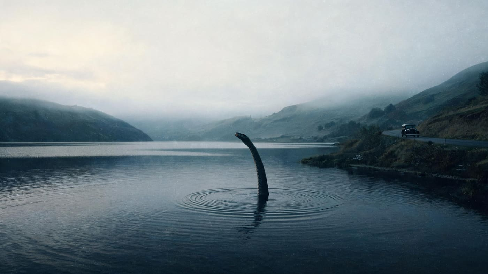
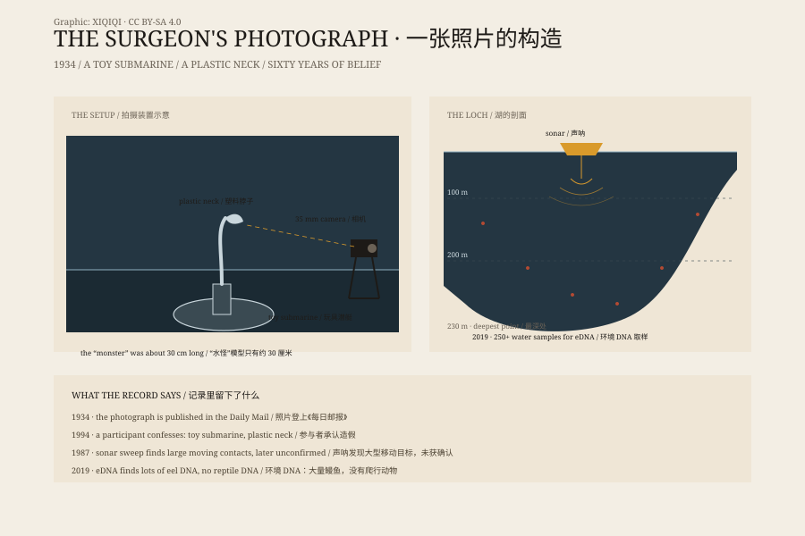

## 1. 1933

The Scottish Highlands, 1933.

A new road opened along the western shore of Loch Ness. Before that, there were only carts and ferries. Now cars could reach the water. Tourists came, hotels filled, and so did the newspapers.

That summer, a couple staying by the loch said they saw a huge animal cross the road and disappear into the water. Another witness said the surface churned and a long neck rose out of it.

The stories reached the papers. London editors loved them: a bottomless loch, a bleak highland, a beast no one had seen. The headlines grew larger. The tourists kept coming.

The modern Loch Ness Monster was born.

If you could photograph the summer of 1933, the frame would look like this: the loch black as iron, the far hills half swallowed by mist, a new road curving along the shore, a car pulled onto the verge, the people inside staring at the water. The surface moves once, then goes still again.

That summer, the small hotels were full, reporters waited on the pier, and shops began selling monster postcards. An animal no one had seen was already supporting a street of businesses.

*Reconstruction: a long neck rising from the black water at Loch Ness in 1933, with a car on the new road. Not a historical photograph. Oddity Archive, CC BY-SA 4.0.*

## 2. Older stories

The idea of a creature in Loch Ness did not begin in 1933.

In the sixth century, the Irish missionary Saint Columba was preaching in Scotland. His biography tells of a group burying a man who had been dragged into the River Ness by a water beast. Columba sent a man into the water; the beast rose again; Columba made the sign of the cross, and the beast retreated.

This is the earliest written account of the Loch Ness Monster. It reads more like a miracle story than a zoological record. The beast is there to demonstrate the saint's power, not to prove that a monster lives in the loch.

## 3. The photograph

In 1934, a photograph appeared in the Daily Mail.

It showed a small head on a long neck rising from the water, with a wake behind it. The photographer was said to be a London surgeon, Robert Kenneth Wilson. The image became known as the “Surgeon's Photograph,” and it shaped the modern image of the monster.

For sixty years, many people believed it was real.

In 1994, a participant came forward. According to Christian Spurling, the “monster” was a toy submarine with a plastic neck: the submarine sat below the surface, the neck rose out of the water, and from a distance it looked like an animal's head and neck. The plan was organised by his stepfather, Marmaduke Wetherell, a hunter who had once been hired by a newspaper to look for the monster. The photograph was taken by Wetherell's son Ian and eventually passed to Wilson.

Wilson was not the discoverer. He was the man who handed the picture to a newspaper. That detail makes the story more complete: the negative can be real, and the animal can be fake.

It was not the only photograph, but it was the most influential. It gave the monster its long neck, small head, and the pose above the water.

## 4. Looking for the monster

From the 1960s onward, people looked more seriously.

In the 1970s, underwater cameras, sonar, and submarines went into the loch. No clear animal images came back.

In 1987, an investigation called Operation Deepscan swept the loch with sonar and reported large moving objects. Later analysis did not confirm that they were animals.

In 2019, an international team collected more than 250 water samples and analysed environmental DNA. They found a great deal of eel DNA. They found no reptile DNA and no evidence of a large unknown vertebrate.

The lead researcher said there might be a very large eel in the loch, but a Jurassic-era aquatic reptile was unlikely.

*Diagram: the 1934 photo setup, plus sonar, environmental DNA, and the depth of the loch. Original graphic, CC BY-SA 4.0.*

## 5. What is it, then

Most sightings can be explained by ordinary things.

Seals can swim in from the North Sea, and a seal's head and neck can look like a monster at a distance. Otters, deer, logs, boat wakes, wind, and shifting light can all become a “hump” or a “neck” far from shore.

Some sightings are also shaped by expectation. The water is dark, the loch is long, and tourists come to see the monster. When a shadow appears, the brain finishes the picture.

The loch itself is worth a look. It is about 37 kilometres long and up to 230 metres deep, one of the largest bodies of fresh water in Britain by volume. Peat stains the water dark brown, and visibility is low. Sonar and cameras can only see a small part of a place that size, in water that colour.

There are still sightings and photographs that have not been explained. They do not prove the monster exists, but they have not all been debunked either.

## 6. Why we keep telling it

The Loch Ness Monster is no longer only a zoological question.

It supports hotels, boat tours, museums, and souvenir shops. It is one of the most successful tourism brands in the Highlands. It is also part of modern folklore: a loch large enough, a shadow vague enough, a story long enough.

The 2019 DNA study did not find a monster, and it did not reduce the number of visitors. People do not necessarily believe there is a beast in the loch. They like the possibility: that beneath the surface, there is still a place we have not finished seeing.

---

**Sources and licenses**: the factual sources are listed in the source ledger S1–S4 at the bottom of this entry. Text and reconstruction illustrations are licensed under CC BY-SA 4.0. Reconstruction illustrations are not historical photographs. The Loch Ness Monster is folklore, not a confirmed animal.
