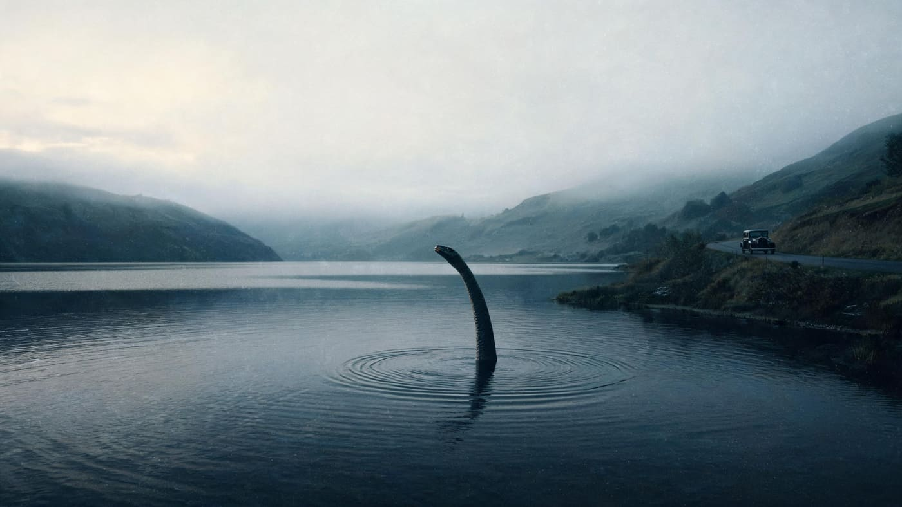
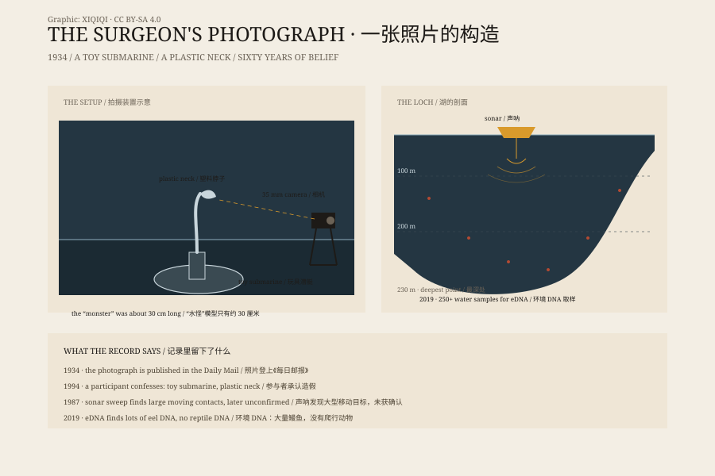

## 一、1933 年

1933 年，苏格兰高地。

一条新公路沿着尼斯湖西岸修通。以前，这里只有马车和渡船；现在，汽车可以开到湖边。游客来了，旅馆满了，报纸也来了。

那年夏天，一对住在湖边的夫妇说，他们看到一只巨大的动物从公路上穿过，消失在湖里。另一名目击者说，湖面翻起水花，露出一条长长的脖子。

这些故事登上了报纸。伦敦的编辑很喜欢：一个深不见底的湖，一片荒凉的高地，一只没人见过的怪兽。标题越写越大，游客越来越多。

“尼斯湖水怪”从此有了现代版本。

如果把 1933 年夏天的尼斯湖拍成一张照片，画面大概是这样：湖面黑得像一块铁，远处的山被雾吞掉一半，新修的公路贴着岸边拐弯，一辆汽车停在路肩，车里的人正盯着水面。湖面动了一下，又恢复了原样。

那时候，湖边的小旅馆住满了人，报社记者在码头等消息，商店开始卖水怪明信片。一个没有人见过的动物，已经养活了一条街。

*场景复原：1933 年尼斯湖清晨，长颈从黑色湖面伸出，岸边停着一辆汽车。不是历史照片。稀奇奇编辑部，CC BY-SA 4.0。*

## 二、更早的传说

尼斯湖里有水怪的说法，不是 1933 年才有的。

公元 6 世纪，爱尔兰传教士圣哥伦巴在苏格兰传教。传记里写，他在尼斯河边遇到一群人正在埋葬一个被水怪拖下水的人。哥伦巴让人下水，水怪又出现了；他画了个十字，水怪就退回了水里。

这个故事是尼斯湖水怪最早的书面记录。但它更像一则宗教奇迹故事，而不是动物学记录。水怪在这里的作用，是证明圣人的力量，不是证明湖里真的有一只怪物。

## 三、照片

1934 年，一张照片登上了《每日邮报》。

照片里，一只长颈小头从湖面伸出来，身后拖着一道水波。拍摄者说，他是一名伦敦外科医生，叫罗伯特·肯尼斯·威尔逊。照片被称为“外科医生的照片”，成了尼斯湖水怪最著名的形象。

六十年来，很多人相信它是真的。

1994 年，参与造假的人站了出来。据克里斯蒂安·斯珀林说，“水怪”是他用一艘玩具潜艇和一根塑料脖子做的：潜艇沉在水下，脖子伸出水面，远处看就像一只动物的头和颈。策划这件事的是他的继父马默杜克·韦特雷尔，一位曾被报纸雇来找水怪的猎人。照片由韦特雷尔的儿子伊恩拍下，最后由威尔逊交给报社。

威尔逊并不是发现者，他只是一个把照片递出去的人。这个细节让故事更完整：底片可以是真的，动物可以是假的。

这不是唯一一张照片，但它是影响最大的一张。它塑造了人们对水怪的想象：长颈、小头、露出水面。

## 四、找水怪的人

从 1960 年代开始，人们用更认真的办法找它。

1970 年代，水下摄影、声呐和潜艇都被放进湖里。没有清晰的动物影像。

1987 年，一项叫“深潜行动”的调查用声呐扫过整个湖，声称发现了大型移动物体。但后续分析没有确认那是动物。

2019 年，一个国际团队在湖里采集了 250 多个水样，分析环境 DNA。他们找到了大量鳗鱼 DNA，没有找到爬行动物 DNA，也没有找到大型未知脊椎动物的证据。

研究负责人说，尼斯湖里可能有一条很大的鳗鱼，但不太可能有一只侏罗纪时代的水生爬行动物。

*图解：1934 年照片的拍摄装置，以及声呐、环境 DNA 和湖的深度。原创图解，CC BY-SA 4.0。*

## 五、那到底是什么

大多数目击可以用更普通的东西解释。

海豹会从北海游进湖里，露出水面的头和长颈很像水怪。水獭、鹿、木头、船 wake、风浪和光影，也能在远处变成“背鳍”和“长颈”。

还有一部分目击，是人们在期待中看到的。尼斯湖的水很黑，湖面很长，游客来这里就是为了看水怪；当水面出现一个影子，大脑很容易把它补成一只动物。

湖本身也值得一看。尼斯湖长约 37 公里，最深处约 230 米，是英国水量最大的湖泊之一。湖水被泥炭染成深褐色，能见度很低；声呐和相机在这样的大小和颜色面前，都只能看到很小的一部分。

当然，也有无法解释的目击和照片。它们不能证明水怪存在，但也没有全部被拆穿。

## 六、为什么我们还在讲

尼斯湖的水怪故事，已经不只是动物学问题。

它养活了旅馆、游船、博物馆和纪念品店。它是苏格兰高地最成功的旅游品牌之一。它也是现代民间传说的一部分：一个足够大的湖，一个足够模糊的影子，一个足够长的故事。

2019 年的 DNA 研究没有找到水怪，但也没有让游客减少。人们并不一定真的相信湖里有一只怪物。他们只是喜欢那个可能性：在湖面之下，还有一块我们没看完的地方。

---

**来源与许可**：本文的事实来源见条目底部来源台账 S1–S4。文字与场景复原插图采用 CC BY-SA 4.0；场景复原插图不是历史照片。尼斯湖水怪属于民间传说，本文不把它当作已确认的动物。
