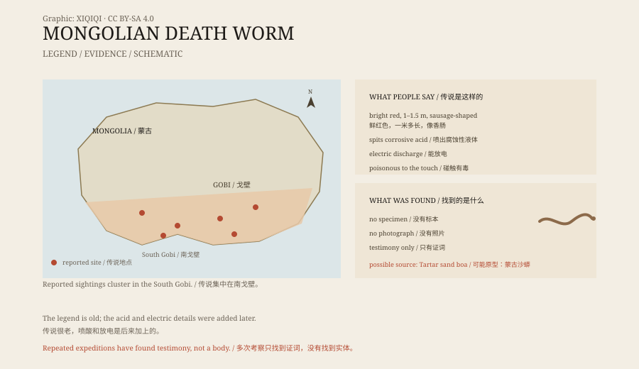

## 1. A Gobi legend

In Mongolian it is called olgoi-khorkhoi, which means “intestine worm”.

Herders say it lives in the sand of the South Gobi. Its body is bright red, thick as a sausage, and more than a metre long. It stays buried, comes out after rain, and attacks when horses or camels come near.

This is the Mongolian death worm.

The story has circulated in the Gobi for a long time. Herders lower their voices when they tell it, as if it should not be mentioned too loudly.

*Original schematic: the reported range, the claimed features, and the sand boa as a possible source. Not a record of a sighting. Oddity Archive, CC BY-SA 4.0.*

## 2. How it kills

In the most widely repeated version, it kills in three ways.

The first is venom. It spits a corrosive liquid that burns any skin it touches.

The second is electricity. It can make metal tingle, and people who come close fall down as if shocked.

The third is gas. Some say it gives off a poisonous vapour that kills animals that breathe it.

These details were not always there. In the 1920s, the American explorer Roy Chapman Andrews heard about the creature in the Gobi. What he recorded was that it was poisonous to the touch. There was no acid and no electricity.

The acid and the electric discharge were added later, by books and television.

## 3. The search

People have gone looking.

The Czech explorer Ivan Mackerle made two expeditions, in 1990 and 2004. Richard Freeman of the Centre for Fortean Zoology led a search in 2005. That same year, the New Zealand journalist David Farrier also went.

They collected testimony, visited places where people said they had seen it, and found no worm.

No specimen, no photograph, no piece of skin, no droppings. The Gobi is enormous and the sand is deep; failing to find something does not prove it is not there. But failing to find it does not prove it is there either.

## 4. Probably a sand boa

One common explanation is that people saw a sand boa.

The Tartar sand boa (Eryx tataricus) lives in the sand of the Gobi. It has a short, thick body, coloured much like the soil, and it likes to bury itself with only a little showing. When threatened, it hisses and strikes.

It is not red, it does not spit acid, and it does not produce electricity. But its shape, its hiding behaviour, and the way it suddenly appears are not unlike the “worm under the sand” of the legend.

Another possibility is that the story combines several animals: sand boas, lizards, insects, or ordinary snakes that grew in the retelling.

## 5. Why the story survived

The Gobi is not an easy place to live.

Water is scarce, the wind is strong, the sand moves, and it is easy to get lost. In a place like that, a story works as a map: it tells people where the danger is and where not to go.

The death worm does that too. It turns “something under the sand” into a concrete image. Children who hear it stay away from dunes; herders avoid certain places.

The acid and the electricity came from outside. Explorers, writers, and television needed a more exciting monster, and the story grew new organs.

## 6. Now

No museum holds a specimen of the Mongolian death worm.

It appears in books, games, films, and tourist brochures. Guides in the South Gobi sometimes point at a patch of sand and say, “It's down there,” then laugh.

The herders' accounts are still there. Researchers still record them, but a record is not a proof.

A lot can be hidden under sand. There can also be nothing at all.

---

**Sources and licenses**: the factual sources are listed in the source ledger S1–S3 at the bottom of this entry. Text and original diagrams are licensed under CC BY-SA 4.0. This article separates the herders' tradition, the expedition record, the media additions, and the biological explanation; there is currently no specimen, photograph, or biological sample proving that the animal exists.
