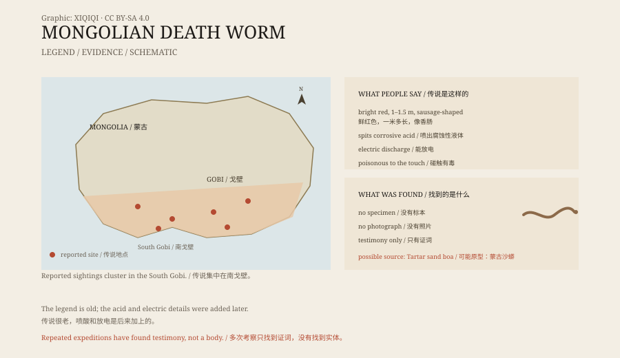

## 一、戈壁的传说

蒙古语里，它叫“奥尔戈伊-霍尔霍伊”，意思是“肠子一样的虫”。

牧民说，它住在南戈壁的沙地里，身体是鲜红色的，像一根粗香肠，有一米多长。它平时藏在沙下，下雨后钻出来。马和骆驼靠近时，它会攻击。

这就是“蒙古死亡蠕虫”。

故事在戈壁流传了很久。牧民讲它的时候，会压低声音，像是在说一件不该大声提的事。

*原创示意图：传说分布、描述特征与沙蟒原型的对照。不是目击记录。稀奇奇编辑部，CC BY-SA 4.0。*

## 二、它怎么杀人

按照流传最广的说法，它有三种杀人方式。

第一种是喷毒。它会从嘴里喷出腐蚀性的液体，沾到皮肤就会溃烂。

第二种是放电。它能让金属发麻，靠得近的人会像被电击一样倒下。

第三种是气味。有人说它散发毒气，动物闻到就会死。

这些细节不是一开始就有的。二十世纪二十年代，美国探险家罗伊·查普曼·安德鲁斯在戈壁听到过这种动物的传说。他记下的是：它有毒，碰到会死。没有喷酸，也没有放电。

喷酸和放电，是后来的书和电视节目加上去的。

## 三、找虫的人

有人真的去找过。

捷克探险家伊万·马克莱尔在 1990 年和 2004 年两次进入戈壁。英国“奇特动物学中心”的理查德·弗里曼在 2005 年组织过一次考察。同年，新西兰记者戴维·法里尔也去找过。

他们找到了牧民的证词，找到了据说目击过的地点，但没有找到虫。

没有标本，没有照片，没有一片皮肤，也没有一份粪便。戈壁太大了，沙子又深，找不到并不能证明它不存在；但同样，找不到也不能证明它存在。

## 四、可能是沙蟒

一种常见的解释是：人们看到的是沙蟒。

蒙古沙蟒（Eryx tataricus）生活在戈壁的沙地里，身体粗短，颜色接近沙土，喜欢把身体埋进沙里，只露出一点。受到威胁时，它会发出嘶声，做出攻击动作。

它不红，不会喷酸，也不会放电。但它的体型、藏身方式和突然出现的效果，和传说里的“沙下之虫”有几分相似。

还有一种可能是，传说混合了好几种动物：沙蟒、蜥蜴、昆虫，甚至是被夸大的普通蛇。

## 五、为什么故事留了下来

戈壁不是一块容易生活的地方。

水少，风大，沙子会移动，人走远了很容易迷路。在这样的地方，故事是一种地图：它告诉人哪里危险，哪里不该去。

死亡蠕虫的故事也有这层作用。它把“沙下有东西”变成了一个具体的形象。孩子听了会远离沙丘，牧民听了会绕开某些地方。

至于喷酸和放电，那是外面的世界加进来的。探险家、作家和电视节目需要一个更刺激的怪物，故事就慢慢长出了新的器官。

## 六、现在

今天，没有一家博物馆藏有死亡蠕虫的标本。

它出现在书里、游戏里、电影里，也出现在旅游手册里。南戈壁的导游偶尔会指着某片沙地说：“它就在下面。”然后笑起来。

牧民的说法仍然存在。研究者仍然会记录这些说法，但记录不等于证明。

一片沙子下面可以藏很多东西。也可能什么都没有。

---

**来源与许可**：本文的事实来源见条目底部来源台账 S1–S3。文字与原创示意图采用 CC BY-SA 4.0。文中把牧民传说、探险记录、媒体加工与生物学解释分开叙述；目前没有标本、照片或生物学样本可以证明这种动物存在。
