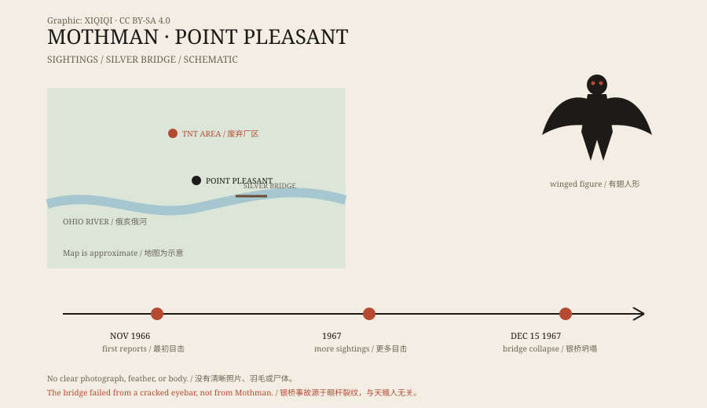

## 1. The TNT area in 1966

Point Pleasant sits on the Ohio River, a small city in West Virginia.

North of town was an abandoned industrial site that had made explosives during the Second World War. Locals called it the “TNT area.” The factory buildings were empty, the roads cracked, and brush and trees had grown back. Few people went there at night.

In November 1966, two young couples drove through the area. They later told police they had seen a huge creature, part human and part bird, standing by the road.

## 2. What it looked like

The description gradually settled.

It was about two metres tall, with large gray-brown wings and red eyes. It flew without sound, or with only a low call. Some said it had no head and that its eyes were in its chest; others said it had simply pulled its neck down into its shoulders.

It chased cars. At least one couple said it followed them at high speed until they accelerated away.

*Original schematic: the 1966–1967 sightings around Point Pleasant and the location of the Silver Bridge. Not a precise map. Oddity Archive, CC BY-SA 4.0.*

## 3. The Silver Bridge

On 15 December 1967, the Silver Bridge near Point Pleasant collapsed during the evening rush hour.

Cars and pedestrians fell into the Ohio River, and 46 people died. The investigation pointed to a cracked eyebar — a key component of the suspension chain — and long-term fatigue.

Mothman was not the cause. But in later tellings, the sightings and the disaster were placed together: a red-eyed thing appeared, and then the bridge fell. The story needed a herald, and Mothman was assigned the part.

## 4. The story spreads

In 1975, the writer John Keel published The Mothman Prophecies.

The book wove together the Point Pleasant sightings, UFOs, men in black, animal oddities, and the Silver Bridge disaster. Keel mixed interviews, rumour, and speculation. It was compelling to read, but the evidence was incomplete.

The book carried Mothman beyond West Virginia. Films, documentaries, a museum, and an annual Mothman Festival fixed the red-eyed image in popular culture.

## 5. Explanations

The most ordinary explanation is misidentification.

The river valley has large birds such as sandhill cranes, herons, and owls. A sandhill crane stands tall, spreads wide wings, and has a red patch on its head. At dusk or in headlights, it can look like a “red-eyed winged man.”

Another explanation is collective panic. Once the newspapers started reporting, people passing the TNT area began to see ordinary shadows, birds, and lights as the same creature.

A third is hoaxing or exaggeration. There is no clear photograph, no feather, and no body. As the story grew more complete, the details became harder to check.

## 6. Now

Point Pleasant has a Mothman statue, a museum, and an autumn festival.

It is no longer just a sighting from 1966. It is a local symbol: a small city remembered for a bridge disaster, and a red-eyed shadow flying over the treetops at night.

---

**Sources and licenses**: the factual sources are listed in the source ledger S1–S3 at the bottom of this entry. Text and original diagrams are licensed under CC BY-SA 4.0. This article separates the sighting record, the Silver Bridge investigation, and the later association with disaster; it does not identify Mothman as the cause of the bridge collapse.
